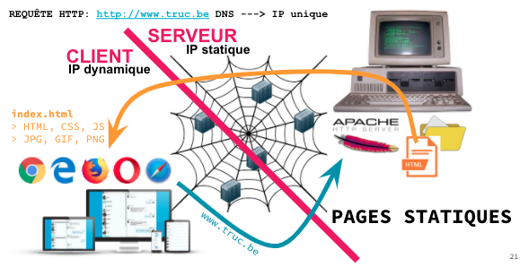
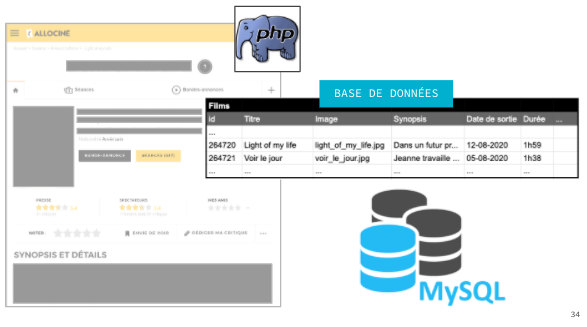
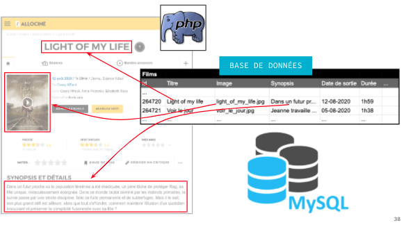
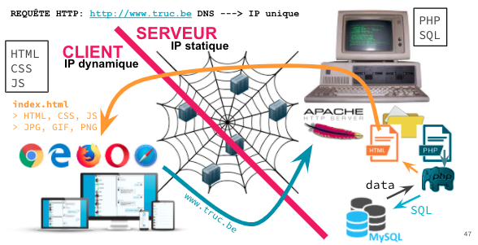
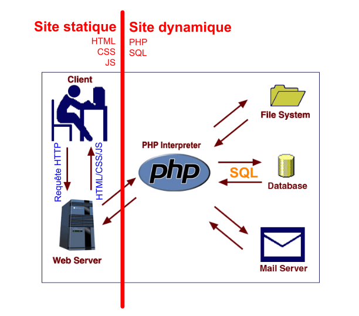

# 1-01 Comment fonctionne une page web ?

---

1. Une adresse IP pour se connecter au réseau INTERNET
2. Un navigateur pour demander des pages web (faire une requête HTTP)
3. Le CLIENT fait une requête HTTP via son navigateur web
4. Le nom de domaine, qui cache une autre adresse IP, celle d'un SERVEUR
5. L'hébergeur loue des serveurs
6. La requête du CLIENT arrive donc au SERVEUR
7. Le SERVEUR web... Un centre de tri
8. Les technologies CLIENT
9. Pages statiques VS pages dynamiques
10. Les sites web dynamiques
11. Un template vierge à remplir !!!
12. Que doit-on installer sur nos machines pour travailler tout ça ?
13. Ce qu'il faut retenir...
    1. Pour un site statique, on a besoin...
    2. Pour un site dynamique...

---

```embed
title: "Comment fonctionne une page web ?"
image: "https://i.ytimg.com/vi/Oh_aI1NxlpA/hqdefault.jpg"
description: "Vidéo YouTube · Pascal LACROIX"
url: "https://www.youtube.com/watch?v=Oh_aI1NxlpA"
favicon: ""
aspectRatio: "56.25"
```

---

## 1. Une adresse IP pour se connecter au réseau INTERNET

INTERNET est un réseau d'ordinateurs et autres appareils connectés. Pour se connecter au réseau INTERNET, il nous faut une connexion INTERNET qui nous sera fournie par un fournisseur d'accès comme VOO, Proximus ou autre Télénet, qui proposent des abonnements INTERNET.

Pour être connecté à un réseau, il faut que notre appareil puisse être identifié de manière unique sur ce réseau. Exactement comme lorsque vous recevez un numéro de téléphone qui vous permet d'être joignable sur le réseau des téléphones. Il n'existe pas 2 numéros de téléphones identiques. Ce serait un problème...

C'est ce que va faire votre fournisseur d'accès à INTERNET, il va vous fournir une adresse unique qu'on appelle adresse IP (Internet Protocol). Cette adresse pourra changer au cours du temps. Il est très probable qu'elle soit différente à chaque fois que vous vous connectez mais elle sera toujours unique sur le réseau. On dit qu'elle est dynamique.

Une adresse IP ressemble à ceci: 156.243.034.213 (4 séries de 3 chiffres)

## 2. Un navigateur pour demander des pages web (faire une requête HTTP)

Sur votre machine connectée (smartphone, tablette, ordinateur, tv...), vous allez pouvoir consulter des pages web une fois connecté. Mais pour ce faire, il vous faut un logiciel comme Google Chrome, Firefox, Safari ou autre Microsoft Edge... Ce sont des navigateurs web qui vont vous permettre de faire des recherches et accéder à des pages.

A chaque fois que vous demandez une page web, vous faites une requête HTTP (HyperText Transfert Protocol) avec votre navigateur comme par exemple [http://www.promotion-sociale.be](http://www.promotion-sociale.be) (On appelle ça une URL (Uniform Resource Locator), l'adresse du site web quoi...)

## 3. Le CLIENT fait une requête HTTP via son navigateur web

Dès que vous demandez une page web avec votre navigateur (en cliquant sur un lien par exemple ou en tapant l'adresse d'un site dans la barre d'URL du navigateur), vous devenez un CLIENT faisant une requête HTTP.

Le CLIENT fait donc une requête HTTP, il demande à consulter la page web dont l'adresse correspond à ce qui se trouve dans la barre d'URL [http://www.promotion-sociale.be](http://www.promotion-sociale.be).

## 4. Le nom de domaine, qui cache une autre adresse IP, celle d'un SERVEUR

[www.promotion-sociale.be](https://www.promotion-sociale.be) est ce que l'on appelle un nom de domaine ou DNS (Domain Name Server). Il s'agit en fait d'un nom qui a été loué pour masquer l'adresse IP de l'ordinateur connecté sur lequel se trouvent les fichiers du site web. On appelle cet autre ordinateur connecté le SERVEUR. En général, ce SERVEUR possède une adresse IP statique, c'est-à-dire qui ne change jamais.

Alors c'est très pratique un nom de domaine, car ça évite de devoir faire appel à l'adresse IP du serveur et de devoir taper un truc du genre http://156.243.034.213 🤮

C'est pas très convivial ni très pratique à partager... Imaginez... *"Vas voir sur mon site. L'adresse c'est http://156.243.034.213"* 😱

Lorsque l'on crée un site web pour un client, on va lui demander le nom de domaine qu'il souhaite et le réserver chez un prestataire de service qu'on appelle un registar. C'est chez lui qu'il faudra louer le nom de domaine, mais il faudra aussi ne pas oublier de lui donner l'adresse IP de la machine sur laquelle se trouvent les fichiers sinon le nom de domaine ne pointera vers aucun serveur !!! Arrghhh ! 😭

## 5. L'hébergeur loue des serveurs

Alors je peux utiliser un ordinateur pour créer mon propre serveur, c'est-à-dire placer les fichiers d'un site web, mais en général, on passe par un hébergeur dont c'est le métier. Il gèrera les problèmes de sécurité et de backup. C'est un véritable métier et du coup ce sont eux qui portent la responsabilité d'une grande partie de la sécurité des sites web... 😬

Donc en temps que développeur de sites web, c'est chez l'hébergeur que nous stockerons les fichiers des sites que nous développons. Ils seront donc accessible via un nom de domaine 😀

## 6. La requête du CLIENT arrive donc au SERVEUR

Votre requête HTTP [www.promotion-sociale.be](https://www.promotion-sociale.be) arrive donc au SERVEUR (hébergeur) correspondant à ce nom de domaine. C'est là que le serveur va faire son job.

Votre demande sera évidemment accompagnée de votre adresse IP pour savoir qui a fait cette demande évidemment sinon... comment savoir à qui envoyer les infos ??? 🤫

## 7. Le SERVEUR web... Un centre de tri

L'ordinateur SERVEUR doit donc avoir une adresse IP statique mais également un logiciel qu'on appelle le serveur web, comme APACHE ou Internet Information serveur pour Microsoft.

Le rôle de ce logiciel est très simple. Il reçoit une requête HTTP. Cette requête correspond à un fichier stocké sur cet ordinateur. Il va donc prendre ce fichier et l'envoyer à l'adresse IP de la requête, c'est à dire la vôtre !!! Et voilà ! 😃

C'est comme ça que fonctionne une page web statique.

## 8. Les technologies CLIENT

Le fichier envoyé contient principalement du code HTML (HyperText Markup Langage). Le code HTML est la base de toute page web.

C'est le navigateur de votre machine qui va l'interpréter. C'est donc une technologie CLIENT puisqu'elle est interprétée sur la machine CLIENT.

D'autres codes et fichiers seront également envoyés par le serveur. Il permettront d'afficher correctement la page demandée.

- Le code HTML décrit le contenu (titre, paragraphes, ...)
- Les images à afficher seront envoyées (jpg, gif, png, ...)
- Le code CSS s'occupera de la mise en page (couleurs, marges, bords, colonnes, ...)
- Le code Javascript s'occupera e rendre les éléments HTML interactifs...

Tous ces langages sont des technologies CLIENT car elles sont interprétées par le client (par le navigateur client pour être précis)

## 9. Pages statiques VS pages dynamiques

Ce qui vient d'être décrit correspond à une simple page web utilisant uniquement des technologies clients comme le HTML, le CSS ou le JavaScript. On appelle ce genre de page une page STATIQUE.



## 10. Les sites web dynamiques

Il n'y a aucune intervention du serveur autre que l'envoi des fichiers nécessaires... Il n'y a donc aucun langage serveur dans une page statique.

Alors il faut bien dire que ce type de pages devient relativement rare car elles sont en général assez basiques que pour qu'on ne doivent pas les modifier souvent.

Parce que, en général, les sites web actuels sont tout de même un rien plus complexes qu'un simple texte qui ne change jamais…

Si on prend comme exemple le site allociné.fr, on voit sur la première page les sorties de la semaine. Il y a au dessus un moteur de recherche et la rubrique prochainement. Tous ces éléments varient continuellement, de jours en jours ou, pour la recherche, cela dépend totalement de ce que l'utilisateur va rechercher.


Il est évident que ces pages ne sont pas recodées continuellement par un développeur qui devrait encoder toutes les sorties de la semaine ou qui coderait à la volée la page qui correspond à la recherche de chaque utilisateur... Ca ne marche pas comme ça.

Et si je clique sur un des films de la semaine, j'arrive sur la page de détails de ce film, avec son titre, son image, son synopsis. Et si j'avais choisi un autre film, 'aurais eu la page de cet autre film…

On peut tout de même constater que ces 2 pages sont identiques au niveau de la mise en forme, ce qui diffère c'est le contenu mais on retrouve dans les 2 cas,

- Le titre
- L'image
- Le synopsis et toute une série d'autres infos concernant le film en question.


Et dans l'URL, je peux également remarquer que je retrouve la même chose si ce n'est le n° du film qui est différent dans la barre d'URL (adresse de la page)

Alors, de nouveau, il n'y a pas un développeur qui va faire un copier coller de la page et qui va venir y modifier les titre et images etc à chaque fois qu'il faut faire apparaître un nouveau film sur le site... ce serait dingue et pas rentable du tout…

## 11. Un template vierge à remplir !!!

Ce qui serait cool … Ce serait d'avoir une page qui correspond au détails d'un film mais avec des zones vides à la place du contenu du film. Ce code serait du simple HTML mais sans le contenu réel, avec des emplacement pour venir y mettre le contenu du film sur lequel on a cliqué.

Si la structure générale de la mise en page va se faire avec du HTML et du CSS, comme n'importe quelle page statique, la création des zones à remplir et leur remplissage devra être réalisé par le serveur puisque c'est lui qui a les infos. Il faudra donc un langage qui devra être interprété par le serveur, un langage serveur comme le PHP par exemple, ou NodeJS, ou Python, ... Ce fichier vierge, ce fichier 'template' sera donc un fichier PHP et non un fichier HTML simple. C'est à dire une structure simple en HTML avec des trous à remplir dedans en PHP.


Ce serait cool un fichier comme ça. et ce qui serait encore plus cool, ce serait d'avoir quelque part sur le serveur les infos qui correspondent à chaque film, comme dans une tableau Excel.



Et bien c'est exactement ce qui se trouve dans les bases de données du serveur.La base de données va reprendre toutes les infos qui correspondent aux films comme le N°, le titre, .... Et en fonction du n° du film choisi (celui de l'URL), on pourra placer, au bon endroit,

- Le titre
- L'image,
- Le synopsis, et toutes les autres infos disponibles.



Ce qui veut dire qu'il n'y a qu'une seule page PHP pour une énorme quantité de films qui sont encodés dans la base de données. On ne refait pas le travail 1000 fois. Il faudra juste encoder les films dans la base de données évidemment, avec des outils que nous verrons plus tard, mais ce sera les gestionnaires du site allociné qui vont faire ça, pas le développeur. Il n'y aura besoin d'aucune compétence en développement pour encoder ces films dans la base de données.

Ce type de page 'template' dont le contenu est dans une base de données s'appelle une page dynamique. Et on va voir maintenant comment on met ça en place.

On a vu que le fichier devait cette fois être te type PHP. Lorsque le serveur web se rend compte que le client demande une page de type PHP, il ne l'envoi pas directement comme il le fait avec les fichiers HTML.

Il envoi le fichier à son moteur PHP. C'est le moteur PHP qui va ouvrir le fichier et interpréter les instructions PHP qui s'y trouve, à savoir où sont les zones à remplir. Une fois repérées, il va

- Demander à la base de données les infos relatives au film choisi car ces infos sont bien dans la base de données. Pour faire ça, il va devoir communiquer avec la base de données et celle-ci ne parle que …
- Le SQL... C'est un langage qui va permettre de sélectionner des infos dans la base de données, mais également d'en ajouter, d'en modifier ou d'en supprimer... Ici, il s'agit surtout d'en sélectionner.La base de données va
    - Renvoyer les données vers le PHP qui va les utiliser pour remplir
    - Les zones à remplir dans le HTML. Une fois que le moteur PHP a terminé, il n'y a plus que du simple code HTML avec les données de la base de données.
- Et là, le serveur web va pouvoir renvoyer ce code HTML vers le client qui n'y verra que du feu... Lui, il va recevoir du simple code HTML et CSS sans savoir comment il a été conçu, à partir d'une base de données ou non... Ce sera du simple code HTML comme d'hab.



Voilà comment fonctionnent les sites dynamiques avec une base de données.Dans ce cas, il faut bien comprendre que on a besoin de technologies et de langages qui doivent être interprétés du côté du serveur, des langages SERVEURS comme

- le PHP
- et le SQL

Même s'il y en a bien d'autres comme NodeJS, PYTHON ou graphQL, qui sont des concurrents au PHP et au SQL.

Alors que du côté CLIENT, on retrouve principalement

- Le HTML pour le contenu,
- le CSS pour la mise en page
- et le Javascript pour l'interactivité…

## 12. Que doit-on installer sur nos machines pour travailler tout ça ?

De quoi aurons-nous besoin pour travailler ? Et bien nous devrons simuler toutes ces interactions client/serveur sur notre ordinateur. Il devra être à la fois client et serveur.

Pour être client, c'est facile, il suffit d'installer un navigateur web comme Chrome, Safari, Firefox ou autre... Il n'y a besoin de rien d'autre.

Pour être serveur, il va falloir installer un serveur web comme APACHE, un moteur PHP et un serveur de données MySQL. C'est exactement le rôle de MAMP par exemple, ou LAMP ou Laragon, … Ces outils installent,

- Le serveur web APACHE,
- Un moteur PHP
- et un serveur MySQL. Et le tour est joué.

On a notre super machine client-serveur !

---



---

## Ce qu'il faut retenir...

### Pour un site statique, on a besoin...

- D'un client
- Et d'un serveur.

Le client, via son navigateur, fait une requête HTTP vers le serveurEt le serveur, via son serveur web, va renvoyer la page statique demandée, uniquement constituée de code HTML, CSS et JS. Ces langages sont appelés langages client car ils sont interprétés par le navigateur du client

### Pour un site dynamique...

le serveur va devoir intervenir un peu plus, via un moteur de scripts de type PHP par exemple. Et la plupart du temps, ce moteur PHP ira chercher des infos dans la base de données pour construire du HTML à la volée. Mais il peut faire beaucoup d'autres choses

- Comme interagir avec les système de fichier du serveur.Il pourra lire des fichiers, créer des fichiers ou des dossiers etc comme le site dropBox par exemple…
- Il pourra également interagir avec les serveurs de mail du serveur pour envoyer des mails de confirmation etc…

Ces langages sont appelés langages serveurs car ils sont interprétés du côté du serveur.

Et voilà !!!

<video src="images/N5wbjlITSKHNrxTp.mp4" autoplay loop muted playsinline controls></video>
