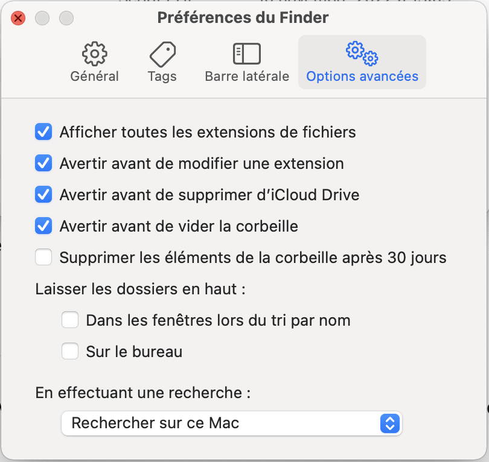
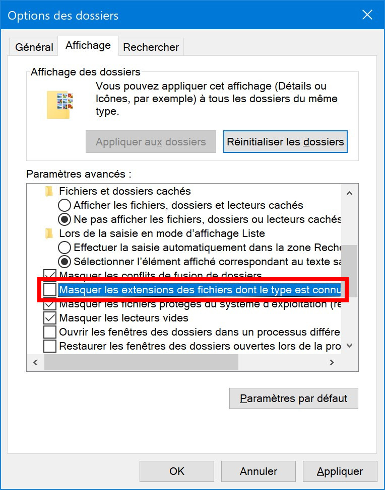

# 2-01. Notre environnement de travail

---

**VIDÉOS**

▶️ [Vidéo](https://www.youtube.com/watch?v=7k94fWJo4eI)

▶️ [Vidéo](https://www.youtube.com/watch?v=URJ2iWtnRrc)

---

## POUR BIEN DÉMARRER: Afficher les extensions de fichiers

Une application web fait appel à plusieurs langages et technologies. Elle sera constituée d'un grand nombre de fichiers. Il sera important pour nous de savoir à quel type de fichier on a affaire, s'il s'agit d'un fichier html, css, js ou php par exemple. Pour s'y retrouver, chaque fichier portera une extension différente selon la technologie utilisée. Nous aurons donc des fichiers avec des extensions machin.html, truc.css, bidule.js ou encore test.php.

MAIS, par défaut, certains ordinateurs n'affichent pas les extensions des fichiers, pour préserver la santé mentale des utilisateurs j'imagine.

Dons, la première chose que nous allons faire, c'est de les afficher.

- Sur MacOSX: c'est automatique (la santé mentale des utilisateurs est déjà compromise)Finder > Préférences > Options avancées > Cochez "Afficher toutes les extensions de fichiers"
- Sur Windows: Sélectionnez un dossier > Menu affichage > Décochez "Masquer les extensions des fichiers dont le type est connu"

Bienvenue dans le côté obscur de la Force !

## Installation et test de VSCode

VSCode est un IDE (Environnement de Développement Intégré). C'est un logiciel qui va nous aider à coder. C'est un outil libre de droits et multi-plateformes.

Pour le télécharger : [https://code.visualstudio.com](https://code.visualstudio.com)

VSCode sera l'IDE utilisé au cours. Il s'agit d'un simple éditeur de fichiers texte particulièrement bien conçu pour le développement de fichiers web. Il s'agit d'un outil libre de droit et compatible MacOSX, Linux et Windows.

Il existe de nombreux IDE concurrents, comme ATOM, Sublime Text, Brackets, NetBeans ou autre PHPStorm. Tu peux installer celui que tu veux mais je travaillerai personnellement avec VSCode.

Vous voilà prêts pour commencer !!!

<video src="images/YVyOdSeX2FX4R1u2.mp4" autoplay loop muted playsinline controls></video>
