# 2-02. Créer un premier fichier HTML et le tester

**VIDÉO:**

▶️ [Vidéo](https://www.youtube.com/watch?v=URJ2iWtnRrc)

---

## 1. Crée un dossier et ouvre le avec VSCODE

Quand on démarre une application web, on crée un dossier qui va reprendre tous les fichiers de notre application. !! !!!!

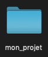

On va ouvrir ce dossier dans VSCode. Il y a 2 manières pour faire ça...

1. On jette le dossier sur l'icône de VSCode
2. On ouvre VSCode puis 'Ficher/ouvrir le dossier' et on choisi le dossier

Dans l'explorateur de VSCode, on a alors la liste des fichiers qui se trouvent dans le dossier en question

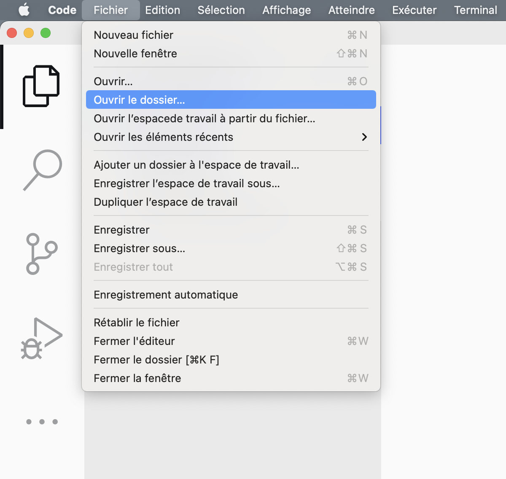

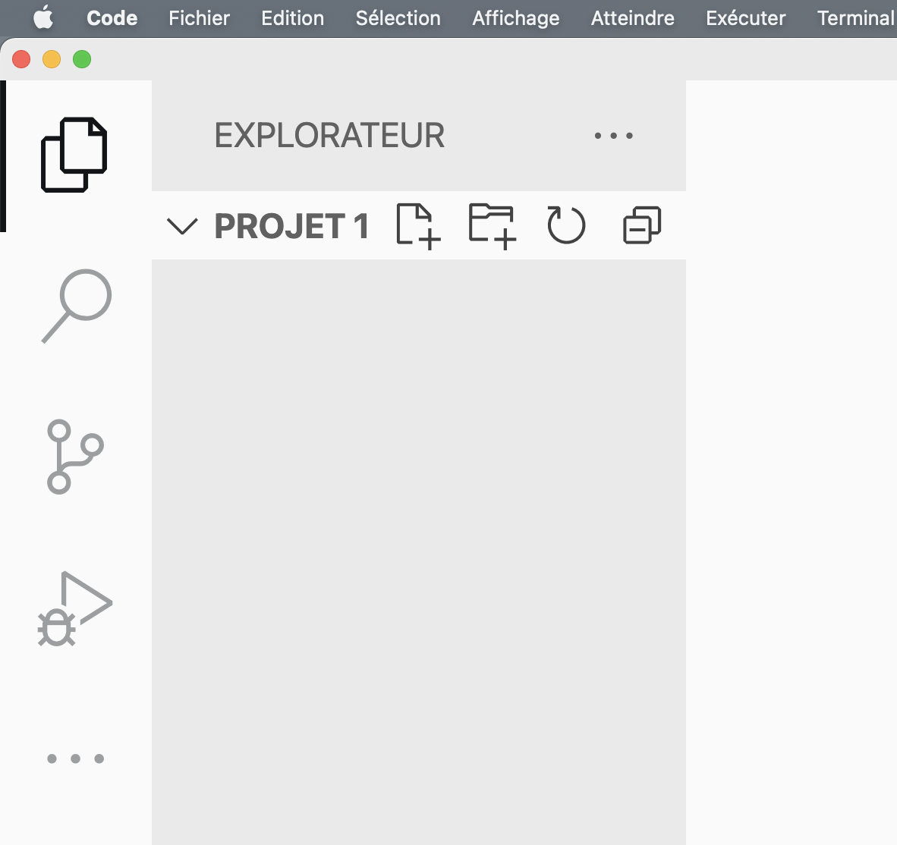

> **ATTENTION:** Dans VSCode, on n'ouvre QUE LE DOSSIER SUR QUI CONTIENT LES FICHIERS DU PROJET EN COURS !!! On n'ouvre pas tout le bureau ou tout le disque dur !

## 2. Crée un fichier avec l'extension .html

Un fichier HTML, c'est un simple fichier texte brut mais dont on a changé l'extension .txt en .html.

Pour créer un nouveau fichier HTML avec VSCode, il y a 3 manières:

1. Clicc sur l'icône de fichier à côté du nom du dossier
2. Click-droit dans l'explorateur du projet puis "Nouveau Fichier"
3. Menu 'Fichier/Nouveau Fichier'

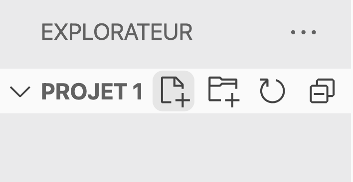

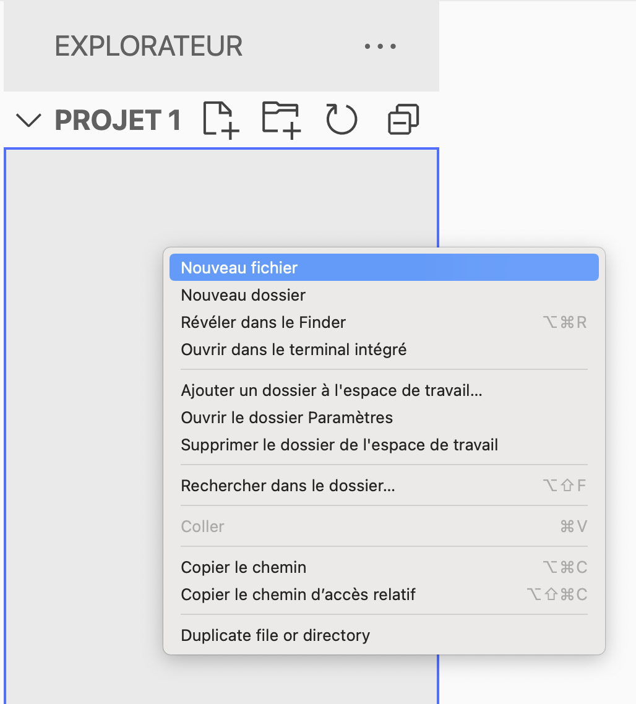

Entre le nom de votre fichier avec l'extension .html

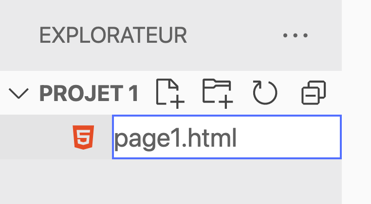

Ton fichier est créé et tu peux taper ton code HTML et enregistrer le fichier.

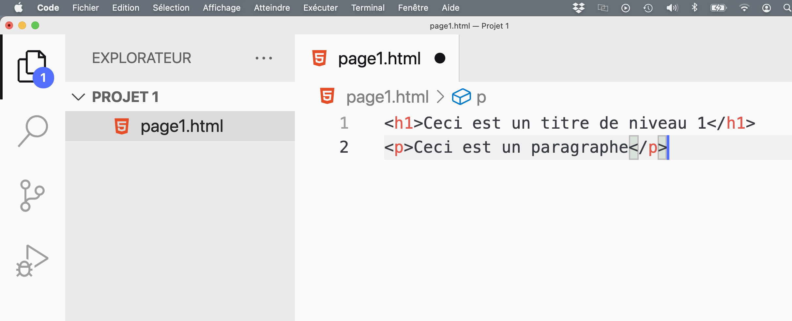

## 3. Teste le fichier dans ton navigateur

Pour tester le fichier, il faut l'ouvrir dans un navigateur web comme Safari, Chrome, Firefox, Opera ou autre Edge, ...

Il suffit de double-cliquer sur le fichier dans votre explorateur windows (Windows) ou votre Finder (MacOSX).

Si tu as installé le package 'Open-in-browser' d' ATOM, tu pourras lancer le navigateur directement depuis ATOM en faisant 'Click-droit/Open)in-browser' sur le fichier.

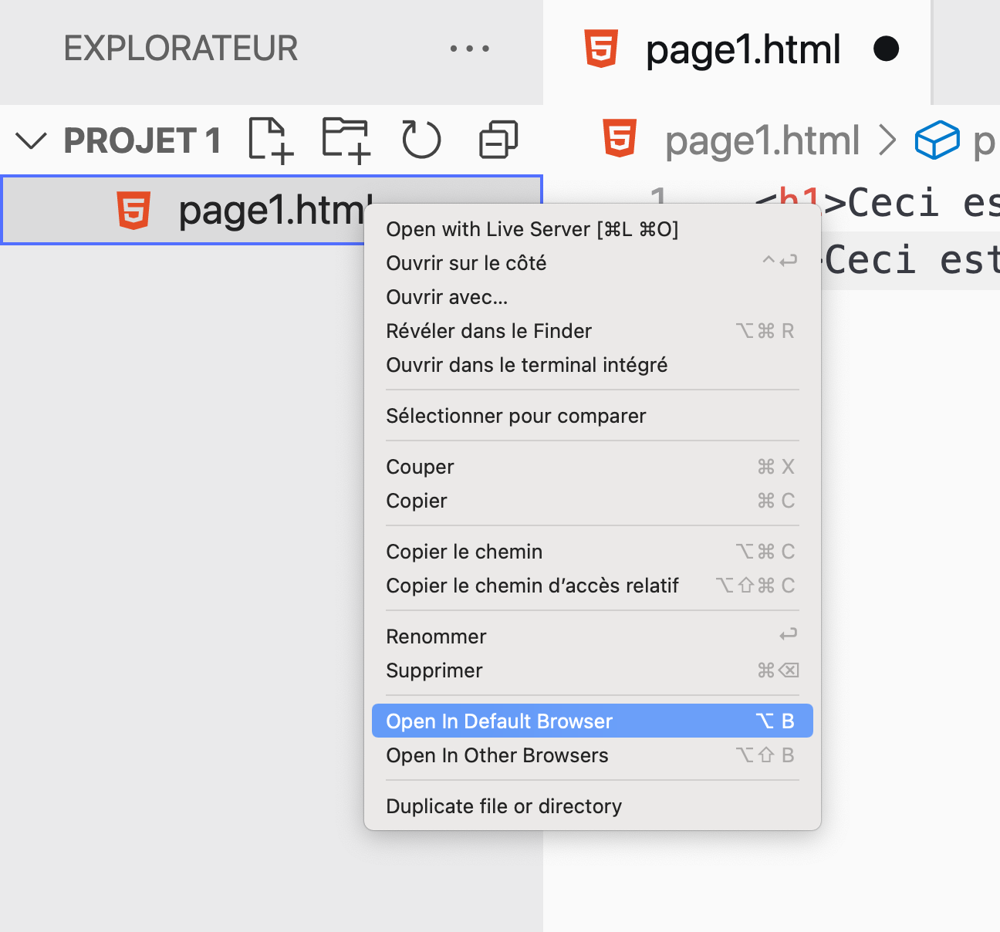

Ton navigateur affichera le résultat de son interprétation du code HTML

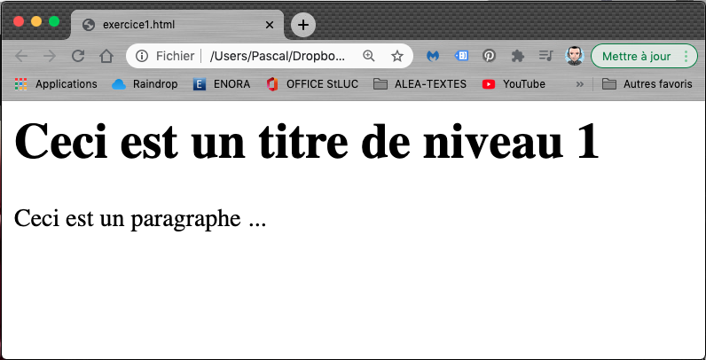

## 4. Affiche le code source de la page

Si tu clique-doit sur une partie vierge de la page HTML dans ton navigateur, tu pourras voir le code source de la page.

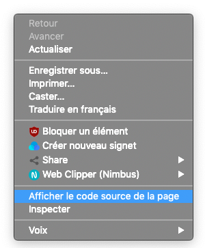

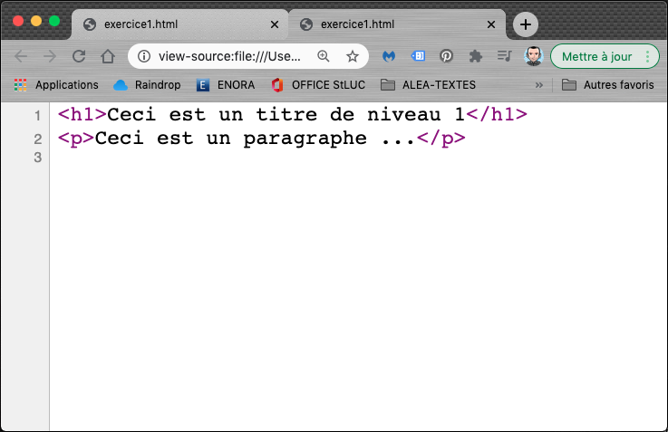

C'est bien le code que nous avons créé.

---

## JE TE METS AU DÉFI !

- Crée un dossier nommé "projet_1"
- Crée un fichier HTML nommé "index.html"
- Places-y un titre h1 avec comme contenu: "Ceci est le titre de la page"
- Teste ton fichier dans un navigateur
