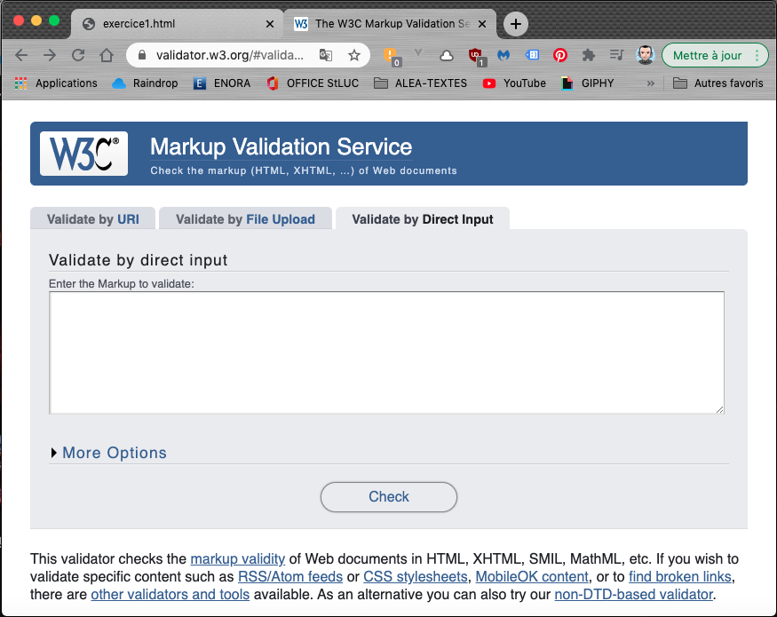
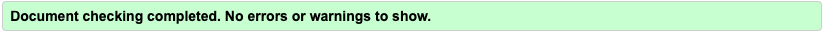
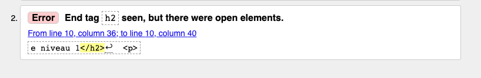

# 2-04 Une structure HTML valide

```embed
title: "2. Une structure HTML valide"
image: "https://i.ytimg.com/vi/GLBBjOTevsY/hqdefault.jpg"
description: "Vidéo YouTube · Pascal LACROIX"
url: "https://www.youtube.com/watch?v=GLBBjOTevsY"
favicon: ""
aspectRatio: "56.25"
```

---

## 1. Un document bien formé n'est pas nécessairement valide

Si tu construis ton code HTML en respectant les 5 principes précédents, ton code sera bien formé.

**Un document HTML est un document XML et comme tout document XML, un document HTML doit contenir** :

- **Un** `<!DOCTYPE html>` : qui dit au navigateur quel version du HTML on va utiliser (ici : HTML5)
- **UNE ET UNE SEULE balise racine** qui contient TOUTES les autres : `<html>...</html>`
- **L'attribut lang="fr" de la balise html :** qui permet de spécifier aux moteur de recherche la langue utilisée pour ce document.`<html lang="fr">...</html>`

Ton code sera valide, s'il respecte les normes du langage mentionné dans le DOCTYPE !!! C'est sur ce DOCTYPE qui servira de base à la validation du W3C.

## 2. Une structure HTML5 minimale valide

```html
<!DOCTYPE html>
  <html lang="fr">
  <head>
    <meta charset="UTF-8">
    <title>Titre de la page</title>
  </head>
  <body>
	<!-- Ici vient le contenu de la page ... -->
  </body>
  </html>
```

### A. L'entête du document

**La partie** `<head>...</head>` **:** l'entête du document : infos qui ne s'afficheront pas dans la fenêtre principale et qui servent principalement aux moteurs de recherche

- `<meta charset="UTF-8" />` : type de codage de caractères (UTF-8 : prend en compte les caractères accentués occidentaux)
- `<title>...</title>` :
    - Balise la plus importante pour le référencement naturel de votre page
    - On y met les mots clés principaux pour cette page

### B. Le corps du document

**La partie** `<body>...</body>` **:** C'est le corps principal de la page

- On y met tous nos objets de contenu (paragraphes, titres, images, formulaires, ...)
- On tentera de placer un `<h1></h1>` le plus haut possible pour le référencement naturel

## 3. Valider un code HTML

Le code HTML d'une page peut être validé auprès du service de validation du W3C: [https://validator.w3.org/](https://validator.w3.org/)

Tu choisis la manière de checker ton code:

1. En tapant l'URL de votre fichier (s'il est sur un serveur) dans l'onglet 'URI'
2. En uploadant votre fichier dans l'onglet 'File Upload'
3. En faisant un copier-coller de votre code dans l'onglet 'Direct Input'C'est le plus rapide !



## 4. Interpréter le résultat de la validation

### A. Aucune erreur ! YESSS !



### B. Les Warnings

Un Warning ne signifie pas que ton code n'est pas valide, mais qu'il est améliorable.

### C. Les erreurs

Les erreurs doivent être corrigées car ton code n'est pas valide !


