# 3-03. Balises de structuration de contenus

## **1. Balises de structuration de contenu**

Pour aller plus loin: [Référence des éléments HTML - HTML (HyperText Markup Language) | MDN](https://developer.mozilla.org/fr/docs/Web/HTML/Element)

|  |  | Balise | Type | Sémantique | Exemples |
|---|---|---|---|---|---|
| 1 |  | `<a href=""></a>` | INLINE | Hyperlien | `<a href="http://www.google.be">Google</a>` |
| 2 |  | `<abbr></abbr>` | INLINE | Abbréviation | `<p>Le <abbr>HTML</abbr> est un...</p>` |
| 3 |  | `<address>...</address>` | SUPER BLOC | Adresse | `<address>` `Rue Machin, 5 <br/>` `4537 Truc``</address>` |
| 4 |  | `<blockquote cite="..."></bockquote>` | SUPER BLOC | Bloc contenant une longue citation | `<blockquote cite="http://www...">` `Lorem ipsum ...``</bockquote>` |
| 5 |  | `<br />` | - | Saut de ligne dans un bloc (pas de valeur sémantique) | `<address>` `Rue Machin, 5 <br/>` `4537 Truc``</address>` |
| 6 |  | `<cite></cite>` | INLINE | Titre d'une oeuvre, ... | `<p>` `Comme dans l'oeuvre` `<cite>Le cri</cite> d'Edward ...``</p>` |
| 7 |  | `<code></code>` | INLINE | Portion de code | `Le code suivant est du javascript` `<code>window.alert("coucou")</code>` |
| 8 |  | `<div>...</div>` | SUPER BLOC | Bloc générique non sémantique | `<div>` `Ceci est un contenu indéfinissable``</div>` |
| 9 |  | `<em></em>` | INLINE | Mise en évidence de niveau 1 | `<p>``Voici un mot <em>particulier</em``</p>` |
| 10 |  | `<h1>...</h1>``<h2>...</h2>``...``<h6>...</h6>` | BLOC | Titre de niveau 1, 2, ... 6 | `<h1>Titre de niveau 1</h1>``<h2>Titre de niveau 2</h2>` |
| 11 |  | `<kbd></kbd>` | INLINE | Touche de clavier | `<p``>` `Appuyez sur <kbd>Cmd</kbd>` `+ <kbd>C</kbd> pour copier``</p>` |
| 12 |  | `` | INLINE | Image | `` |
| 13 |  | `<p>...</p>` | BLOC | Simple paragraphe | `<p>Lorem ipsum...</p>` |
| 14 |  | `<q></q>` | INLINE | Courte citation | `<p>` `Notre but est, je cite,` `<q>Faire de la sémantique</q>.``</p>` |
| 15 |  | `<span></span>` | INLINE | Balise INLINE sans valeur sémantique. Utilisée principalement pour le CSS. | `<p>` `Voici un <span>contenu</span>``</p>` |
| 16 |  | `<strong></strong>` | INLINE | Mise en évidence de niveau 2 | `<p>` `Ceci est un <strong>mot</strong>` `très important``</p>` |
|  |  | All:16 | All:16 | All:16 | All:16 |

## 2. Balises de listes

Pour aller plus loin: [Référence des éléments HTML - HTML (HyperText Markup Language) | MDN](https://developer.mozilla.org/fr/docs/Web/HTML/Element)

|  |  | Balises | Sémantique | Interprétation graphique |
|---|---|---|---|---|
| 1 |  | `<dl>` `<dt>terme 1</dt>` `<dd>Définition 1...</dd>` `<dt>Terme 2</dt>` `<dd>Définition 2...</dd>``</dl>` | Liste de descriptions | Terme1 Définition1...Terme2 Définition 2... |
| 2 |  | `<ol>` `<li>Item 1</li>` `<li>Item 2</li>` `<li>Item 3</li>``</ol>` | Liste ordonnée d'éléments de même nature | 1. Item 12. Item 23. Item 3 |
| 3 |  | `<ul>` `<li>Item 1</li>` `<li>Item 2</li>` `<li>Item 3</li>``</ul>` | Liste non ordonnée d'éléments de même nature | • Item 1• Item 2• Item 3 |
|  |  | All:3 | All:3 | All:3 |

## 3. Nouvelles balises sémantiques de structuration HTML5

Pour aller plus loin: [Référence des éléments HTML - HTML (HyperText Markup Language) | MDN](https://developer.mozilla.org/fr/docs/Web/HTML/Element)

|  |  | Balises | Type | Sémantique | Exemples |
|---|---|---|---|---|---|
| 1 |  | `<article></article>` | SUPER BLOC | Article autonome | `<article>` `<h1>Titre ...</h1>` `<p>...</p>``</article>` |
| 2 |  | `<aside></aside>` | SUPER BLOC | Contenu complémentaire à un contenu principal | `<article>` `<h1>...</h1>` `<p>... </p>` `<aside>...</aside>``</article>` |
| 3 |  | `<details></details>` | SUPER BLOC | Reprend les détails d'un élément | `<details>` `<summary>HTML</summary>` `<p>Le HTML ...</p>``</details>` |
| 4 |  | `<figcaption></figcaption>` | SUPER BLOC | Légende d'une figure | `<figure>` `` `<figcaption>...</figcaption>``</figure>` |
| 5 |  | `<figure></figure>` | SUPER BLOC | Figure illustrant un contenu | `<figure>````<figcaption>...</figcaption>``</figure>` |
| 6 |  | `<footer></footer>` | SUPER BLOC | Pied de l'élément | `<article>` `<h1>Titre de l'article</h1>` `<p>Lorem ipsum... </p>` `<footer>Auteur: Bruce Willis</footer>``</article>` |
| 7 |  | `<header></header>` | SUPER BLOC | Entête de l'élément | `<article>` `<header>` `<h1>Titre de l'article</h1>` `<div>Auteur: Bruce Willis</div>` `</header>` `<p>Lorem ipsum... </p>``</article>` |
| 8 |  | `<main></main>` | SUPER BLOC | Section principale du document | `<body>` `<header>...</header>` `<main>.../main>` `<footer>...</footer>``</body>` |
| 9 |  | `<nav></nav>` | SUPER BLOC | Navigation | `<header>` `<h1>Titre du document</h1>` `<nav>` `<ul>` `<li><a href="...">Lien 1</a></li>` `<li><a href="...">Lien 2</a></li>` `</ul>` `</nav>``</header>` |
| 10 |  | `<section></section>` | SUPER BLOC | Section de contenu | `<section>` `<h2>WWF History</h2>` `<p>Lorem ipsum...</p>``</section>``<section>` `<h2>WWF's Symbol</h2>` `<p>Lorem ipsum...</p>``</section>` |
| 11 |  | `<summary></summary>` | BLOC | Elément pouvant être détaillé | `<details>` `<summary>HTML</summary>` `<p>Le HTML ...</p>``</details>` |
| 12 |  | `<time datetime="..."></time>` | INLINE | Défini une heure | `<p>` `Rdv ce` `<time datetime="2020-03-22 10:00:00">` `Vendredi 22 mars à 10h` `</time>``</p>` |
|  |  | All:12 | All:12 | All:12 | All:12 |

## 4. Structuration sémantique d'un document HTML

Il y a plusieurs manières d'utiliser ces balises sémantiques pour structurer correctement un document HTML. Alors l'idée n'est pas de se dire "Est-ce que je fais bien ou non?", mais plutôt "Est-ce que ça a du sens ou non ?"

A part la balise `<main></main>` qui ne peut apparaître q'une seule fois dans un document HTML (ce qui est un aberration à mon sens), il faut comprendre que chaque balise peut se retrouver à différents niveaux. Par exemple, le document peut avoir un `<header></header>` qui reprend ses éléments d'entête, mais un `<article></article>` peut également avoir un `<header></header>`, tout comme une `<section></section>`. Pareil pour les `<footer></footer>` et les `<aside></aside>`, ... Un `<article></article>` peut être structuré en `<section></section>` tout comme une `<section></section>` de document peut contenir des `<article></article>`, ...

### A. Le div en dernier recours...

Quand j'étais petit, on mettait des `<div></div>` partout... cette balise n'a aucune valeur sémantique.

Mais avec l'arrivée des balises sémantiques du HTML5, on essaie de donner du sens aux contenu. Ça ne veut pas dire qu'on ne peut plus utiliser le `<div></div>`, mais on l'utilise lorsque le contenu ne correspond à aucune autre balise... Par dépit si vous voulez...

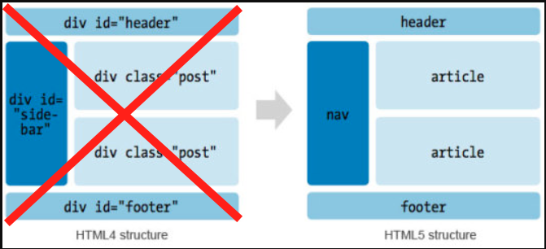

### B. Quelques exemples de structurations sémantiques

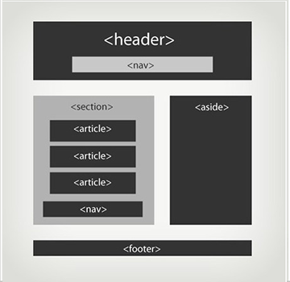

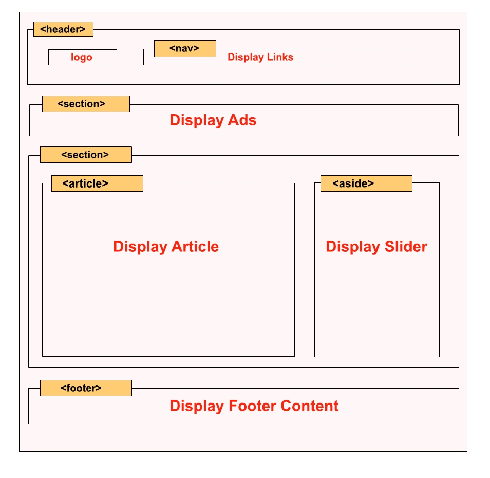

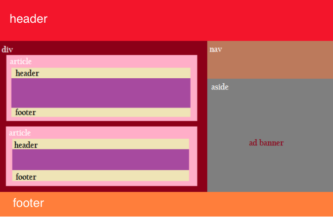

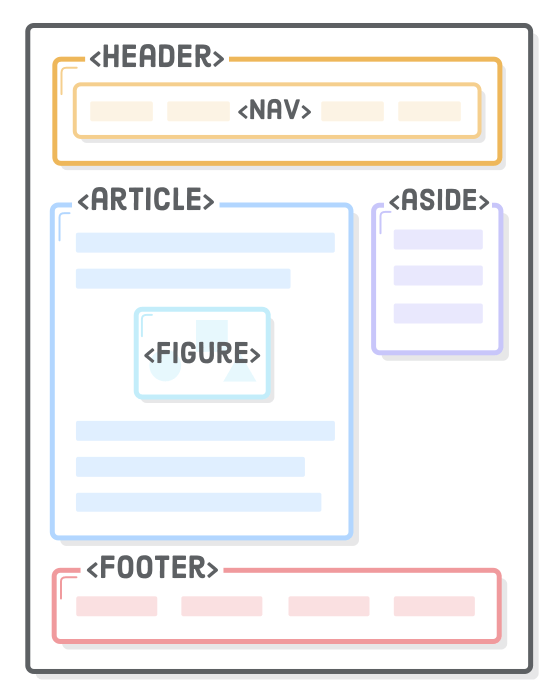

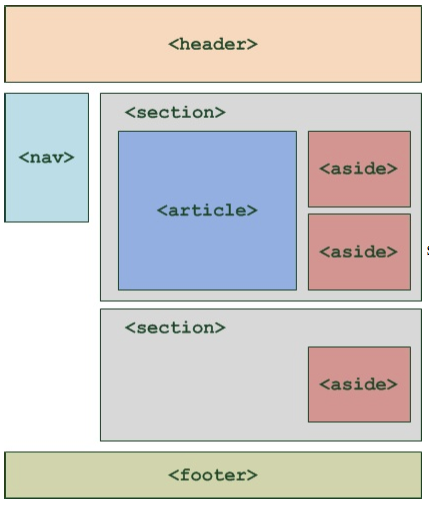

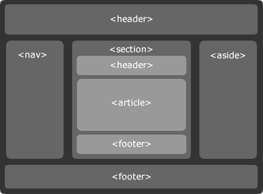

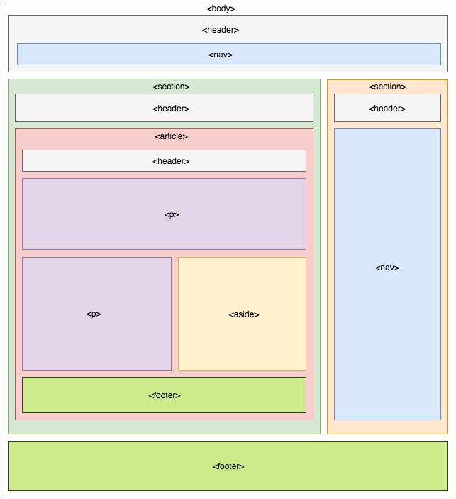

---

## UN MEMENTO DES PRINCIPALES BALISES HTML

📎 [Memento Balises HTML5.pdf](images/FHVP6v5B7wc8trSH.pdf)

---

## JE TE METS AU DÉFI

Propose une structure HTML valide et sémantique pour les documents suivants:

### **DÉFI 1:**

Réalise les structures HTML sémantique des exemples ci-dessus.

---

### DÉFI 2:

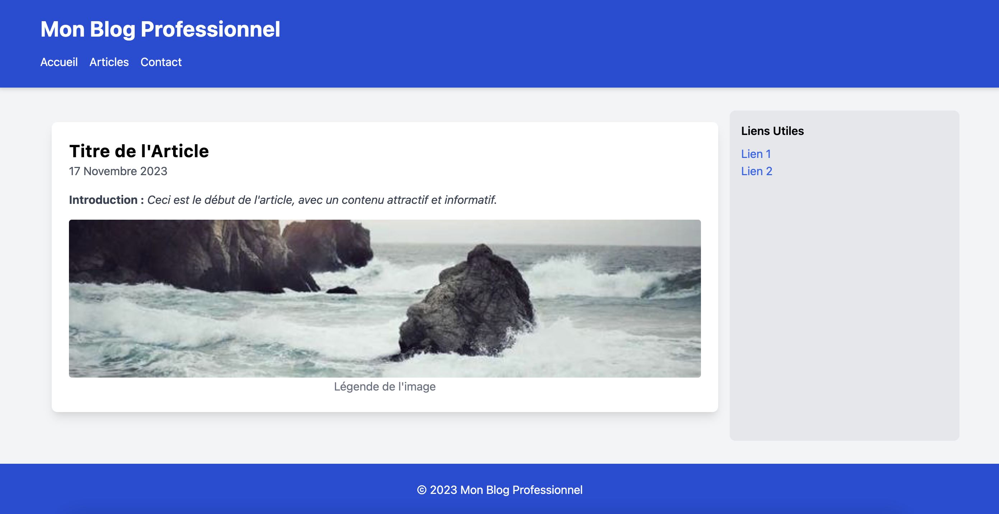

---

### DÉFI 3:


---

### DÉFI 4:


---

### DÉFI 5:

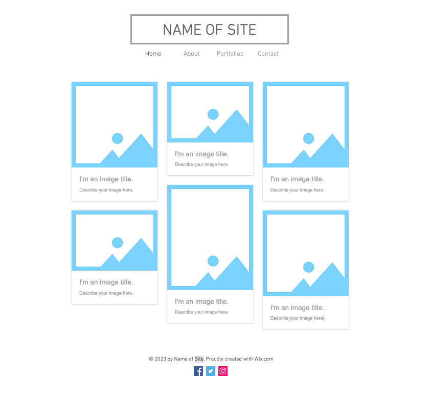

---

### DÉFI 6

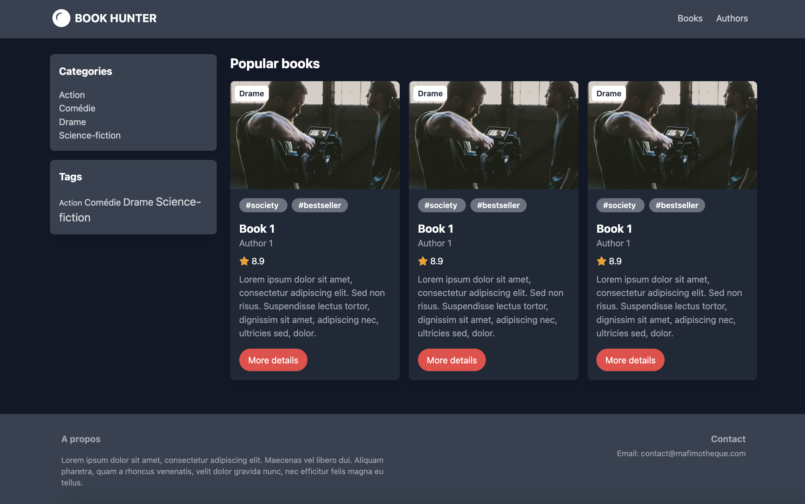

---

## Pour aller plus loin

- [https://developer.mozilla.org/fr/docs/Web/HTML/Element](https://developer.mozilla.org/fr/docs/Web/HTML/Element)
- [https://www.w3schools.com/tags/default.asp](https://www.w3schools.com/tags/default.asp)
