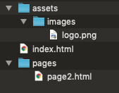
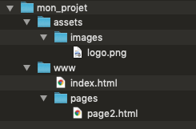
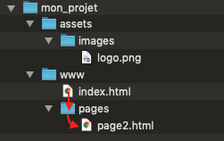
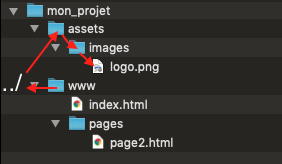

# 4-01. Chemins absolus et chemins relatifs

Lorsqu'on doit faire un lien entre 2 pages ou que l'on doit insérer un fichier image par exemple, alors se pose très vite le problème des chemins absolus et des chemins relatifs.

## 1. Les chemins absolus

Un chemin absolu est un chemin qui est le même quelque soit l'endroit où on se trouve.

### A. Dans la vie réelle

Par exemple, si je demande à une personne en Égypte et une autre au Canada de se rendre à l'adresse suivante:

> 9, rue Charles Deliège4620 FléronBelgique

Ils encoderont ça dans leur GPS et c'est parti, il y arriveront tous les 2...C'est une **adresse absolue** !

### B. Sur une page web

Si j'écris le code suivant dans un fichier index.html

```html
<!-- Lien vers un site distant (chemin absolu) -->
<a href="http://www.promotion-sociale.be">EAFC de Fléron</a>

<!-- Chargement d'une image distante (chemin absolu) -->

```

Et que je teste ce fichier sur 2 ordinateurs différents, dans les 2 cas, le lien aboutira au site de l'IEPS de Fléron et l'image chargée sera celle qui est sur le serveur de l'IEPS de Fléron.

### C. Dans quel cas utiliser un chemin absolu ?

On utilise donc des chemins absolus pour faire référence à des **RESSOURCES DISTANTES**, c'est-à-dire se trouvant sur un serveur web AUTRE que celui sur lequel se trouve notre fichier HTML. Exemples:

1. Faire un lien vers un autre site `<a href="http://www.promotion-sodiale.be">IEF de Fléron</a>`
2. Charger une vidéo depuis le site de Youtube`<video src="[https://www.youtube.com/watch?v=5CjOGS9-4OA](https://www.youtube.com/watch?v=5CjOGS9-4OA)"></video>`
3. Charger un GIF depuis le site GIPHY``
4. ...

## 2. Les chemins relatifs

Un chemin relatif est un chemin qui dépend de l'endroit où on se trouve.

### **A. Dans la vie réelle**

Par exemple, si je demande à une personne en Égypte et une autre au Canada de suivre le chemin suivant:

> 3ème à gauche1ère à droite5ème maison1er étage3ème porte à droite

Ils n'arriveront pas du tout au même endroit !!!C'est un **chemin relatif** ! L'arrivée dépend de l'endroit de départ !!!

### **B. Sur une page web**

Si j'écris le code suivant dans un fichier index.html

```html
<!-- Lien vers un autre fichier HTML (chemin relatif) -->
<a href="pages/page2.html">Aller à la page 2</a>

<!-- Chargement d'une image locale (chemin relatif) -->

```

Et que je teste ce fichier sur un ordinateurs, alors, tout dépend de comment les dossiers et les fichiers sont organisés.

Il faut que l'organisation des dossiers et des fichiers soit exactement comme ceci :



### **C. Dans quel cas utiliser un chemin relatif ?**

On utilise donc des chemins relatifs pour faire référence à des **RESSOURCES LOCALES**, c'est-à-dire se trouvant sur le MÊME serveur web que le fichier HTML se trouve. Exemples:

1. Faire un lien vers une autre page du site`<a href="contacts.html">Contactez-nous</a>`
2. Charger une feuille de style locale`<link rel="stylesheet" href="assets/css/app.css" />`
3. Charger un fichier vidéo local `<video src="assets/videos/eafc.mp4">...</video>`
4. Charger une image locale``
5. ...

Mais il faut bien s'assurer que le chemin relatif corresponde bien à l'emplacement de la ressource chargée **PAR RAPPORT au fichier HTML** qui l'appelle !

## 3. Écrire un chemin relatif

Un chemin relatif s'écrit TOUJOURS en partant du fichier HTML qui appelle la ressource locale.Imaginons l'arborescence suivante:



### A. Entrer dans des dossiers

Si je veux faire un lien dans la page index.html vers la page2.html, je dois

- Entrer dans le dossier 'pages' avec `pages/`
- Trouver le fichier 'page2.html' avec `page2.html`



```html
<!-- Code du fichier index.html -->
...
<a href="pages/page2.html">Aller à la page 2</a>
```

### B. Sortir des dossiers

Pour charger correctement le logo depuis le fichier index.html, je dois

- Sortir du dossier 'www' avec `../`
- Entrer dans le dossier 'assets' avec `assets/`
- Entrer dans le dossier 'images' avec `images/`
- Trouver le fichier 'logo.png' avec `logo.png`



```html
<!-- Code du fichier index.html -->
...

```

Ben voilà ! :-)

[https://media1.giphy.com/media/v1.Y2lkPTc5MGI3NjExNmI4cnRld3lqeDBhajZ6Z3RwM2Ztd3hyMjY0bW1lMWNuMWtjMDBmNSZlcD12MV9pbnRlcm5hbF9naWZfYnlfaWQmY3Q9Zw/IsBy9xFHETtzoVGIqK/giphy.gif](https://media1.giphy.com/media/v1.Y2lkPTc5MGI3NjExNmI4cnRld3lqeDBhajZ6Z3RwM2Ztd3hyMjY0bW1lMWNuMWtjMDBmNSZlcD12MV9pbnRlcm5hbF9naWZfYnlfaWQmY3Q9Zw/IsBy9xFHETtzoVGIqK/giphy.gif)

---
