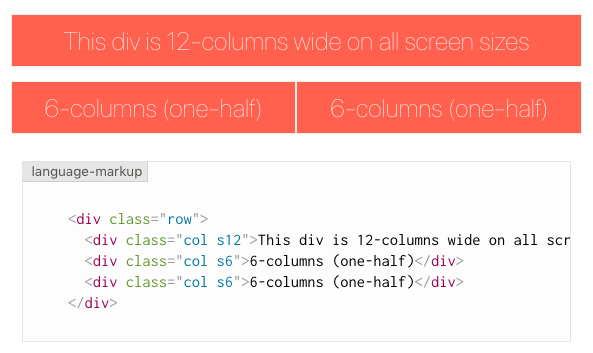
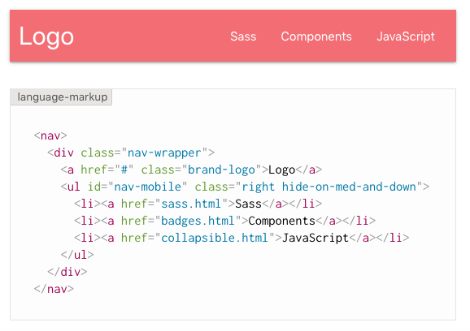
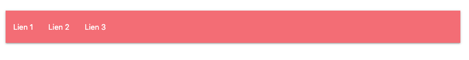

# 5-01. Des frameworks Frontend

---

1. Des frameworks Frontend ?
2. Un principe simple et efficace
3. Des classes ré-utilisables
4. Des composants plus complexes
5. Des éléments interactifs
6. Les grands frameworks trop envahissants ?

---

## **1. Des frameworks Frontend?**

Depuis plusieurs années, on voit émerger des outils qui permettent aux intégrateurs web de travailler d'un manière plus efficace et partageable. L'idée est très simple: proposer une série de classes CSS toutes faites permettant de faciliter la mise en page de notre code HTML ainsi que la mise en place de composants interactifs sans avoir à coder trop de CSS ou de JS.

Parmi ces outils, on peut citer, par exemple, le très efficace Materialize CSS [[Documentation - Materialize](https://materializecss.com/) ], le célèbre Bootstrap proposé par Twitter [[Bootstrap · The most popular HTML, CSS, and JS library in the world.](https://getbootstrap.com/) ], MUI ([MUI - Material Design CSS Framework](https://www.muicss.com/)), Semantic UI ([https://semantic-ui.com/](https://semantic-ui.com/)), ou encore le très moderne Tailwind CSS [[Tailwind CSS - Rapidly build modern websites without ever leaving your HTML.](https://tailwindcss.com/) ], ...

## 2. Un principe simple et efficace

1. On charge le framework dans la page web (le lien se trouve dans la doc du framework)
2. On peut alors utiliser les classes CSS toutes faites en ajoutant ces classes dans nos balises HTML grâce à l'attribut HTML `class=""`

```html
<!DOCTYPE html>
<html lang="fr">
<head>
  <meta charset="UTF-8">
  <title>Titre de la page</title>

  <!-- 1. Chargement du framework Materialize -->
  <link rel="stylesheet" href="https://cdnjs.cloudflare.com/ajax/libs/materialize/1.0.0/css/materialize.min.css">  

</head>
<body>

  <!-- 2. Utilisation des classes dans le code de la page -->
  <h1 class="center-align">Titre de la page</h1>

</body>
</html>
```

La clé pour utiliser efficacement ces outils, c'est le recours à la documentation officielle. On peut y trouver toutes les classes et composants disponibles.

## 3. Des classes ré-utilisables

Les classes s'appliquent à une balise HTML pour mettre en place un effet graphique particulier sur cette balise, comme l'alignement d'un texte, la couleur de fond d'un élément...


```html
<div>
  <h5 class="center-align">This should be center aligned</h5>
</div>
```

## 4. Des composants plus complexes

Au delà des simples classes que l'on attribue à une balise, les frameworks proposent également des composants plus complexes comme des barres de navigation, des systèmes de grille responsives ou encore des systèmes de cards, ...

Ces composants sont également des classes mais elles doivent être appliquées sur un ensemble de balises et non sur une seule balise. La documentation illustre alors la structure HTML proposée pour le composant. Ces composants sont plus ou moins complexes...

### Le système de grille de Materialize CSS



### Le système de navbar de Materialize



## 5. Des éléments interactifs

Les grands framework intègrent également des composants interactifs. Il faut alors charger également le script JS du framework.

Ces frameworks sont donc des frameworks CSS mais intègrent également du JS. Ce sont de véritables frameworks frontend.

## 6. Les grands frameworks trop envahissants ?

Dès qu'on intègre Materialize ou Bootstrap dans une page web, cela va déjà modifier l'affichage de notre page même sans avoir placé la moindre classe...



```html
<nav>
  <ul>
    <li><a href="#">Lien 1</a></li>
    <li><a href="#">Lien 2</a></li>
    <li><a href="#">Lien 3</a></li>
  </ul>
</nav>
```

Ca peut sembler pratique à priori, mais cela peut devenir très envahissant si nous souhaitons un design radicalement différent de ce que propose par défaut le framework.

On peut être amené à se battre contre le framework et à ce moment là, ce n'est plus un outil très aidant.

## 7. Des frameworks plus légers et plus spécialisés

C'est la raison pour laquelle on a vu émerger quantité de plus petits frameworks dont l'objectif n'est plus de prendre en charge l'ensemble de la mise en page mais un seul de ses aspects comme le système de grille, la gestion des images, les barres de navigation, les animations, ...

On trouve par exemple Simple Grid [[Simple Grid | Lightweight CSS grid for web development](https://simplegrid.io/) ] dont l'objectif est de fournir uniquement le système de grille responsive, Skeleton ([http://getskeleton.com/](http://getskeleton.com/)), Bulma [[Navbar | Bulma: Free, open source, and modern CSS framework based on Flexbox](https://bulma.io/documentation/components/navbar/) ] qui ne gère que les barres de navigation, et beaucoup d'autres comme Animate CSS [[Animate.css | A cross-browser library of CSS animations.](https://animate.style/) ] ...

L'idée peut alors être de ne charger que le ou les outil(s) dont on a besoin dans le projet en cours... C'est en tout cas une alternative à considérer.

La logique reste la même...

1. On charge le framework
2. On utilise les classes de la doc dans le code HTML
