# 5-02. Materialize CSS: Un framework très efficace

---

1. Le Material Design de Google
2. Installations
    1. Installation distante via les CDN
        1. Avantages du chargement distant via les CDN
        2. Inconvénients du chargement distant via les CDN
    2. Installation en local
        3. La version standard
        4. La version SASS
        5. Avantages du chargement local
        6. Inconvénients du chargement local
3. Classes, composants, éléments interactifs, ...
4. Des éléments directement mis en page
5. Quelques classes bien pratiques
    3. La classe 'container': une boite centrée
    4. La classe 'container' pour centrer et aligner le contenu des blocs
    5. Alignement des textes
    6. Habillage des blocs
    7. Couleurs des blocs et des textes
        7. Couleur de fond des blocs
        8. Couleur des textes
    8. La classe flow-text pour les blocs héros
6. Le module de grille responsive
7. Le module des cards
8. Les icônes
9. Le module des boutons
10. Le module des navbars
11. Et bien d'autres classes, modules et composants...
12. EXERCICES

---

**VIDÉOS**

```embed
title: "1. MATERIALIZE - Trois manières de l'installer"
image: "https://i.ytimg.com/vi/x5I6d_Zo5QU/hqdefault.jpg"
description: "Vidéo YouTube · Pascal LACROIX"
url: "https://www.youtube.com/watch?v=x5I6d_Zo5QU"
favicon: ""
aspectRatio: "56.25"
```

```embed
title: "2. MATERIALIZE - Principes de base"
image: "https://i.ytimg.com/vi/O0qmVLGU6R8/hqdefault.jpg"
description: "Vidéo YouTube · Pascal LACROIX"
url: "https://www.youtube.com/watch?v=O0qmVLGU6R8"
favicon: ""
aspectRatio: "56.25"
```

```embed
title: "3. MATERIALIZE - La gestion des icônes"
image: "https://i.ytimg.com/vi/UuJtmzO2nb8/hqdefault.jpg"
description: "Vidéo YouTube · Pascal LACROIX"
url: "https://www.youtube.com/watch?v=UuJtmzO2nb8"
favicon: ""
aspectRatio: "56.25"
```

```embed
title: "4. MATERIALIZE - Les boutons"
image: "https://i.ytimg.com/vi/snua2Fqo0CI/hqdefault.jpg"
description: "Vidéo YouTube · Pascal LACROIX"
url: "https://www.youtube.com/watch?v=snua2Fqo0CI"
favicon: ""
aspectRatio: "56.25"
```

```embed
title: "5. MATERIALIZE - Le module de grille responsive"
image: "https://i.ytimg.com/vi/fyQlk-5zSoc/hqdefault.jpg"
description: "Vidéo YouTube · Pascal LACROIX"
url: "https://www.youtube.com/watch?v=fyQlk-5zSoc"
favicon: ""
aspectRatio: "56.25"
```

```embed
title: "6. MATERIALIZE - Le module des visibilités"
image: "https://i.ytimg.com/vi/7QHhcBQ1Mzo/hqdefault.jpg"
description: "Vidéo YouTube · Pascal LACROIX"
url: "https://www.youtube.com/watch?v=7QHhcBQ1Mzo"
favicon: ""
aspectRatio: "56.25"
```

```embed
title: "7. MATERIALIZE - Le module des navbars"
image: "https://i.ytimg.com/vi/8T2aqWQfYqc/hqdefault.jpg"
description: "Vidéo YouTube · Pascal LACROIX"
url: "https://www.youtube.com/watch?v=8T2aqWQfYqc"
favicon: ""
aspectRatio: "56.25"
```

```embed
title: "8. MATERIALIZE - Utilisation d'un fichier de surcharge"
image: "https://i.ytimg.com/vi/BHrZUrJBIUE/hqdefault.jpg"
description: "Vidéo YouTube · Pascal LACROIX"
url: "https://www.youtube.com/watch?v=BHrZUrJBIUE"
favicon: ""
aspectRatio: "56.25"
```

```embed
title: "9. MATERIALIZE - Utilisation de la version SASS avec le bundler PARCEL"
image: "https://i.ytimg.com/vi/NSlMB7rUzto/hqdefault.jpg"
description: "Vidéo YouTube · Pascal LACROIX"
url: "https://www.youtube.com/watch?v=NSlMB7rUzto"
favicon: ""
aspectRatio: "56.25"
```


---

## 1. Le Material Design de Google

Google présente pour la première fois en 2014 des règles de design pour les concepteurs d'applications sur Android, reprises sous le concept de Material Design. Material car ces règles s'inspirent du monde réelle et de l'expérience sensible dans la vraie vie, du monde matériel tel qu'on le perçoit avec nos sens. Le Material Design se base évidemment sur les principes de la GESTALT (Psychologie de la forme et de la perception).

L'idée est de présenter les objets graphiques comme des objets de la vie réelle, du monde matériel, en utilisant par exemple des ombres portées lorsqu'il y a des superpositions. C'est ainsi notamment que les boutons et autres fenêtres vont se différencier du fond par des ombres comme s'il s'agissait d'objets sur une table ...

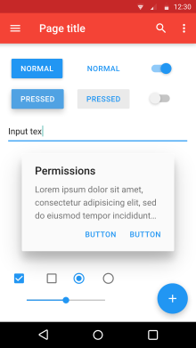

Le Material Design actuel est un guide de design particulièrement riche et cohérent que tout designer se doit de parcourir et étudier.

- [https://material.io/](https://material.io/)
- [https://fr.wikipedia.org/wiki/Material_Design](https://fr.wikipedia.org/wiki/Material_Design)

Materialize CSS est un Framework Frontend qui permet de mettre en oeuvre les grands principes du Material Design dans nos mises en page.

## **2. Installations**

Materialize comme beaucoup d'autres frameworks frontend comprend une feuille de styles CSS et un ensemble de scripts JS.

Il suffit alors d'intégrer, dans notre code HTML, cette feuille de styles CSS et ce script JS si on veut utiliser les composants interactifs. On peut les installer en distant ou en local.

### A. Installation distante via les CDN

Un CDN est un chemin absolu permettant de charger, en version distante, la feuille de styles CSS et les scripts JS de Materialize.

On trouve les liens dans la doc officielle [[https://materializecss.com/getting-started.html].](https://materializecss.com/getting-started.html].)

Il suffit alors de les intégrer dans notre code HTML en utilisant des chemins ABSOLUS !!!

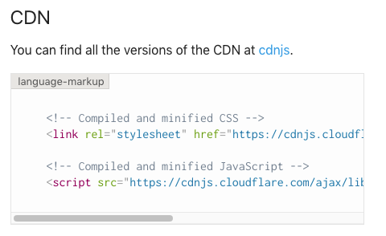

- Le CSS dans le `<head>`
- Le JS en fin de `<body>`

```html
<!DOCTYPE html>
<html lang="fr">
<head>
  <title>Titre de la page</title>

  <!-- 1. Chargement distant (CDN) du CSS de Materialize -->
  <link rel="stylesheet" href="https://cdnjs.cloudflare.com/ajax/libs/materialize/1.0.0/css/materialize.min.css">

</head>
<body>

  <!-- 2. Chargement distant (CDN) du JS de Materialize  -->
  <script src="https://cdnjs.cloudflare.com/ajax/libs/materialize/1.0.0/js/materialize.min.js"></script>
</body>
</html>
```

#### Avantages du chargement distant via les CDN

- Il est très probable que la version distante soit déjà en cache du navigateur de l'internaute car beaucoup de sites utilisent Materialize et donc le navigateur aura probablement déjà lu ce chemin absolu... Il ne devra donc pas le recharger et la page sera plus performante.
- Moins de fichiers à gérer en local

#### **Inconvénients du chargement distant via les CDN**

- Il est nécessaire d'avoir une connexion internet sinon... Pas de CSS ni de JS ! 😱
- Pas possible de customiser le framework avec SASS !!! 😩 Faut obligatoirement passer par un fichier de surcharge (on verra ça plus tard)

### B. Installation en local

Il est également possible de télécharger les fichiers CSS et JS de Materialize pour les installer en local (sur notre ordinateur). On peut choisir la version standard ou la version SASS qui va nous permettre de customiser Materialize !!! 😍

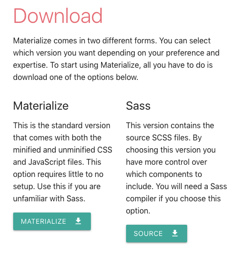

#### La version standard

On obtient un dossier nommé 'materialize' reprenant les fichiers CSS et JS en versions de développement ou de production (minifiées). Après avoir renommé le dossier, il faut y ajouter notre fichier HTML (en général à la racine du dossier).

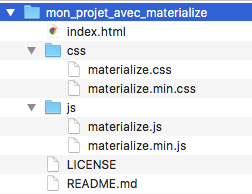

Il faut alors intégrer ces fichiers CSS et JS dans notre code HTML, mais cette fois, avec des chemins RELATIFS !!!

```html
<!DOCTYPE html>
<html lang="fr">
<head>
  <title>Titre de la page</title>

  <!-- 1. Chargement local du CSS de Materialize -->
  <link rel="stylesheet" href="css/materialize.min.css">

</head>
<body>

  <!-- 2. Chargement local du JS de Materialize  -->
  <script src="js/materialize.min.js"></script>
</body>
</html>
```

#### **La version SASS**

L'intérêt de la version SASS est qu'elle va nous permettre de customiser le framework pour l'adapter à nos besoins sans devoir trop contrarier le framework via un fichier de surcharge... (à voir plus tard...).

En téléchargeant la version SASS on obtient la structure suivante...

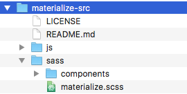

C'est dans le dossier 'components' que l'on trouve le fichier '_variables.scss' dans lequel on va pouvoir modifier les paramètres du framework et le personnaliser pour notre projet.

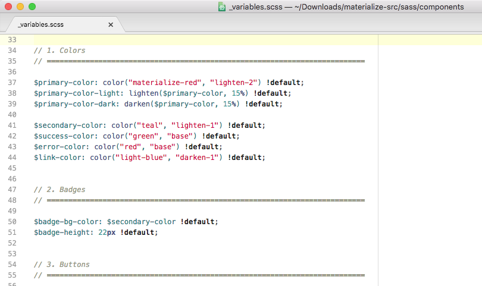

Alors évidemment il faut avoir mis en place tout l'environnement de développement permettant de travailler avec la technologie SASS (Un compilateur SASS comme Scout App ou un Bundler du genre Parcel ou mieux: viteJS...), ce qui n'est pas encore le cas... Nous verrons donc cela plus tard.

Retenons pour l'instant que cette version est une version plus professionnelle et plus souple permettant au développeur de charger et modifier comme il le souhaite les paramètres et composants du framework.

#### **Avantages du chargement local**

- Ne nécessite pas de connexion Internet une fois les fichiers téléchargés
- Possibilité d'utiliser la technologie SASS

#### **Inconvénients du chargement local**

- Le fichier local ne sera en cache du navigateur de l'Internaute qu'après avoir visité notre application
- Une structure et un environnement de travail plus complexe

## 3. Classes, composants, éléments interactifs, ...

La doc officielle est organisée autour d'un menu reprenant les classes, les composants, les formulaires, et autres éléments interactifs, ...

Il est essentiel de parcourir l'ensemble de la documentation. Je ne vais reprendre ici que quelques éléments de la doc qui permettront de comprendre la logique générale...

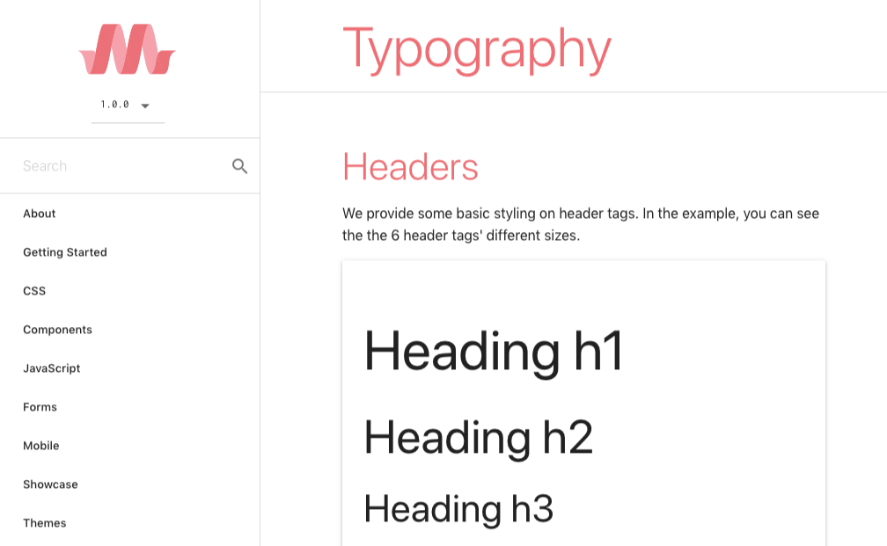

## 4. Des éléments directement mis en page

Dès qu'on a installé le CSS de Materialize, certains traitements graphiques sont déjà mis en place. C'est ainsi que la police de caractères 'Roboto' est chargée et utilisée pour le texte, et la balise &lt;nav> est automatiquement transformée en menu horizontal, ... Sans aucune modification notre code HTML.

```html
<nav>
  <ul>
    <li><a href="#">Lien 1</a></li>
    <li><a href="#">Lien 2</a></li>
    <li><a href="#">Lien 3</a></li>
  </ul>
</nav>
```

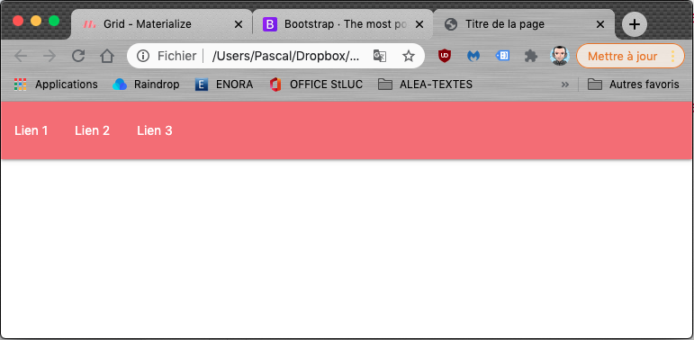

## 5. Quelques classes bien pratiques

### A. La classe 'container': une boite centrée

La classe 'container' permet de créer une boite centrée avec une largeur variant selon la largeur de l'écran.

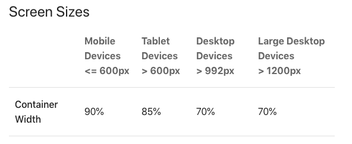

```html
<body class="container">
  <nav>
    <ul>
      <li><a href="#">Lien 1</a></li>
      <li><a href="#">Lien 2</a></li>
      <li><a href="#">Lien 3</a></li>
    </ul>
  </nav>
</body>
```

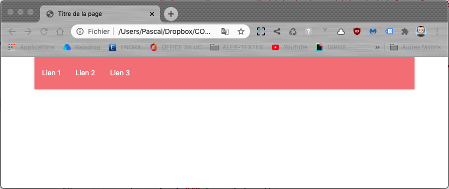

### B. La classe 'container' pour centrer et aligner le contenu des blocs

```html
<nav>
  <ul class="container">
    <li><a href="#">Lien 1</a></li>
    <li><a href="#">Lien 2</a></li>
    <li><a href="#">Lien 3</a></li>
  </ul>
</nav>
<main class="container">
  <h1>Ceci est le titre</h1>
  <p>Lorem ipsum dolor sit amet, consectetur adipisicing elit. Temporibus unde consequatur at fuga accusantium doloremque maiores amet deserunt distinctio aperiam quaerat vero, deleniti laudantium animi rem iure labore, culpa perferendis.</p>
</main>
```

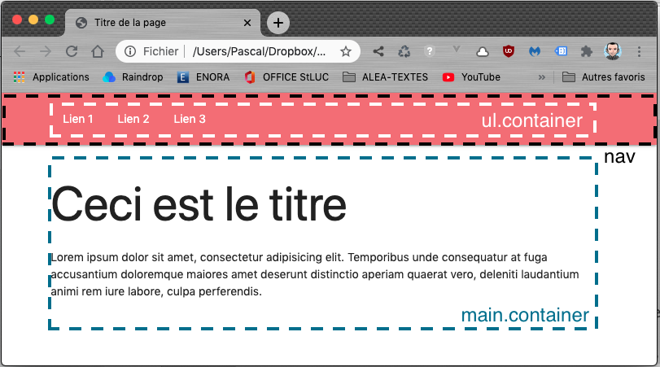

### B. Alignement des textes

[https://materializecss.com/helpers.html](https://materializecss.com/helpers.html)

```html
<h2 class="left-align">Lorem ipsum dolor.</h2>
<h2 class="right-align">Modi voluptatibus ullam.</h2>
<h2 class="center-align">Possimus sequi nam?</h2>
```

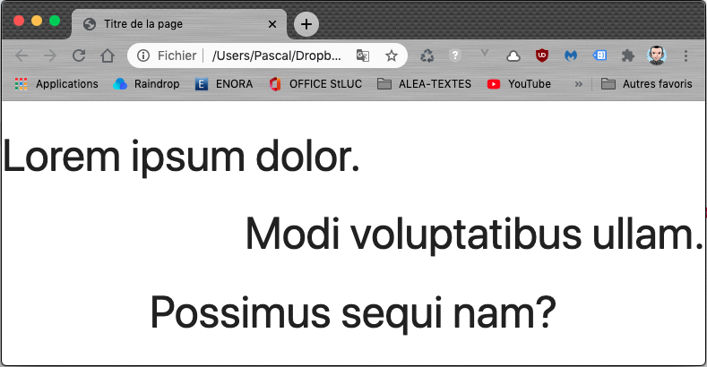

### C. Habillage des blocs

[https://materializecss.com/helpers.html](https://materializecss.com/helpers.html)

L'habillage est le fait qu'un texte entoure un bloc comme une image par exemple...

```html
<article>
  
  <h1>Lorem ipsum dolor.</h1>
  <p>Lorem ipsum dolor sit amet, consectetur adipisicing elit. Qui quas omnis dolores quasi accusantium quibusdam, amet alias maxime dolore, quia molestiae reprehenderit quam illo. Facere labore, optio adipisci dolorem ullam.</p>
  
  <p>Necessitatibus eius hic repudiandae, sit quibusdam nostrum quaerat fugit laborum aspernatur eligendi debitis perspiciatis, obcaecati voluptatibus labore quam consequatur perferendis vero nam error, architecto distinctio? Repellendus ipsum ea ab nostrum.</p>
  <p>Lorem ipsum dolor sit amet, consectetur adipisicing elit. Vitae suscipit quibusdam, odio, exercitationem ut pariatur provident facilis obcaecati distinctio magnam cumque, harum veniam quas at dolorem amet. Explicabo, iusto, doloribus!</p>
</article>
```

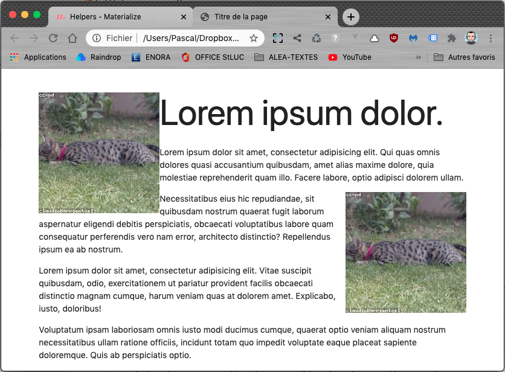

### D. Couleurs des blocs et des textes

[https://materializecss.com/color.html](https://materializecss.com/color.html)

On choisi la couleur dans la doc de Materialize et on l'utilise dans le code HTML.

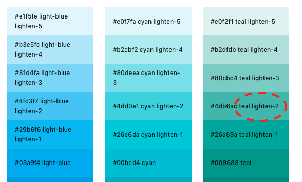

#### Couleur de fond des blocs

```html
<main class="container">
  <h1>Lorem ipsum dolor.</h1>
  <p>Lorem ipsum dolor sit amet, consectetur adipisicing elit. Eaque excepturi sint magnam laborum provident suscipit. Quidem recusandae, placeat tempora non nihil neque illo. Architecto perspiciatis voluptate voluptatum delectus deserunt nihil.</p>
</main>
<footer class="teal lighten-2">
  <div class="container">  
    &copy; IEPS 2020
  </div>
</footer>
```

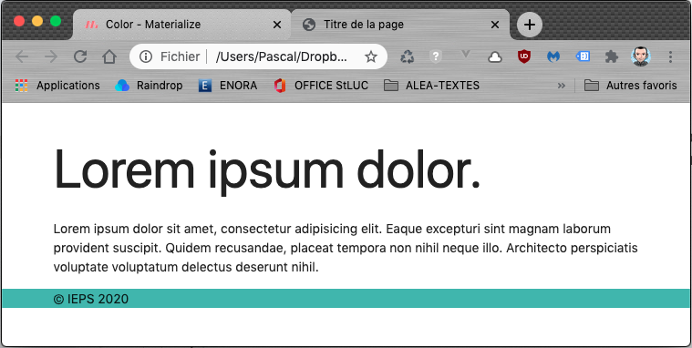

#### Couleur des textes

On choisi toujours la couleur et on met `'text-'` **derrière** le nom de la couleur et **devant** la variante...

```html
<main class="container">
  <h1 class="teal-text text-lighten-2">Lorem ipsum dolor.</h1>
</main>
```

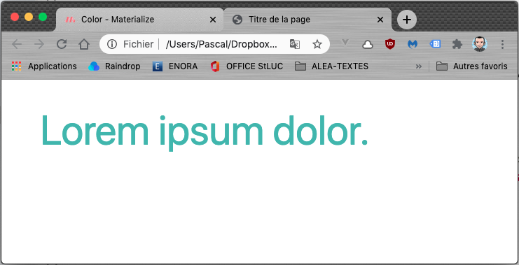

### E. La classe flow-text pour les blocs héros

```html
<p class="flow-text">Lorem ipsum dolor sit amet, consectetur adipisicing elit. Possimus odio, nemo amet, maiores recusandae tempore iure architecto earum qui voluptas ea non animi numquam quidem. Hic laborum eum sapiente nostrum!</p>
<p>Lorem ipsum dolor sit amet, consectetur adipisicing elit. Possimus odio, nemo amet, maiores recusandae tempore iure architecto earum qui voluptas ea non animi numquam quidem. Hic laborum eum sapiente nostrum!</p>
```

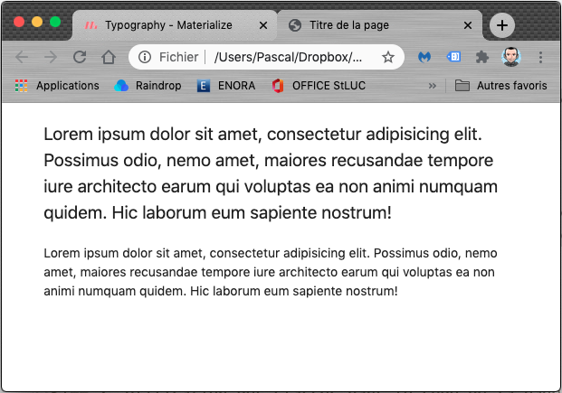

## 6. Le module de grille responsive

[https://materializecss.com/grid.html](https://materializecss.com/grid.html)

Le système de grille est toujours l'outil central d'une mise en page. La plupart des templates sont créés sur la base d'une grille, le plus souvent en 12 colonnes.

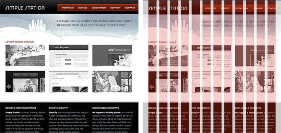

Pour réaliser la mise en page de ces templates en CSS, il faut un système de grille équivalent dans le framework. Materialize propose un système de grille très efficace.

L'idée est la suivante:

1. Une `class="row"` défini le conteneur des colonnes
2. L'attribut `class="col"` permet de dire qu'un élément va prendre un certain nombre de colonnes sur les 12.
3. Il faut définir, pour chaque élément, le nombre de colonnes qu'il prend sur les 12, et ce, pour chaque dimension de l'écran (S, M, L et XL) par une `class="col s6 m4"`.
4. Ce qui est défini pour une dimension d'écran le sera pour toutes les dimensions supérieures`class="col s6"` est équivalent à `class="col s6 m6 l6 xl6"``class="col s6 m4"` est équivalent à `class="col s6 m4 l4 xl4"``class="col s6 m4 l3"` est équivalent à `class="col s6 m4 l3 xl3"`
5. Si on ne défini pas de nombre de colonnes, l'élément prendra par défaut 1 colonnes.`class="col m6 l4"` est équivalent à `class="col s1 m6 l4"`
6. La classe `offset-s6` permet de pousser l'élément de 6 colonnes vers la gauche, comme si il y avait un élément vide de 6 colonnes avant lui...

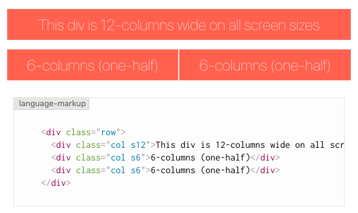

## 7. Le module des cards

[https://materializecss.com/cards.html](https://materializecss.com/cards.html)

Les cards sont très fréquentes dans les templates actuels. Materialize propose un ensemble de classes permettant de mettre en page rapidement nos cards... En général, les cards sont intégrées dans une grille car elles prennent rarement toute la largeur disponible.

Les classes principales pour les cards:

- `.card` pour le conteneur de la card
- `.card-image` pour le bloc image de la card
- `.card-content` est le conteneur secondaire
- `.card-title` pour le titre
- `.card-action` pour le footer

```html
<div class="row">
   <div class="col m4">
     <div class="card">
       <div class="card-image">
         
         <span class="card-title">Card Title</span>
       </div>
       <div class="card-content">
         <p>Lorem ipsum dolor sit amet, consectetur adipisicing elit. Commodi molestiae amet.</p>
       </div>
       <div class="card-action">
         <a href="#">This is a link</a>
       </div>
     </div>
   </div>
 </div>
```

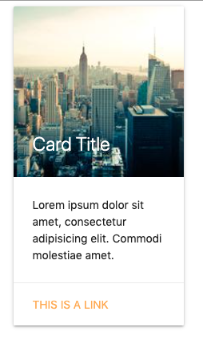

## 8. Les icônes

[https://materializecss.com/icons.html](https://materializecss.com/icons.html)

Il faut d'abord charger, dans le `<head></head>`, la polices comprenant les icônes...

```html
<head>
  ...
  <link href="https://fonts.googleapis.com/icon?family=Material+Icons" rel="stylesheet">
  ...
</head>
```

On peut alors utiliser les icônes en plaçant le code suivant: `<i class="material-icons">nom_icone</i>`

Et on trouve le nom des icônes dans la doc...

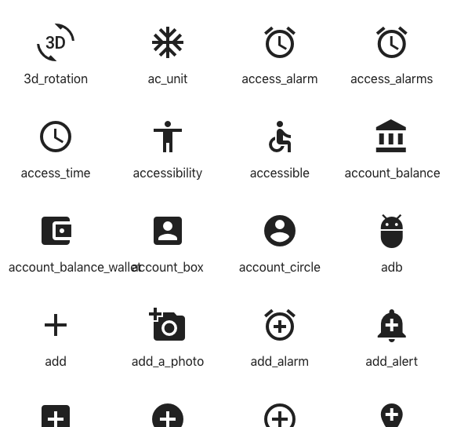

On peut également choisir la taille de l'icône...

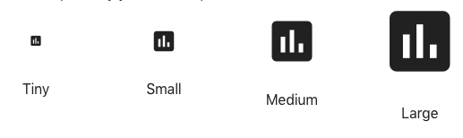

```
<i class="material-icons">add_a_photo</i>
<i class="material-icons tiny">add_a_photo</i>
<i class="material-icons small">add_a_photo</i>
<i class="material-icons medium">add_a_photo</i>
<i class="material-icons large">add_a_photo</i>
```


## 9. Le module des boutons

[https://materializecss.com/buttons.html](https://materializecss.com/buttons.html)

```html
<div>
  <a class="btn">button</a>
  <a class="btn disabled">button</a>
  <a class="btn-floating">
    <i class="material-icons">add</i>
  </a>
</div>
<div>
  <a class="btn btn-large">button</a>
  <a class="btn btn-large disabled">button</a>
  <a class="btn-floating btn-large">
    <i class="material-icons">add</i>
  </a>
</div>
```

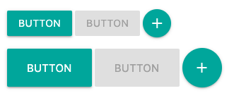

## 10. Le module des navbars

[https://materializecss.com/navbar.html](https://materializecss.com/navbar.html)

Sans entrer dans le détails de ce module très développé, le principe des navbars de Materialize se base sur une structure HTML très simple d'un `nav>ul>li>a`...

Le principe est d'y intégrer le titre principal ou le logo...

- Un `<nav>` sans classe entoure la structure
- `.nav_wrapper` pour le conteneur de la navbar
- `.brand-logo` pour le titre ou le logo
- `.active` pour identifier le lien courant

```html
<nav>
  <div class="nav-wrapper container">
    <a href="#" class="brand-logo">Logo</a>
    <ul class="right">
      <li class="active"><a href="#">Lien 1</a></li>
      <li><a href="#">Lien 2</a></li>
      <li><a href="#">Lien 3</a></li>
    </ul>
  </div>
</nav>
```

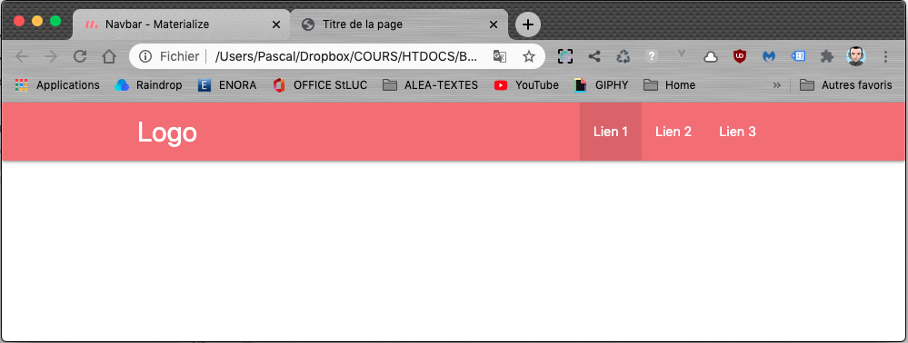

Et bien d'autres classes, modules et composants...

---

## Pour aller plus loin

- [https://materializecss.com/](https://materializecss.com/)
- [https://medium.com/@swarnakishore/getting-started-with-materialize-css-cf8548969fdb](https://medium.com/@swarnakishore/getting-started-with-materialize-css-cf8548969fdb)

```embed
title: "Framework CSS - Materialize"
image: "https://i.ytimg.com/vi/TSI1TIsAFGI/hqdefault.jpg"
description: "Vidéo YouTube · Code By Simon"
url: "https://www.youtube.com/watch?v=TSI1TIsAFGI"
favicon: ""
aspectRatio: "56.25"
```

---

## JE TE METS AU DÉFI !

### Défi 1. Le Starter Template

[Starter Template - Materialize](https://materializecss.com/templates/starter-template/preview.html)

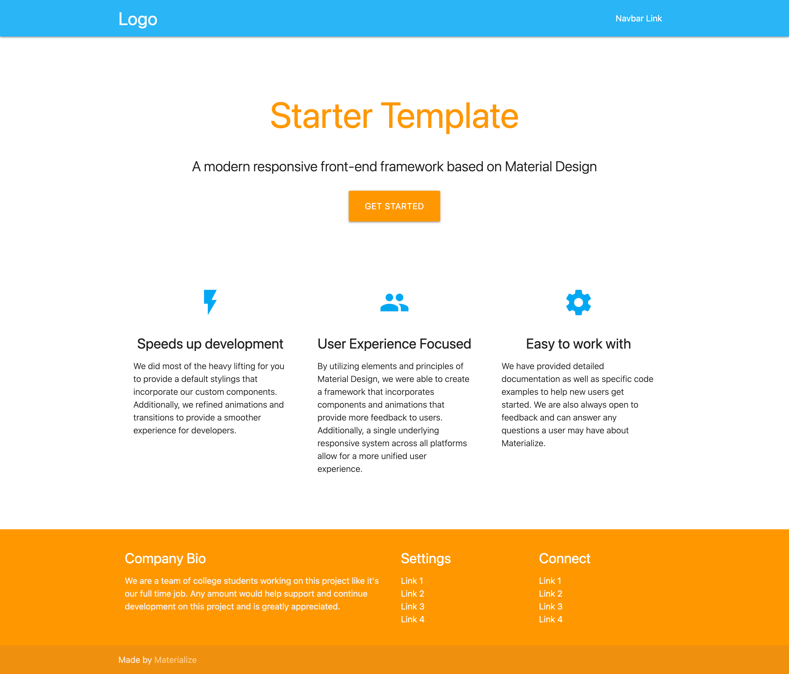

Observez le code et la mise en place des classes... Refaites cette mise en page en partant de la documentation.

📎 [materialize_starter_template.html.zip](images/ozIwAuNnwu4FRpL6.zip)

---

### Défi 2. Des articles

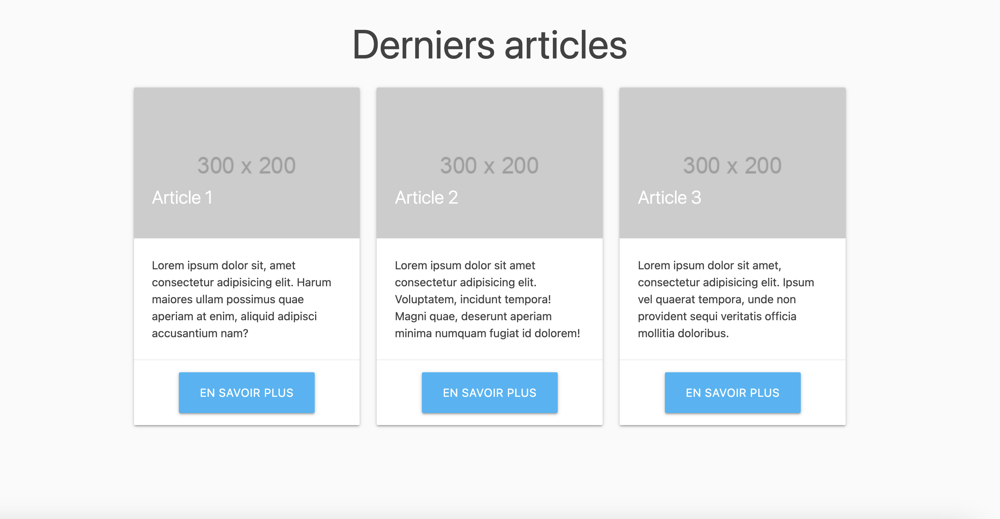

Documentation:

- CSS Grid
- CSS Color
- Component Card
- Component Button
- Les images sont des [https://via.placeholder.com/300x200](https://via.placeholder.com/300x200)

Astuces:

- Mettre les articles dans des div.col enfants directs du .row...

📎 [defi2.html.zip](images/yG9BMySa7wqhk9qs.zip)

---

### Défi 3. Un formulaire

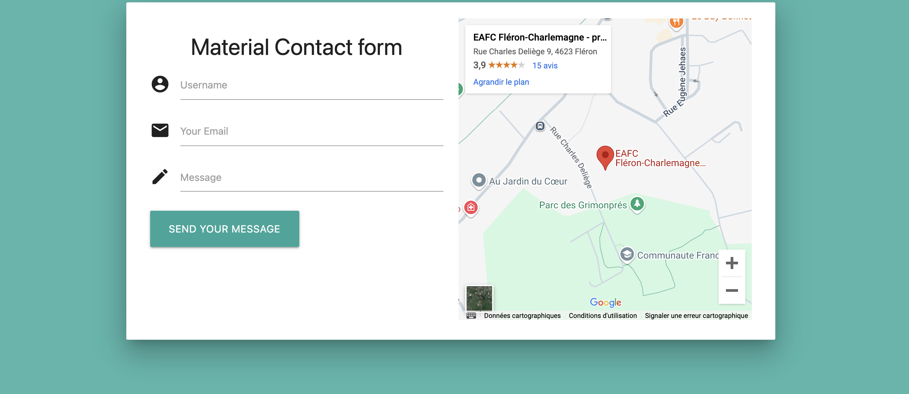

📎 [defi5_bis.html.zip](images/bGvrjLBykXdpvt3T.zip)

Documentation:

- Forms
- CSS Grid
- Components Buttons

Astuces:

- Aller sur Google Map
- Chercher l'adresse
- Partager/Intégrer une carte
- Changer la largeur (width) en 100% dans le code HTML

---

### Défi 4. Une fenêtre modale


Et quand on clique dessus:

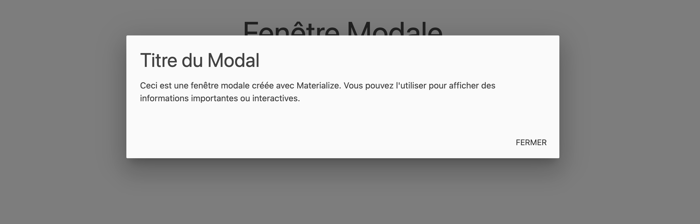

📎 [defi4.html.zip](images/4usGNAyFtOsGSeVv.zip)

Documentation:

- Javascript Modal
- Components Buttons

Astuces:

- Chargez le javascript de Materialize
- Initialisez
