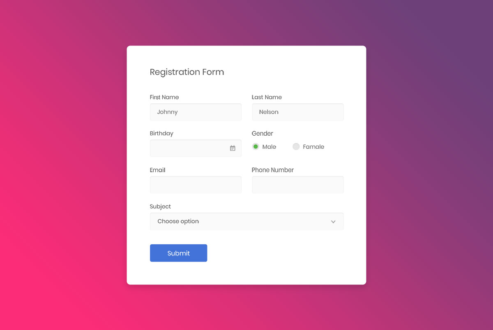
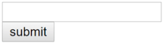
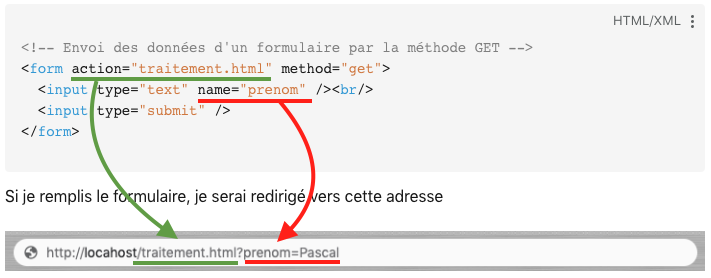

# 6-01. Le principe des formulaires HTML



## 1. La balise &lt;form>&lt;/form> pour créer le formulaire

La balise `<form></form>` permet de placer un formulaire sur une page html.

Dans cette balise `<form></form>`, on va placer des balises qui correspondent à des éléments de formulaire pour placer des champs de texte, des cases à cocher, des boutons radio, des menus déroulants, ... (la plupart des éléments de formulaire sont des `<input type="..." />`).

```html
<!-- Le niveau zéro du formulaire HTML -->
<form>
  <input type="text" /><br/>
  <input type="submit" />
</form>
```



Alors, on a bien un formulaire HTML mais là, comme ça, il ne fonctionne pas du tout ! Bouhouhou !!! 😭

## 2. Des éléments de formulaire

Pour placer des éléments dans notre formulaire, il faut utiliser les balises d'éléments de formulaire. Voir [6-03. Les Balises de formulaire](https://nimbusweb.me/ws/1gt8zmqxv4zh5oar/blVfDfbl7ubUpuvp)

La plupart des éléments de formulaire utilisent la balise `<input type="..." />`

## **3. Quatre conditions pour qu'un formulaire soit fonctionnel**

### **A. L'attribut *action=""* de la balise &lt;form> :** **Pour définir là où les données doivent être envoyées !**

L'attribut `action="..."` de la balise `<form></form>` va définir l'adresse à laquelle les informations contenues dans le formulaire vont être envoyées pour être traitées. Il peut s'agit d'un autre domaine (adresse absolue) ou d'une autre page dans notre domaine (adresse relative).

```html
<!-- Envoi des données vers une autre page de notre domaine -->
<form action="traitement.html">
   <!-- Ici viennent les éléments du fortmulaire... -->
</form>

<!-- Envoi des données vers un autre domaine (vers Paypal par exemple) -->
<form action="https://www.paypal.com/fr/cgi-bin/webscr">
   <!-- Ici viennent les éléments du formulaire... -->
</form>
```

### B. **L'attribut method de la balise &lt;form> :** **Pour définir le canal d'envoi des données envoyées**

L'attribut `method="..."` de la balise `<form></form>` permet de définir la manière avec laquelle les données vont être envoyées.

Il n'y a que 2 méthodes possibles:

- **La méthode GET :** les données sont envoyées via la barre d'URL Chaque élément de formulaire ayant un nom est transformé en variable d'URL (ou variable GET) du même nom que l'élément et avec comme valeur, la valeur de l'élément



Les variables d'URL sont séparées du nom de la page par un '?' Et si j'ai plusieurs variables d'URL envoyées, elles sont séparées par un '&'.`[http://www/monsite.be/traitement.html**?varviable1=valeur1&variable2=valeur2&...**](http://www/monsite.be/traitement.html?varviable1=valeur1&variable2=valeur2&...)`

- **La méthode POST :** les données sont envoyées via un paquet attaché qui arrivera au serveur mais dont on ne verra nulle part le contenu
- **GET ou POST ?**
        - **La méthode GET:**
                - Peut être mis en cache du navigateur
                - Peut rester dans l'historique du navigateur
                - Peut être mis en favoris ou bookmarké
                - Ne pas utiliser pour des données sensibles !!! (mot de passe, cartes de crédit, ...)
                - Max 256 caractères !!!
                - A utiliser seulement pour aller chercher des infos (dans la DB, ...), pour transmettre des infos à des services nécessitant des ressources (moteur de recherche, page/détails, ...)
        - **La méthode POST**
                - Ne peut être mises en cache du navigateur
                - N'apparaissent pas dans l'historique du navigateur
                - Ne peuvent être bookmarkées ou mises en favoris
                - A utiliser pour envoyer des données vers le serveur (ajouter des infos dans la DB, transmettre des données sensibles, données perso, ...)
                - Pas de limitation de taille

### **C. Un attribut name pour chaque élément devant être envoyé**

Lorsque l'on place des éléments dans notre formulaire (des champs de texte, des cases à cocher, des menus déroulants, ...), il faut savoir que ne seront envoyés avec les formulaire QUE les éléments qui porte un nom (un attribut name)

```html
<form action="traitement.php" method="get">
  <input type="text" name="nom" />      <!-- Envoyé -->
  <input type="text" name="prenom" />	<!-- Envoyé -->
  <input type="submit" />		<!-- Pas envoyé -->
</form>
```

### D. Une 'value' pour chaque élément devant être envoyé

Là, il faut bien comprendre le truc...

### **E. Un bouton submit** pour que le formulaire puisse être envoyé

```html
<form action="traitement.php" method="get">
  <input type="text" name="nom" />     
  <input type="text" name="prenom" />
  <input type="submit" />		<!-- OBLIGATOIRE -->
</form>
```

---

## 4. Exemple de formulaire basique mais fonctionnel

```html
<form action="traitement.php" method="get">
  <input type="text" name="nom" />
  <input type="text" name="prenom" />
  <input type="submit" />
</form>
```
