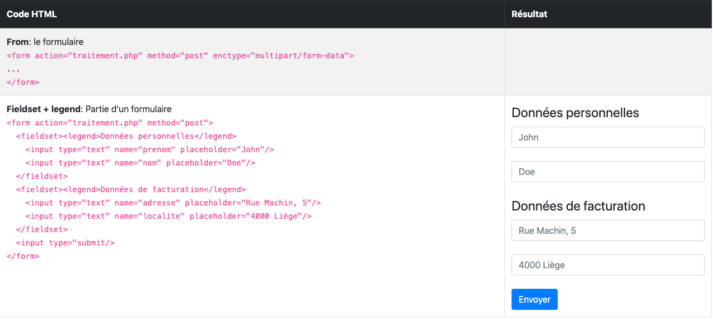
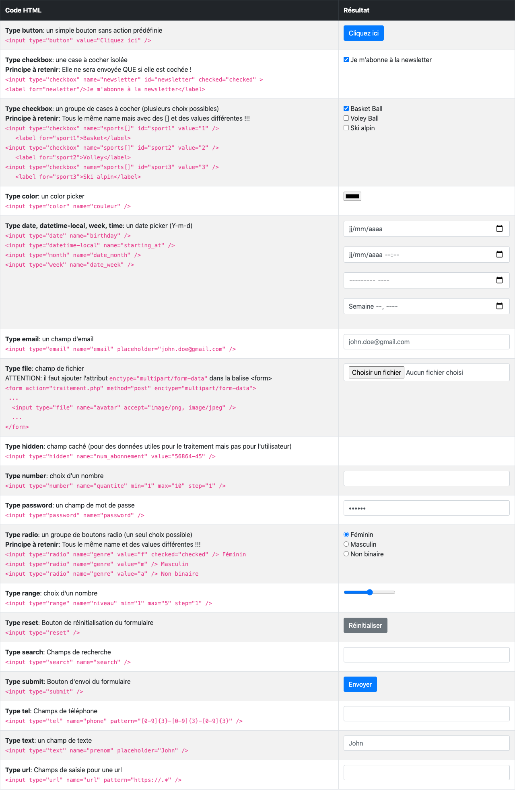
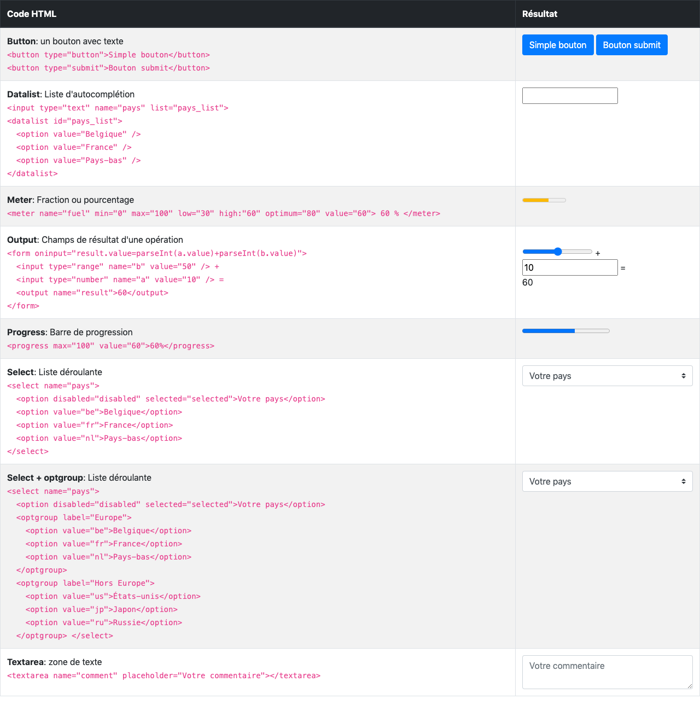

# 6-03. Les Balises de formulaire

## 1. Balises générales

## 2. Les inputs

## 3. Les autres éléments de formulaire

---

## 4. RÉFÉRENCES - Pour aller plus loin

- [Référence des éléments HTML](https://developer.mozilla.org/fr/docs/Web/HTML/Element#Formulaires)
- [https://htmlreference.io/forms/](https://htmlreference.io/forms/)
- [HTML Forms](https://www.w3schools.com/html/html_forms.asp)
