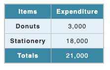
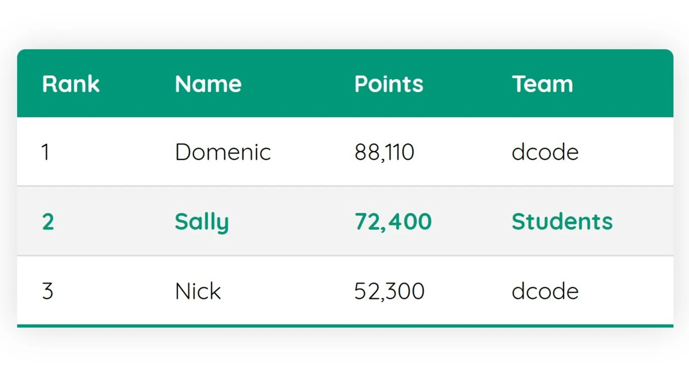
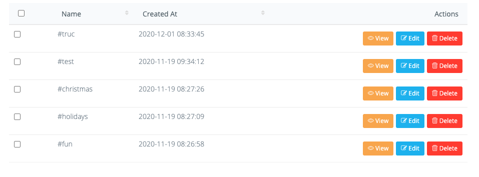

# 7-01 Les tableaux HTML

## 1. Les balises des tableaux

- `<table></table>`: Pour placer un tableau
    - `<caption></caption>`: légende du tableau
    - `<thead></thead>`: entête du tableau
        - `<tr></tr>`: nouvelle ligne de cellules
        - `<th>...</th>`: cellule de titreL'attribut scope permet de définir la portée de ce titre (col ou row)
        - `<td></td>`: cellule de contenu
    - `<tbody></tbody>`: corps du tableau
        - `<tr></tr>`: nouvelle ligne de cellules
        - `<th></th>`: cellule de titreL'attribut scope permet de définir la portée de ce titre (col ou row)
        - `<td></td>`: cellule de contenu
    - `<tfoot></tfoot>`: pied du tableau
        - `<tr></tr>`: nouvelle ligne de cellules
        - `<th></th>`: cellule de titreL'attribut scope permet de définir la portée de ce titre (col ou row)
        - `<td></td>`: cellule de contenu

## 2. Mise en place d'un tableau

```html
<table>
  <caption>He-Man and Skeletor facts</caption>
  <thead>
    <tr>
      <th>Items</th>
      <th scope="col">Expenditure</th>
    </tr>
  </thead>
  <tbody>
    <tr>
      <th scope="row">Donuts</th>
      <td>3,000</td>
    </tr>
    <tr>
      <th scope="row">Stationery</th>
      <td>18,000</td>
    </tr>
  </tbody>
  <tfoot>
    <tr>
      <th scope="row">Totals</th>
      <td>21,000</td>
    </tr>
  </tfoot>
</table>
```



## Pour aller plus loin

[Référence des éléments HTML](https://developer.mozilla.org/fr/docs/Web/HTML/Element#Contenu_tabulaire)

---

## EXERCICES





