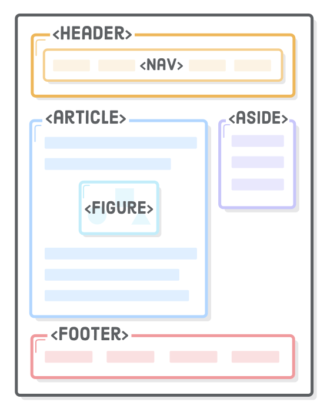

# 8-01. Balises pour les éléments multimédia

## 1. Intégration d'éléments multimédia

Pour aller plus loin: [Référence des éléments HTML - HTML (HyperText Markup Language) | MDN](https://developer.mozilla.org/fr/docs/Web/HTML/Element)

|  |  | Balises | Attributs | Sémantique | Exemples |
|---|---|---|---|---|---|
| 1 |  | `<audio src=""></audio>` | `autoplay``controls``loop``muted``src` | Intégration d'un fichier audio | `<figure>` `<figcaption>Arrgh - Mt Mountain</figcaption>` `<audio controls src="audio/arrrgh.mp3">` `Votre navigateur ne supporte pas la balise audio` `</audio>``</figure>` |
| 2 |  | `<audio>` `<source src="" type="" />``</audio>` | `autoplay``controls``loop``muted``src` | Intégration d'un fichier audio avec alternatives de formats | `<audio controls autoplay>` `<source src="audio/arrrgh.mp3``" type="audio/mpeg" />` `<source src="audio/arrrgh.ogg" type="audio/ogg" />` `<p>Votre navigateur ne supporte pas la balise audio</p>``</audio>` |
| 3 |  | `` | `alt``src``srcset``sizes` | Intégration d'un fichier image (GIF, JPG, PNG, SVG, ...) | `<figure>` `` `` `<figcaption>Paysages alpins</figcaption>``</figure>` |
| 4 |  | `<track></track>` | `default``kind``label``src``srclang` | Intégration de sous-titres pour les balises &lt;audio> et &lt;video> | `<video controls src="videos/friday.mp4">` `<track default kind="captions" srclang="fr" src="vtt/test.vtt" />` `Sorry, your browser doesn't support embedded videos.``</video>` |
| 5 |  | `<video src=""></video>` | `autoplay``controls``loop``muted``poster``src` | Intégration d'un fichier vidéo | `<figure>` `<figcaption>Arrgh - Mt Mountain</figcaption>` `<video controls src="video/arrrgh.mp4">` `Votre navigateur ne supporte pas la balise video` `</video>``</figure>` |
| 6 |  | `<video>` `<source src=""` `type="">` `<source src="" type="">``</video>` | `autoplay``controls``loop``muted``poster``src` | Intégration d'un fichier vidéo avec alternatives de formats | `<video controls>` `<source src="videos/flower.webm"` `type="video/webm">` `<source src="videos/flower.mp4"` `type="video/mp4">` `Sorry, your browser doesn't support embedded videos.``</video>` |
|  |  | All:6 | All:6 | All:6 | All:6 |

## 2. Le cas particulier des images

### A. Dans le code HTML ou dans le code CSS ?

Intégrer une image dans une page web peut se faire de trois manières:

1. Avec la balise ``. Le fichier image est alors indexé par Google
2. Avec les CSS, on peut mettre une image en `background` d'une balise. Le fichier image n'est alors pas indexée par Google
3. Avec la balise `<i></i>` et un `background` en CSSLe fichier image n'est alors pas indexée par Google

### B. Comment allons-nous choisir l'une ou l'autre méthode ?

- Si l'image DOIT ou PEUT être indéxée par Google, alors, on choisi la balise ``Ce sera le cas des logos, des images qui font partie du contenu, qui amènent une information, auxquelles on sait ce qu'on doit mettre dans le `'alt'` et que cet attribut `'alt'` doit être indexé par Google.
- Si l'image NE DOIT PAS être indexée par Google, alors on choisi le `background` CSSCe sera le cas des images de fond, des textures et autres images sans contenu informatif, juste là pour la déco.
- S'il s'agit d'une icône, alors on utilise la balise `<i></i>` avec un `background` en CSS`<i class="icon icon-home"></i>`

## 3. Les figures

[https://developer.mozilla.org/fr/docs/Web/HTML/Element/figure](https://developer.mozilla.org/fr/docs/Web/HTML/Element/figure)

Une figure est un élément qui illustre un contenu. Une figure a une légende. Une figure contient un ou plusieurs éléments multimédia (texte, image, vidéo, diagram, audio, ...) avec une légende en commun. Elle illustre un contenu principal.



```html
<!-- Figure avec une seule image -->
<figure>
    
    <figcaption>Un groupe d'éléphants d'Afrique</figcaption>
</figure>

<!-- Figure avec plusieurs médias -->
<figure>
    
    <video src="videos/elephant1.mp4"></video>
    <figcaption>L'éléphant d'Afrique</figcaption>
</figure>

<!-- Figure avec une citation -->
<figure>
   <figcaption>
     <cite>Edsger Dijkstra</cite>
   </figcaption>
   <q>« Si le débogage correspond au retrait de bogues, 
      alors la programmation correspond à l'ajout de bogues. »</q>
</figure>
```

---

## POUR ALLER PLUS LOIN...

- [https://developer.mozilla.org/fr/docs/Web/HTML/Element](https://developer.mozilla.org/fr/docs/Web/HTML/Element)
