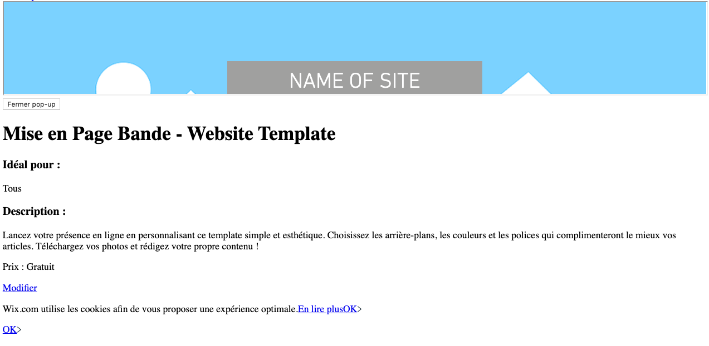
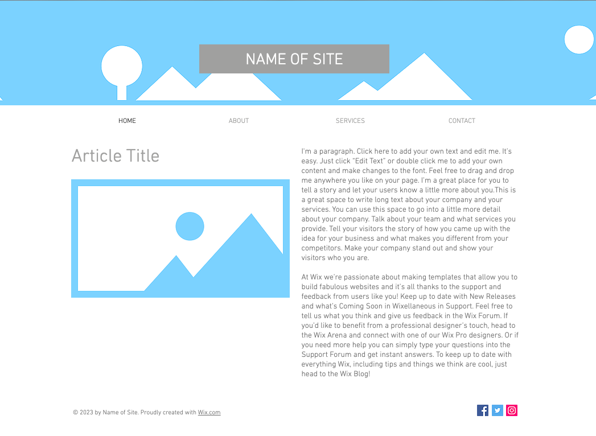

# 9-01. Les CSS... À quoi ça sert ?

## **1.** La mise en page

Le rôle des CSS est de mettre les éléments HTML en forme:

    - Définir leur position
    - Définir leurs caractéristiques graphiques (taille, couleurs, ...)

*Sans CSS*

*Avec CSS*

## 2. Des animations et des transitions

Les CSS permettent également de définir des animations d'éléments ou des transitions lorsque l'on passe la souris dessus, ...

<video src="images/S6QnQ9vZyPBNCCsf.mp4" autoplay loop muted playsinline controls></video>

<video src="images/X3tkG23Jr6jTr19p.mp4" autoplay loop muted playsinline controls></video>
