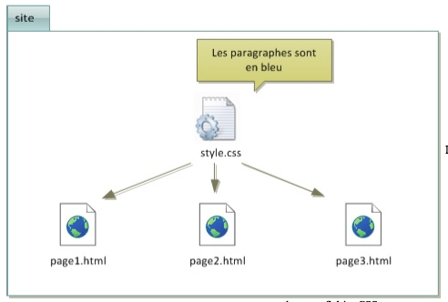

# 9-02. Trois endroits où placer le code CSS

---

1. Directement dans les balises HTML
2. Dans la partie &lt;head>&lt;/head>
3. Dans un fichier CSS externe
4. Afficher le code source de la page
5. EXERCICE

---

## 1. Directement dans les balises HTML

- On utilise alors l'attribut HTML `style="..."`
- Déconseillé

```html
<p style="...">...</p>
```

## **2. Dans la partie &lt;head>&lt;/head>**

- Ce sont les feuilles de style internes
- On utilise la balise `<style>...</style>` dans la partie `<head>...</head>`
- Déconseillé dans le cadre d'un site web complet
- OK pour un exercice isolé en classe

```html
<!doctype html>
<html>
  <head>
    <!-- ... -->
    <style>
      /* on place les styles ici */
    </style>
  </head>
  <body>
     <!-- ... -->
  </body>
</html>
```

## **3. Dans un fichier CSS externe**

- Ce sont les feuilles de style externes
- On utilise la balise `<link />` dans la partie `<head>...</head>` pour faire le lien avec ce fichier CSS
- **Vivement conseillé dans le cadre d'un site web complet**
- La feuille de style s'applique alors à tous les fichiers HTML du site qui sont liés à cette feuille de styles.



```html
<!doctype html>
<html>
  <head>
    <!-- ... -->
    <link rel="stylesheet" href="chemin vers le ficher CSS" />
  </head>
  <body>
     <!-- ... -->
  </body>
</html>
```

---

## EXERCICES

- [https://www.w3schools.com/css/exercise.asp?filename=exercise_howto1](https://www.w3schools.com/css/exercise.asp?filename=exercise_howto1)
