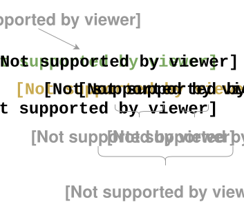

# 9-03. Anatomie d'une règle de styles

---

1. Un ou plusieurs sélecteur(s)
2. Une ou plusieurs déclaration(s)
    1. La propriété à modifier
    2. La valeur attribuée
3. EXERCICES

---



## **1. Un ou plusieurs sélecteur(s)**

Le ou les sélecteurs permettent de définir à quels objets du document vont s'appliquer les déclarations. S'il y a plusieurs sélecteurs, on va les séparer par des virgules.

```css
p, div {
  color: red;
}
```

## **2. Une ou plusieurs déclaration(s**)

Chaque déclaration se termine par un ';' et est constituée de 2 parties :

### A. La **propriété à modifier**

Les propriétés de style sont les caractéristiques que nous pouvons modifier. La liste est nombreuse et est disponible ici: [Référence CSS - CSS : Feuilles de style en cascade | MDN](https://developer.mozilla.org/fr/docs/Web/CSS/Reference)

### B. La **valeur attribuée**

Chaque propriété accepte un certain type de valeur. En mettant une nouvelle valeur à une propriété, on affecte la mise en page de l'élément.

---

## EXERCICES

Créez un fichier ex1.html avec le code suivant:

```html
<!DOCTYPE html>
<html lang="en">
  <head>
    <meta charset="UTF-8">
    <title>Titre du document</title>
  </head>
  <body>

    <!-- Chargez le fichier externe css/ex1.css
         et faites en sorte que les titre h1 et h2 soient
         en rouge (propriété color, valeur red) -->

    <h1>Titre du document</h1>
    <h2>Sous-titre du document</h2>
    <p>Lorem ipsum ...</p>

  </body>
  </html>
```

Chargez le fichier externe css/ex1.css et faites en sorte que les titre h1 et h2 soient en rouge (propriété color, valeur red)

---

## RÉFÉRENCES

- [Référence CSS - CSS : Feuilles de style en cascade | MDN](https://developer.mozilla.org/fr/docs/Web/CSS/Reference)
- [CSS Reference](https://www.w3schools.com/cssref/)
- [Liste des propriété CSS - Référence CSS - Pierre Giraud](https://www.pierre-giraud.com/liste-propriete-css-reference/)
- [Propriétés par ordre alphabétique](http://www.css-faciles.com/proprietes-css-liste-alphabetique.php)
