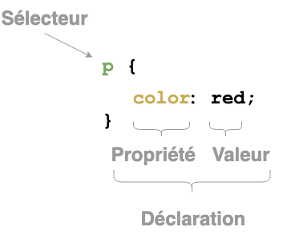

# 10-01. Des sélecteurs CSS ? Pour quoi faire ?

---

1. Du code CSS directement dans les balises
2. Mais ça va vite être le bordel !
3. Des sélecteurs css pour attraper les éléments à maquiller
4. Va donc falloir bien connaître ces sélecteurs
5. RÉFÉRENCES

---

## **1.** Du code CSS directement dans les balises

On peut placer du code CSS directement dans les balises avec l'attribut HTML `style=""`

```html
<p style="color: red;">Lorem ipsum ...</p>
```

## 2. Mais ça va vite être le bordel !

Ce n'est pas une bonne idée de metre tou le code CS dans les balises HTML car ça va vite devenir difficile de s'y retrouver dans le code si tout est mélangé... 😬

Donc, on va placer le code CSS en dehors des balises,

- Soit dans l'entête du document avec la balise `<style>...</style>`
- Soit dans un fichier CSS externe que l'on lie avec `<link rel="stylesheet" href="..." />`

Mais le problème, c'est que dès le moment où les déclarations CSS ne sont plus dans les balises, il va falloir dire au navigateur à quelles balises il faut les appliquer! 🤔

## 3. Des sélecteurs CSS pour attraper les éléments à maquiller

C'est grâce aux sélecteurs CSS que l'on va pouvoir dire à quels éléments s'appliquent les déclarations, et la structure d'une règle CSS sera donc la suivante



## 4. Va donc falloir bien connaître ces sélecteurs

Ben oui... C'est parti ! 😀

---

## **RÉFÉRENCES**

- [Référence CSS - CSS : Feuilles de style en cascade | MDN](https://developer.mozilla.org/fr/docs/Web/CSS/Reference#s%C3%A9lecteurs)
- [CSS3 module: W3C Selectors](https://www.w3.org/Style/css3-selectors-updates/WD-css3-selectors-20010126.fr.html)
- [CSS Selectors Reference](https://www.w3schools.com/cssref/css_selectors.asp)
- [Sélecteurs CSS (simples et complexes) - Liste et utilisation - Pierre Giraud](https://www.pierre-giraud.com/liste-selecteurs-css-utilisation/)
