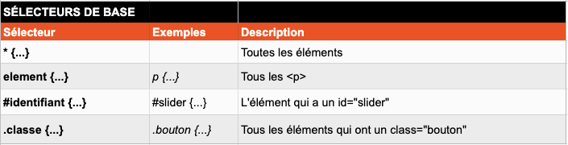

# 10-02. Trois types de sélecteurs CSS

---

1. Sélectionner des balises HTML
2. Sélectionner des objets identifiés par un id
3. Sélectionner des objets via une étiquette de style
4. Un sélecteur global
5. EXERCICES
6. Pour aller plus loin
7. RÉFÉRENCES

---



h

```html
<header>
<header>
  <h1>My E-shop</h1>
  <h2>With wonderfull products</h2>
  <nav id="menuPrincipal">
    <ul>
      <li class="actif"><a href="#">Home</a></li>
      <li><a href="#">Products</a></li>
      <li><a href="#">Contacts</a></li>
    </ul>
  </nav>
</header>
```

## 1. Sélectionner des balises HTML

```css
/* 1. Selectionner des balises -------------------------- */
/* Toutes les balises de type h1 */
  h1 {
    color: red;
  }

/* Toutes les balises de type a */
  a {
    color: green;
  }
```

## 2. Sélectionner des objets identifiés par un id

```css
/* 2. Selectionner des objets identifiés ---------------- */
/* L'élement avec l'identifiant #menuPrincipal */
  #menuPrincipal {
    background: blue;
  }
```

## 3. Sélectionner des objets via une étiquette de style

```css
/* 3. Selectionner des objets avec une classe ------------- */
/* Tous les élements avec la classe 'actif' */
  .actif {
    background: green;
  }
```

## 4. Un sélecteur global

```css
/* Tous les éléments */
  * {
    background: orange;
  }
```

---

## JE TE METS AU DÉFI

Créez un document HTML avec le code suivant et complétez la partie des styles

```html
<!DOCTYPE html>
<html lang="en">
<head>
  <meta charset="UTF-8">
  <meta name="viewport" content="width=device-width, initial-scale=1.0">
  <meta http-equiv="X-UA-Compatible" content="ie=edge">
  <title>Trois types de sélecteurs</title>
  <style>
    /* 1. Mettez un fond gris clair et la police de caractère Verdana au body */
    /* 2. Mettez un fond rouge à tous les h2 */
    /* 3. Mettez un fond orange à l'objet qui porte l'identifiant 'sectionPrincipale' */
    /* 4. Mettez une taille de police de 1.5em aux éléments qui ont une classe 'prime' */
    /* 5. Mettez un fond orange et une couleur de police en blanc aux éléments qui ont une classe 'active' */
    /* 6. BONUS: supprimer le soulignement de tous les liens  */
  </style>
</head>
<body>
  <section id="sectionPrincipale">
    <h1>Atelier 1</h1>
    <h2>Trois types de sélecteurs</h2>
    <nav>
      <ul>
        <li class="active"><a href="#">Accueil</a></li>
        <li><a href="#">Notre équipe</a></li>
        <li><a href="#">Contact</a></li>
      </ul>
    </nav>
    <article>
      <h1>Titre de l'article</h1>
      <h2>Sous-titre de l'article</h2>
      <p class="prime">Lorem ipsum dolor sit amet, consectetur adipisicing elit. 
         Nobis rem iste, soluta, vitae expedita id debitis totam dolor 
         cupiditate pariatur molestiae aut, culpa voluptate sapiente illum 
         maxime dicta quibusdam eos.</p>
      <p>Lorem ipsum dolor sit amet, consectetur adipisicing elit. 
         Nobis rem iste, soluta, vitae expedita id debitis totam dolor 
         cupiditate pariatur molestiae aut, culpa voluptate sapiente illum 
         maxime dicta quibusdam eos.</p>
    </article>
  </section>
</body>
</html>
```

- Vous trouverez les propriétés ici: [CSS Reference](https://www.w3schools.com/cssref/)
- Voici un petit mémento bien pratique

📎 [MÉMENTOS CSS - MÉMENTO DES PRINCIPALES PROPRIÉTÉS CSS.pdf](images/7nvehsLng1LpRZh8.pdf)

---

## Pour aller plus loin

- [Coding Games and Programming Challenges to Code Better](https://www.codingame.com/playgrounds/36092/exercices-css/base-css)

---

## **RÉFÉRENCES**

- [Référence CSS - CSS : Feuilles de style en cascade | MDN](https://developer.mozilla.org/fr/docs/Web/CSS/Reference#s%C3%A9lecteurs)
- [CSS3 module: W3C Selectors](https://www.w3.org/Style/css3-selectors-updates/WD-css3-selectors-20010126.fr.html)
- [CSS Selectors Reference](https://www.w3schools.com/cssref/css_selectors.asp)
- [Sélecteurs CSS (simples et complexes) - Liste et utilisation - Pierre Giraud](https://www.pierre-giraud.com/liste-selecteurs-css-utilisation/)
