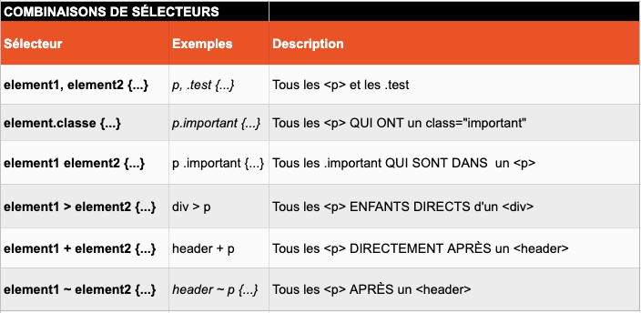

# 10-03. Combiner les sélecteurs CSS

---

1. Sélectionner des balises HTML
2. Sélectionner des objets identifiés par un id
3. Sélectionner des objets via une étiquette de style
4. Un sélecteur global
5. EXERCICES
6. Pour aller plus loin
7. RÉFÉRENCES

---



---

## JE TE METS AU DÉFI

Créez un document HTML avec le code suivant et complétez la partie des styles

```html
<!DOCTYPE html>
<html lang="en">
<head>
  <meta charset="UTF-8">
  <meta name="viewport" content="width=device-width, initial-scale=1.0">
  <meta http-equiv="X-UA-Compatible" content="ie=edge">
  <title>Atelier 2 - Combiner les sélecteurs</title>
  <style>
    /* 1. Mettez un fond rouge et une police blanche aux headers des articles  */
    /* 2. Mettez un fond vert et une police blanche aux headers enfants directs du body */
    /* 3. Mettez une taille de police de 1.5em aux paragraphes avec une classe prime qui sont dans les articles */
    /* 4. Mettez en gris clair la police des paragraphes qui suivent directement un .prime */
    /* 5. Mettez un fond gris clair aux articles qui ont une classe 'new' */
    /* 6. Mettez une couleur de police rouge aux liens qui sont dans un article 'new' */
    /* 7. Mettez une couleur de police verte aux liens qui sont dans une .prime et aux liens actifs */
    /* 8. Mettez en cyan les liens qui sont dans des paragraphes après un .prime */
  </style>
</head>
<body>
  <header>
    <h1>Atelier 2</h1>
    <h2>Combiner les sélecteurs</h2>
    <nav>
      <ul>
        <li><a href="#">Home</a></li>
        <li class="active"><a href="#">Blog</a></li>
        <li><a href="#">Contacts</a></li>
      </ul>
    </nav>
  </header>
  <main>
    <article class="new">
      <header>
        <h1>Titre de l'article 1</h1>
        <h2>Sous-titre de l'article 1</h2>
      </header>
      <p class="prime">Lorem ipsum dolor sit amet, consectetur adipisicing elit. 
         Nobis rem iste, soluta, vitae expedita id debitis totam dolor 
        cupiditate pariatur molestiae aut, <a href="#">culpa voluptate</a> sapiente illum 
         maxime dicta quibusdam eos.</p>
      <p>Lorem ipsum dolor sit amet, consectetur adipisicing elit. 
         Nobis rem iste, soluta, vitae expedita id debitis totam dolor 
         cupiditate pariatur molestiae aut, <a href="#">culpa voluptate</a> sapiente illum 
         maxime dicta quibusdam eos.</p>
    </article>
    <article>
      <header>
        <h1>Titre de l'article 2</h1>
        <h2>Sous-titre de l'article 2</h2>
      </header>
      <p class="prime">Lorem ipsum dolor sit amet, consectetur adipisicing elit. 
         Nobis rem iste, soluta, vitae expedita id debitis totam dolor 
         cupiditate pariatur molestiae aut, <a href="#">culpa voluptate</a> sapiente illum 
         maxime dicta quibusdam eos.</p>
      <p>Lorem ipsum dolor sit amet, consectetur adipisicing elit. 
         Nobis rem iste, soluta, vitae expedita id debitis totam dolor 
         cupiditate pariatur molestiae aut, <a href="#">culpa voluptate</a> sapiente illum 
         maxime dicta quibusdam eos.</p>
    </article>
  </main>
</body>
</html>
```

---

## Autres exercices

- [https://codepen.io/pascallllacroix/full/oNMLLMG](https://codepen.io/pascallllacroix/full/oNMLLMG)
- [https://www.w3schools.com/css/exercise.asp?filename=exercise_combinators1](https://www.w3schools.com/css/exercise.asp?filename=exercise_combinators1)
- [CSS Diner - Where we feast on CSS Selectors!](https://flukeout.github.io/)
- [Coding Games and Programming Challenges to Code Better](https://www.codingame.com/playgrounds/36092/exercices-css/selecteurs)

---

## **RÉFÉRENCES**

- [Référence CSS - CSS : Feuilles de style en cascade | MDN](https://developer.mozilla.org/fr/docs/Web/CSS/Reference#s%C3%A9lecteurs)
- [CSS3 module: W3C Selectors](https://www.w3.org/Style/css3-selectors-updates/WD-css3-selectors-20010126.fr.html)
- [CSS Selectors Reference](https://www.w3schools.com/cssref/css_selectors.asp)
- [Sélecteurs CSS (simples et complexes) - Liste et utilisation - Pierre Giraud](https://www.pierre-giraud.com/liste-selecteurs-css-utilisation/)
