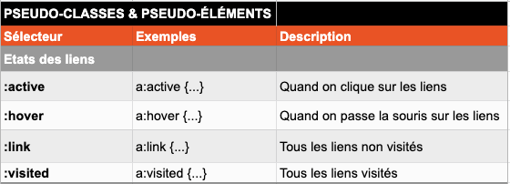

# 10-04. Les pseudo-classes pour les liens

---

1. EXERCICES
2. Pour aller plus loin
3. RÉFÉRENCES

---



## JE TE METS AU DÉFI

Créez un document HTML avec le code suivant et complétez la partie des styles

```html
<!DOCTYPE html>
<html lang="en">
<head>
  <meta charset="UTF-8">
  <meta name="viewport" content="width=device-width, initial-scale=1.0">
  <meta http-equiv="X-UA-Compatible" content="ie=edge">
  <title>Pseudo-classes pour les liens</title>
  <style>
    /* 1. Mettez un fond gris foncé (#333) et une couleur blanche pour les liens des .menu  */
    /* 2. Mettez un fond orange aux liens des li avec une classe 'active' des .menu et aux liens des .menu lorsque l'on passe la souris dessus */
    /* 3. Mettez un fond rouge aux liens des .menu quand on clique dessus */
    /* 4. Mettez un fond gris plus clair (#666) aux liens déjà visités des .menu */
  </style>
</head>
<body>
  <header>
    <h1>Ateliers CSS</h1>
    <h2>Pseudo-classes pour les liens</h2>
    <nav>
      <ul class="menu">
        <li><a href="#">Home</a></li>
        <li class="active"><a href="#">Blog</a></li>
        <li><a href="#">Contacts</a></li>
      </ul>
    </nav>
  </header>
</body>
</html>
```

## Autres exercices:

- [https://www.w3schools.com/css/exercise.asp?filename=exercise_pseudo_classes1](https://www.w3schools.com/css/exercise.asp?filename=exercise_pseudo_classes1)

---

## **Pour aller plus loin**

- [Base CSS - Exercices CSS](https://www.codingame.com/playgrounds/36092/exercices-css/base-css)

---

## **RÉFÉRENCES**

- [Référence CSS - CSS : Feuilles de style en cascade | MDN](https://developer.mozilla.org/fr/docs/Web/CSS/Reference#s%C3%A9lecteurs)
- [CSS3 module: W3C Selectors](https://www.w3.org/Style/css3-selectors-updates/WD-css3-selectors-20010126.fr.html)
- [CSS Selectors Reference](https://www.w3schools.com/cssref/css_selectors.asp)
- [Sélecteurs CSS (simples et complexes) - Liste et utilisation - Pierre Giraud](https://www.pierre-giraud.com/liste-selecteurs-css-utilisation/)
