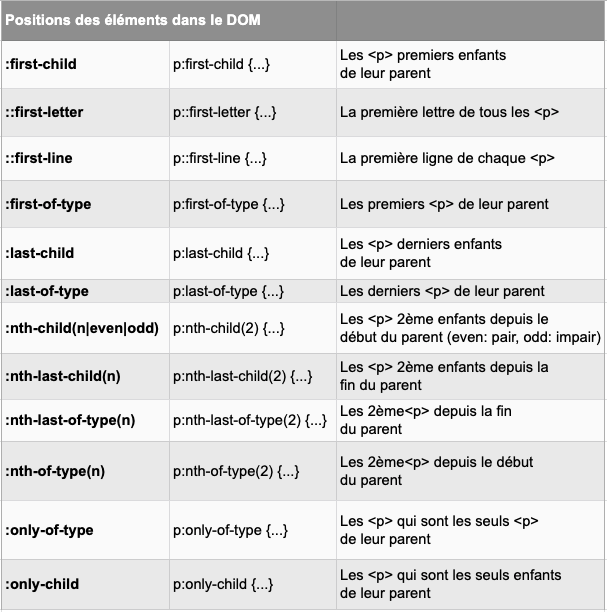

# 10-05. Les pseudo-classes de position

---

1. EXERCICES
2. Pour aller plus loin
3. RÉFÉRENCES

---



## JE TE METS AU DÉFI

Créez un document HTML avec le code suivant et complétez la partie des styles

```html
<!DOCTYPE html>
<html lang="en">
<head>
  <meta charset="UTF-8">
  <meta name="viewport" content="width=device-width, initial-scale=1.0">
  <meta http-equiv="X-UA-Compatible" content="ie=edge">
  <title>Pseudo-classes de position</title>
  <style>
    /* 1. Mettez un fond gris clair au premier article du main  */
	/* 2. Mettez un taille de police de 1.5em au premier paragraphe de chaque articles */
	/* 3. Mettez une taille de police de 3em à la première lettre des premiers paragraphes de chaque article */
    /* 4. Mettez en rouge la première ligne des 2èmes paragraphes de chaque article */
    /* 5. Mettez un fond orange au header du dernier article de main */
    /* 6. Mettez un fond orange au 2ème lien du #menuPrincipal */
    /* 7. Mettez un fond gris clair (#ccc) aux items pairs du ul de #menuPrincipal */
  </style>
</head>
<body>
  <header>
    <h1>Ateliers CSS</h1>
    <h2>Pseudo-classes de position</h2>
    <nav id="menuPrincipal">
      <ul>
        <li><a href="#">Home</a></li>
        <li><a href="#">Blog</a></li>
        <li><a href="#">Products</a></li>
        <li><a href="#">News</a></li>
        <li><a href="#">Contacts</a></li>
      </ul>
    </nav>
  </header>
  <main>
    <article>
      <header>
        <h1>Titre de l'article 1</h1>
        <h2>Sous-titre de l'article 1</h2>
      </header>
      <p>Lorem ipsum dolor sit amet, consectetur adipisicing elit. 
         Nobis rem iste, soluta, vitae expedita id debitis totam dolor 
        cupiditate pariatur molestiae aut, <a href="#">culpa voluptate</a> sapiente illum 
         maxime dicta quibusdam eos.</p>
      <p>Lorem ipsum dolor sit amet, consectetur adipisicing elit. 
         Nobis rem iste, soluta, vitae expedita id debitis totam dolor 
         cupiditate pariatur molestiae aut, <a href="#">culpa voluptate</a> sapiente illum 
         maxime dicta quibusdam eos.</p>
    </article>
    <article>
      <header>
        <h1>Titre de l'article 2</h1>
        <h2>Sous-titre de l'article 2</h2>
      </header>
      <p>Lorem ipsum dolor sit amet, consectetur adipisicing elit. 
         Nobis rem iste, soluta, vitae expedita id debitis totam dolor 
         cupiditate pariatur molestiae aut, <a href="#">culpa voluptate</a> sapiente illum 
         maxime dicta quibusdam eos.</p>
      <p>Lorem ipsum dolor sit amet, consectetur adipisicing elit. 
         Nobis rem iste, soluta, vitae expedita id debitis totam dolor 
         cupiditate pariatur molestiae aut, <a href="#">culpa voluptate</a> sapiente illum 
         maxime dicta quibusdam eos.</p>
    </article>
  </main>
</body>
</html>
```

---

## **Autres exercices**

- [Base CSS - Exercices CSS](https://www.codingame.com/playgrounds/36092/exercices-css/base-css)
- [https://www.w3schools.com/css/exercise.asp?filename=exercise_pseudo_elements1](https://www.w3schools.com/css/exercise.asp?filename=exercise_pseudo_elements1)

---

## **RÉFÉRENCES**

- [Référence CSS - CSS : Feuilles de style en cascade | MDN](https://developer.mozilla.org/fr/docs/Web/CSS/Reference#s%C3%A9lecteurs)
- [CSS3 module: W3C Selectors](https://www.w3.org/Style/css3-selectors-updates/WD-css3-selectors-20010126.fr.html)
- [CSS Selectors Reference](https://www.w3schools.com/cssref/css_selectors.asp)
- [Sélecteurs CSS (simples et complexes) - Liste et utilisation - Pierre Giraud](https://www.pierre-giraud.com/liste-selecteurs-css-utilisation/)
