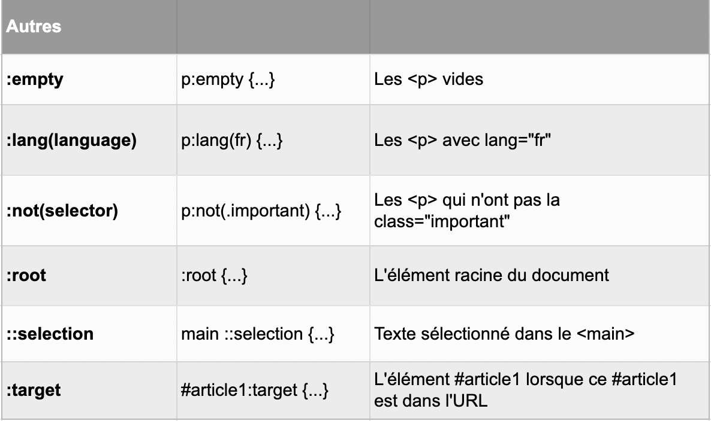

# 10-06. Autres pseudo-classes et pseudo-éléments

---

1. EXERCICES
2. Pour aller plus loin
3. RÉFÉRENCES

---



---

## **JE TE METS AU DÉFI**

Créez un document HTML avec le code suivant et complétez la partie des styles

HTML/XML

```html
<!DOCTYPE html>
<html lang="en">
<head>
  <meta charset="UTF-8">
  <meta name="viewport" content="width=device-width, initial-scale=1.0">
  <meta http-equiv="X-UA-Compatible" content="ie=edge">
  <title>Atelier 5 - Autres pseudo-classe et pseudo-éléments</title>
  <style>
    /* 1. Mettez un fond rouge aux h2 qui suivent directement un h1 vide dans les articles  */
    /* 2. Mettez un fond vert et une police blanche aux articles de langue FR */
    /* 3. Mettez une taille de police de 1.5em aux headers des articles en langue EN */
    /* 4. Mettez en gris clair la police des paragraphes qui ne sont pas 'prime' */
    /* 5. Mettez un fond gris clair aux liens des li qui ne sont pas 'active' */
    /* 6. Mettez une couleur de police verte au #blog lorsqu'on a cliqué sur le lien 'BLOG'  */
    /* 7. Mettez une taille de police de 1.5em aux titres des articles du BLOG lorsqu'on a cliqué sur le lien 'BLOG' */
    /* 8. Mettez un fond bleu et une police banche aux liens du menu sauf au dernier */
  </style>
</head>
<body>
  <header>
    <h1>Atelier 5</h1>
    <h2>Autres pseudo-classe et pseudo-éléments</h2>
    <nav>
      <ul>
        <li><a href="#home">Home</a></li>
        <li class="active"><a href="#blog">Blog</a></li>
        <li><a href="#contact">Contacts</a></li>
      </ul>
    </nav>
  </header>

  <main id="blog">
    <article class="new" lang="en">
      <header>
        <h1>Titre de l'article 1</h1>
        <h2>Sous-titre de l'article 1</h2>
      </header>
      <p class="prime">Lorem ipsum dolor sit amet, consectetur adipisicing elit.
         Nobis rem iste, soluta, vitae expedita id debitis totam dolor
        cupiditate pariatur molestiae aut, <a href="#">culpa voluptate</a> sapiente illum
         maxime dicta quibusdam eos.</p>
      <p>Lorem ipsum dolor sit amet, consectetur adipisicing elit.
         Nobis rem iste, soluta, vitae expedita id debitis totam dolor
         cupiditate pariatur molestiae aut, <a href="#">culpa voluptate</a> sapiente illum
         maxime dicta quibusdam eos.</p>
    </article>
    <article lang="en">
      <header>
        <h1></h1>
	<h2>Sous-titre de l'article 2</h2>
      </header>
      <p class="prime">Lorem ipsum dolor sit amet, consectetur adipisicing elit.
         Nobis rem iste, soluta, vitae expedita id debitis totam dolor
        cupiditate pariatur molestiae aut, <a href="#">culpa voluptate</a> sapiente illum
         maxime dicta quibusdam eos.</p>
      <p>Lorem ipsum dolor sit amet, consectetur adipisicing elit.
         Nobis rem iste, soluta, vitae expedita id debitis totam dolor
         cupiditate pariatur molestiae aut, <a href="#">culpa voluptate</a> sapiente illum
         maxime dicta quibusdam eos.</p>
    </article>
    <article lang="fr">
      <header>
        <h1>Titre de l'article 2</h1>
        <h2>Sous-titre de l'article 2</h2>
      </header>
      <p class="prime">Lorem ipsum dolor sit amet, consectetur adipisicing elit.
         Nobis rem iste, soluta, vitae expedita id debitis totam dolor
         cupiditate pariatur molestiae aut, <a href="#">culpa voluptate</a> sapiente illum
         maxime dicta quibusdam eos.</p>
      <p>Lorem ipsum dolor sit amet, consectetur adipisicing elit.
         Nobis rem iste, soluta, vitae expedita id debitis totam dolor
         cupiditate pariatur molestiae aut, <a href="#">culpa voluptate</a> sapiente illum
         maxime dicta quibusdam eos.</p>
    </article>
  </main>
</body>
</html>
```

---

## **Pour aller plus loin**

- [Base CSS - Exercices CSS](https://www.codingame.com/playgrounds/36092/exercices-css/base-css)

---

## RÉFÉRENCES

- [Référence CSS - CSS : Feuilles de style en cascade | MDN](https://developer.mozilla.org/fr/docs/Web/CSS/Reference#sélecteurs)
- [CSS3 module: W3C Selectors](https://www.w3.org/Style/css3-selectors-updates/WD-css3-selectors-20010126.fr.html)
- [CSS Selectors Reference](https://www.w3schools.com/cssref/css_selectors.asp)
- [Sélecteurs CSS (simples et complexes) - Liste et utilisation - Pierre Giraud](https://www.pierre-giraud.com/liste-selecteurs-css-utilisation/)
