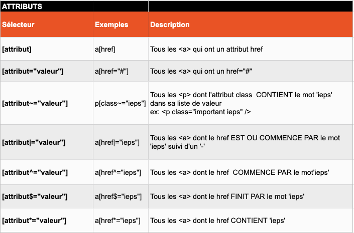

# 10-07 . Les sélecteurs d'attributs

---

1. EXERCICES
2. Pour aller plus loin
3. RÉFÉRENCES

---



---

## **JE TE METS AU DÉFI**

Créez un document HTML avec le code suivant et complétez la partie des styles

```html
<!DOCTYPE html>
<html lang="en">
<head>
  <meta charset="UTF-8">
  <meta name="viewport" content="width=device-width, initial-scale=1.0">
  <meta http-equiv="X-UA-Compatible" content="ie=edge">
  <title>Atelier 3 - Sélecteurs d'attributs</title>
  <style>
    /* 1. Mettez un fond rouge et une police blanche aux p ayant un attribut class  */
    /* 2. Mettez un fond vert et une police blanche aux liens des p ayant un attribut class */
    /* 3. Mettez une taille de police de 1.5em aux iens ayant un href de # dans les articles */
    /* 4. Mettez en gris clair la police des paragraphes ayant une classe qui commence par 'n' */
    /* 5. Mettez un fond vert aux liens ayant 'promotion' dans leur href */
  </style>
</head>
<body>
  <main>
    <article class="new">
      <header>
        <h1>Titre de l'article 1</h1>
        <h2>Sous-titre de l'article 1</h2>
      </header>
      <p class="prime">Lorem ipsum dolor sit amet, consectetur adipisicing elit.
         Nobis rem iste, soluta, vitae expedita id debitis totam dolor
        cupiditate pariatur molestiae aut, <a href="#">culpa voluptate</a> sapiente illum
         maxime dicta quibusdam eos.</p>
      <p>Lorem ipsum dolor sit amet, consectetur adipisicing elit.
         Nobis rem iste, soluta, vitae expedita id debitis totam dolor
         cupiditate pariatur molestiae aut, <a href="http://www.promotion-sociale.be">culpa voluptate</a> sapiente illum
         maxime dicta quibusdam eos.</p>
    </article>
    <article>
      <header>
        <h1>Titre de l'article 2</h1>
        <h2>Sous-titre de l'article 2</h2>
      </header>
      <p class="prime">Lorem ipsum dolor sit amet, consectetur adipisicing elit.
         Nobis rem iste, soluta, vitae expedita id debitis totam dolor
         cupiditate pariatur molestiae aut, <a href="#">culpa voluptate</a> sapiente illum
         maxime dicta quibusdam eos.</p>
      <p>Lorem ipsum dolor sit amet, consectetur adipisicing elit.
         Nobis rem iste, soluta, vitae expedita id debitis totam dolor
         cupiditate pariatur molestiae aut, <a href="#">culpa voluptate</a> sapiente illum
         maxime dicta quibusdam eos.</p>
    </article>
  </main>
</body>
</html>
```

---

## **Autres exercices**

- [https://www.w3schools.com/css/exercise.asp?filename=exercise_attribute_selectors1](https://www.w3schools.com/css/exercise.asp?filename=exercise_attribute_selectors1)
- [Base CSS - Exercices CSS](https://www.codingame.com/playgrounds/36092/exercices-css/base-css)

---

## **RÉFÉRENCES**

- [Référence CSS - CSS : Feuilles de style en cascade | MDN](https://developer.mozilla.org/fr/docs/Web/CSS/Reference#s%C3%A9lecteurs)
- [CSS3 module: W3C Selectors](https://www.w3.org/Style/css3-selectors-updates/WD-css3-selectors-20010126.fr.html)
- [CSS Selectors Reference](https://www.w3schools.com/cssref/css_selectors.asp)
- [Sélecteurs CSS (simples et complexes) - Liste et utilisation - Pierre Giraud](https://www.pierre-giraud.com/liste-selecteurs-css-utilisation/)
