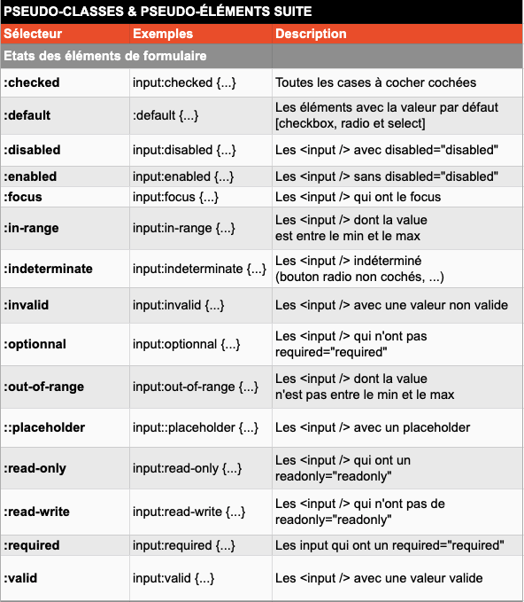

# 10-08. Les pseudo-classes de formulaires

---

1. EXERCICES
2. Pour aller plus loin
3. RÉFÉRENCES

---



---

## JE TE METS AU DÉFI

Créez un document HTML avec le code suivant et complétez la partie des styles

```html
<!DOCTYPE html>
<html lang="en">
<head>
  <meta charset="UTF-8">
  <meta name="viewport" content="width=device-width, initial-scale=1.0">
  <meta http-equiv="X-UA-Compatible" content="ie=edge">
  <title>Atelier 3 - Les pesudo-classes de formulaires</title>
  <style>
    /* 1. Mettez un fond vert et une police blanche aux label suivant directement une case à cocher cochée  */
    /* 2. Mettez un fond rouge et une police blanche aux label des inpput de type radio ayant la valeur par défaut */
    /* 3. Mettez un fond gris aux inputs text désactivés */
    /* 4. Mettez un fond vert clair aux inputs text non désactivés */
    /* 5. Mettez un fond orange aux inputs text qui ont le focus */
    /* 6. Mettez un fond vert et une police blanche aux inputs num qui sont dans leur range et rouge si c'est hors range  */
    /* 7. Mettez en gris clair les label qui suivent directement un input indéterminé */
    /* 8. Mettez en rouge le contenu des inputs non valides et en vert le contenu des valides */
    /* 9. Mettez en un fond orange en fond edes champs requis et un vert clair aux non requis */
    /* 10. Mettez en 1.5em le contenu des champs avec placeholder */
    /* 11. Mettez en 1.5em le contenu des champs en read-only et en 2em les autres */
  </style>
</head>
<body>
  <form action="#" method="get">
    <div
      
<input type="checkbox" id="input1" />
      <label for="input1">Input1</label>    </div>

    <div>
      <input type="radio" name="input2" id="input2a" checked="checked" />
      <label for="input1">Input2a</label>
      <input type="radio" name="input2" id="input2b" />
      <label for="input1">Input2b</label>
      <input type="radio" name="input2" id="input2c" />
      <label for="input1">Input2c</label>
    </div>
    <div>
      <label for="input3">Input3</label>
      <input type="text" id="input3" disabled="disabled" />
    </div>
    <div>
      <label for="input4">Input4</label>
      <input type="text" id="input4" />
    </div>
    <div>
      <label for="input5">Input5 - NUM</label>
      <input type="num" id="input5" min="1" max="10" />
    </div>
    <div>
      <label for="input6">Input6 - email</label>
      <input type="email" id="input6" placelholder="john.doe@gmail.com"/>
    </div>
    <div>
      <label for="input7">Input7 - required</label>
      <input type="text" id="input7" required="required"/>
    </div>
    <div>
      <label for="input8">Input</label>
      <input type="text" id="input8" />
    </div>
    <div>
      <label for="input9">Input9 - read-only</label>
      <input type="text" id="input9" readonly="readlonly" value="foo"/>
    </div>
    <div>
      <label for="input10">Input</label>
      <input type="text" id="input10" value="foo" />
    </div>  </form>
</body>
</html>
```

---

## **Pour aller plus loin**

- [Base CSS - Exercices CSS](https://www.codingame.com/playgrounds/36092/exercices-css/base-css)

---

---

## **RÉFÉRENCES**

- [Référence CSS - CSS : Feuilles de style en cascade | MDN](https://developer.mozilla.org/fr/docs/Web/CSS/Reference#s%C3%A9lecteurs)
- [CSS3 module: W3C Selectors](https://www.w3.org/Style/css3-selectors-updates/WD-css3-selectors-20010126.fr.html)
- [CSS Selectors Reference](https://www.w3schools.com/cssref/css_selectors.asp)
- [Sélecteurs CSS (simples et complexes) - Liste et utilisation - Pierre Giraud](https://www.pierre-giraud.com/liste-selecteurs-css-utilisation/)
