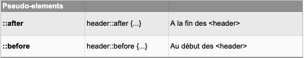
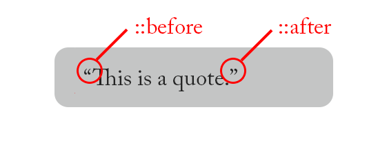

# 10-09. Les pseudo-éléments ::before et ::after

---

1. EXERCICES
2. Pour aller plus loin
3. RÉFÉRENCES

---



Ces deux sélecteurs permettent d'ajouter artificiellement du contenu aux éléments du DOM et d'habiller ce nouveau contenu.



```html
<!-- Dans le code HTML -->
<!-- ... -->
  <blockquote>This is a quote</blockquote>
<!-- ... -->
```

## A. :before : ajouter du contenu en début de l'élément

```css
/* Dans le code CSS */

blockquote::before {
  content: "“";
}
```

## B. :after : ajouter du contenu à la fin d'un élément

```css
blockquote::before {
  content: "”";
}
```

## JE TE METS AU DÉFI

---

## RÉFÉRENCES:

- [::before (:before) - CSS : Feuilles de style en cascade | MDN](https://developer.mozilla.org/fr/docs/Web/CSS/::before)
- [CSS3 module: W3C Selectors](https://www.w3.org/Style/css3-selectors-updates/WD-css3-selectors-20010126.fr.html)
