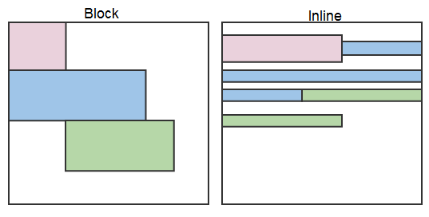
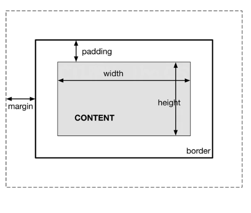
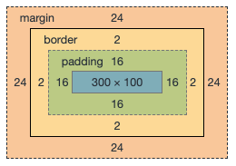
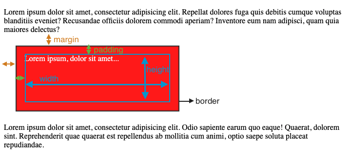
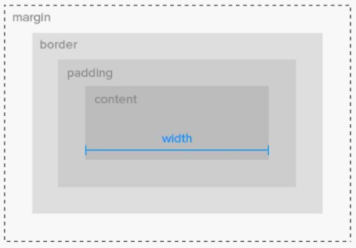
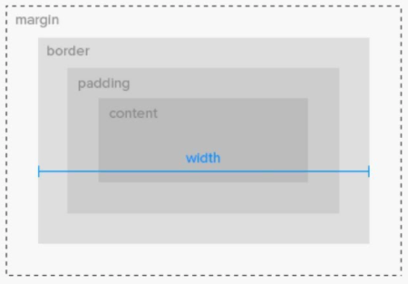
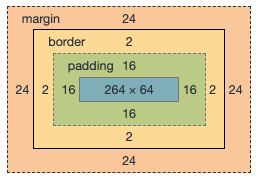
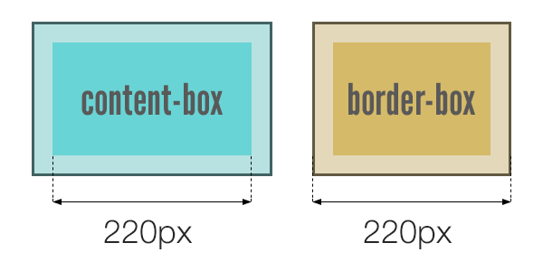
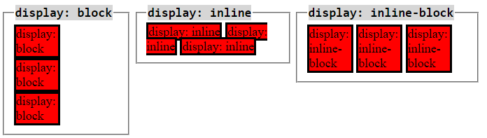

# 12-01. Le modèle des boîtes - BOX MODEL

On appelle boîte toute balise de type block ou inline-block (voir plus loin).

## 1. Les balises de type block vs inline

Une balise de type block&lt;p>, &lt;h1> , &lt;li> , &lt;div>, ...

- Largeur "naturelle" de 100%
- Passage à la ligne de ce qui les suit

Une balise de type inline&lt;a>, &lt;strong> , &lt;span>, ...

- Largeur est celle du contenu
- Ne provoque donc pas de passage à la ligne du contenu qui les suit.



## 2. Le modèle des boîtes

Les bocks, ce sont des boites qui ont comme caractéristiques principales:

- **width**: largeur du contenuPar défaut 100%
- **height**: hauteur du contenuPar défaut celle du contenu "naturel"
- **padding**: marge intérieur (entre le bord et le contenu)Par défaut 0padding-top, padding-bottom, padding-left, padding-right
- **border**: le bordPar défaut 0border-top, border-bottom, border-left, border-right
- **margin**: marge extérieure, entre le block et ce qui l'entourePar défaut 1emmargin-top, margin-bottom, margin-left, margin-right



## 3. On peut modifier ces propriétés

```html
<p>Lorem ipsum dolor sit amet, ...</p>
<p class="ma-boite">Lorem ipsum, ...</p>
<p>Lorem ipsum dolor sit amet, ...</p>
```

```css
.ma-boite {
   background: red;
   color: red;
   width: 300px;
   height: 100px;
   padding: 1em;
   border: #333 2px solid;
   margin: 1.5em;
}
```



*Box Model - Inspecteur*



## 4. Les dimensions effectives d'une boîte

### A. La logique CONTENT-BOX

Attention, par défaut, les dimensions réelles d'une boite sont les suivantes:

> **LARGEUR TOTALE** = width + (2 x padding) + (2 x border)**HAUTEUR TOTALE** = height + (2 x padding) + (2 x border)




> LARGEUR TOTALE = 300 + 32 + 4 = 336pxHAUTEUR TOTALE = 100 + 32 + 4 = 136px

### B. La logique BORDER-BOX

La propriété `box-sizing` permet de modifier ce calcul et de faire en sorte que la largeur totale inclue le padding et le border. dans ce cas:

> **LARGEUR TOTALE** = width **HAUTEUR TOTALE** = height

```css
.ma-boite {
   box-sizing: border-box;
   background: red;
   color: red;
   width: 300px;
   height: 100px;
   padding: 1em;
   border: #333 2px solid;
   margin: 1.5em;
}
```





> **LARGEUR TOTALE** = width = 300px**HAUTEUR TOTALE** = height = 100px

### C. Logique CONTENT-BOX / BORDER-BOX

```css
.content-box {
   width: 220px;
   padding: 1em;
   border: #000 2px solid;
}
```

```css
.border-box {
   box-sizing: border-box;
   width: 220px;
   padding: 1em;
   border: #000 2px solid;
}
```



## **5. La propriété display**

La propriété CSS display permet de modifier le type d'affichage "naturel" d'une balise.

On peut ainsi transformer n'importe quelle balise en block ou en inline, mais également en un série d'autre types de block comme les inline-block et bien d'autres types d'affichage comme les grid et les flexboxes...

CSS/SCSS

```css
div {
   display: inline;
}

li {
   display: inline-block;
}
```

Les balises &lt;div> seront alors de type inline comme un &lt;strong>. Leur largeur sera celle de leur contenu et elle ne provoqueront pas le passage à la ligne de ce qui les suit...Les balises &lt;li> seront des inline-blocks.

## **6. Le type inline-block**

Une balise inline ne respecte pas complètement le modèle des boîtes. Pour une balise de type inline,

- Pas de width
- Pas de height
- Pas de margin-top ni de margin-bottom

On peut juste spécifier

- un padding
- un border
- un margin-left et right

Il est possible de transformer toute balise en type **inline-block.** La plupart des éléments de formulaire comme les inputs par exemple sont "naturellement" des inline-block. Un inline block respecte le modèle des boîtes tout en respectant également la logique des inline...

- Largeur par défaut = largeur du contenu
- Pas de retour à la ligne après la balise
- width
- height
- padding
- border
- margin



## JE TE METS AU DÉFI

---

## **RÉFÉRENCES**

- [CSS Box Model](https://www.w3schools.com/css/css_boxmodel.asp)
- [CSS Tutorial](https://www.w3schools.com/css/)
