# 12-02. Des propriétés générales

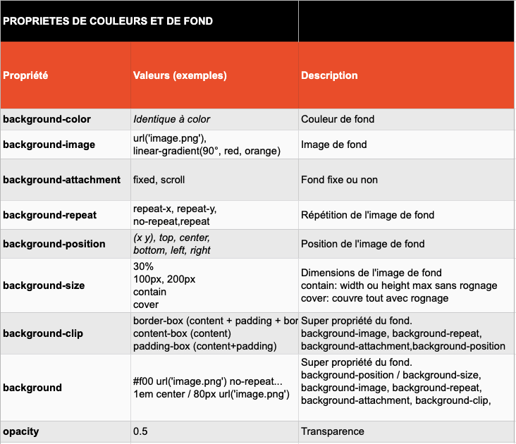

## 1. Background

### A. Background-color et background-image

La propriété background permet de spécifier l'image et/ou la couleur de fond d'une élément.

Si on définit une couleur de fond ET un image de fond, la couleur sera affichée pendant le chargement de l'image de fond. Si l'image est transparente, on verra la couleur de fond au travers...

### B. Background-image

Si on veut intégrer une image de 256px/256px en fond d'un objet, tout va dépendre de la dimension de l'objet par rapport à l'image....

```html
<p class="ma-boite">
   Lorem ipsum, dolor sit amet...
</p>
```

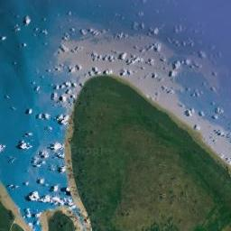

#### L'image est plus grande que l'objet: l'image est rognée

```css
.ma-boite {
   box-sizing: border-box;
   background: red url('kh.jpg');

   color: white;
   padding: 1em;
}
```

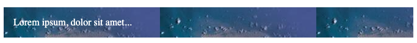

#### L'image a la même dimension que l'objet

```css
.ma-boite {
   box-sizing: border-box;
   background: red url('kh.jpg');

   width: 256px;
   height: 256px;
   color: white;
   padding: 1em;
}
```

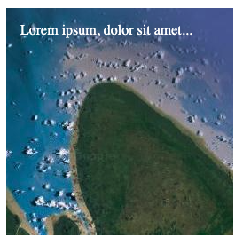

#### L'image est plus petite que l'objet: répétition horizontale et verticale

```css
.ma-boite {
   box-sizing: border-box;
   background: red url('kh.jpg');

   width: 500px;
   height: 300px;
   color: white;
   padding: 1em;
}
```

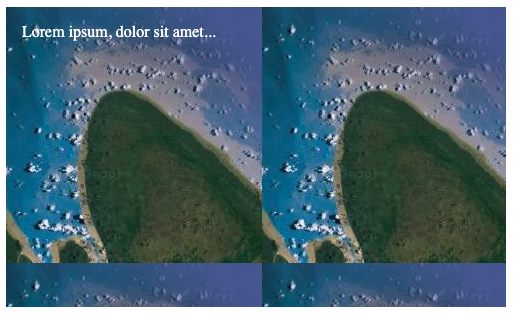

#### Empêcher la répétition: no-repeat

```css
.ma-boite {
   box-sizing: border-box;
   background: red url('kh.jpg') no-repeat;

   width: 500px;
   height: 300px;
   color: white;
   padding: 1em;
}
```

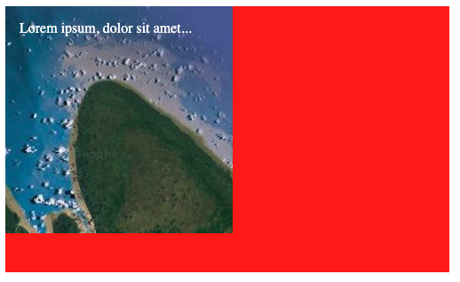

#### Répétition horizontale et verticale

```css
.ma-boite {
   box-sizing: border-box;
   background: red url('kh.jpg') repeat-x;

   width: 500px;
   height: 300px;
   color: white;
   padding: 1em;
}
```

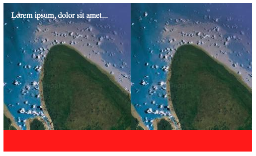

#### Maximaliser la largeur ou la hauteur tout en voyant toute l'image: contain

```css
.ma-boite {
   box-sizing: border-box;
   background: red url('kh.jpg') no-repeat;
   background-size: contain;

   width: 500px;
   height: 300px;
   color: white;
   padding: 1em;
}
```

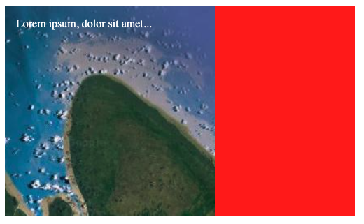

#### Couvrir toute la surface de l'objet en rognant

```css
.ma-boite {
   box-sizing: border-box;
   background: red url('kh.jpg') no-repeat;
   background-size: cover;

   width: 500px;
   height: 300px;
   color: white;
   padding: 1em;
}
```

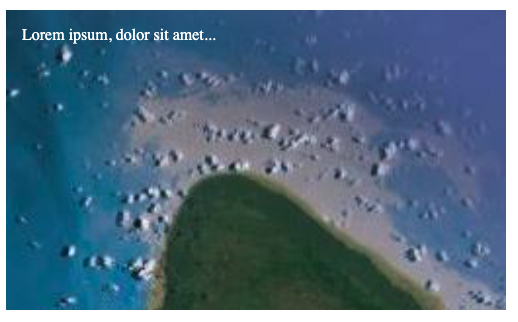

## 2. La super-propriété background

```css
/* 
   background: positions / dimensions url répétition, linear-gradient()...
 */


.ma-boite {
   background: 1em center / 100px url('kh.jpg') no-repeat, 
               linear-gradient(90deg, red, orange);
}
```

---

## **METTEZ-VOUS AU DÉFI !**

### Défi 1

En partant du code suivant et de l'image à télécharger (256px x 256px) avec une largeur totale de 600px pour l'article.ASTUCES

- Mettez l'image en fond du div (600px x 256px)
- Travailler le padding en décomposant top (1em), right (1em), bottom (1em) et left (272px)
- Mettez un font-size de 1.1em.
- Pour faire joli, mettez un bordborder: #000 1px solid;

📎 [kh.jpg](images/bI2Q1THSUE2ONyiu.jpg)

```html
<div class="card">
   <h1>Lorem ipsum dolor sit.</h1>
   <p>
     Lorem ipsum, dolor sit amet consectetur adipisicing elit. 
     Aut quas dignissimos, explicabo laboriosam ullam pariatur ea fugiat, 
     est, nam repellendus ut. Suscipit reiciendis quo, 
     obcaecati nulla dolores exercitationem quod. Dolore.
   </p>
</div>
```

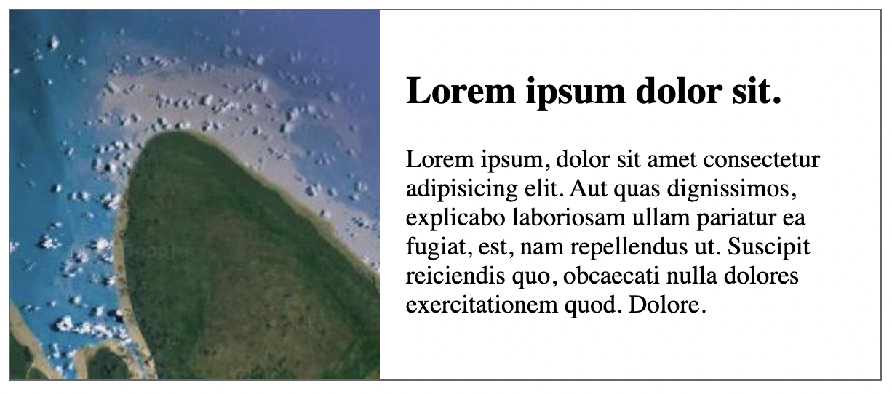

---

### **Défi** 2

Avec le même code HTML et la même image...

ASTUCES:

- Le div en 256px de large et pas de hauteur
- Travaillez le padding en adaptant la logique de l'exercice précédent

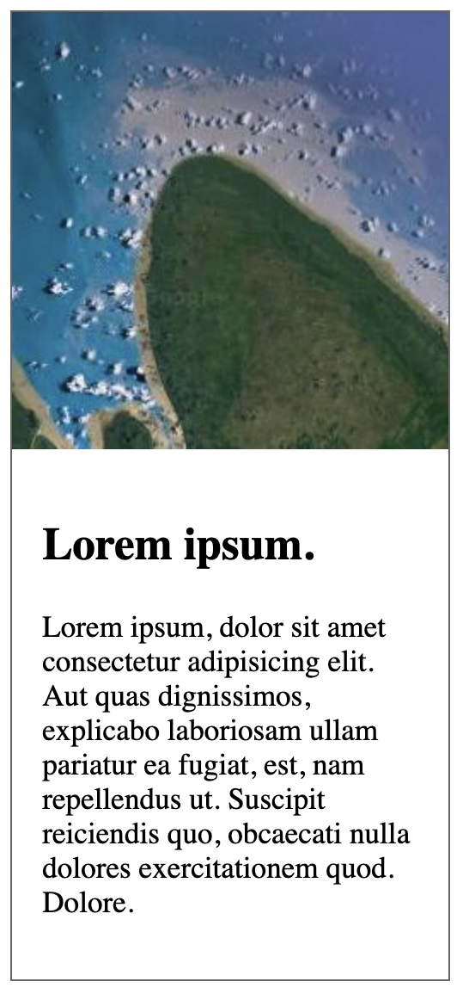

---

### **Défi** 3

Reprenez les 2 exercices précédents et tentez d'obtenir les mêmes résultats en utilisant deux classes supplémentaires .card-horizontale et .card-verticale

ASTUCES:

- Mettez les spécifications communes dans la classe . card
- Mettez les spécifications spécifiques dans les classes spécifiques

```html
<div class="card card-horizontale">
   ...
</div>
```

```html
<div class="card card-verticale">
  ...
</div>
```

---

### **Défi** 4

A partie du code suivant et de l'image à télécharger

ASTUCES:

- Largeur du div: 500px et pas de hauteur
- Image de fond sur le div
- Déplacez le fond de 0 du bord left et centré verticalement du top
- Padding top et bottom de 1em, de 100px en left et de 250px en right
- font-size de 1.1em

```javascript
<div class="card-user">
   <h1>John Doe</h1>
   <p>Lorem ipsum, dolor sit amet consectetur adipisicing elit. Aut quas dignissimos, explicabo laboriosam ullam pariatur ea fugiat.</p>
</div>
```

📎 [user.png](images/hBxEmxruv1MVAvX4.png)

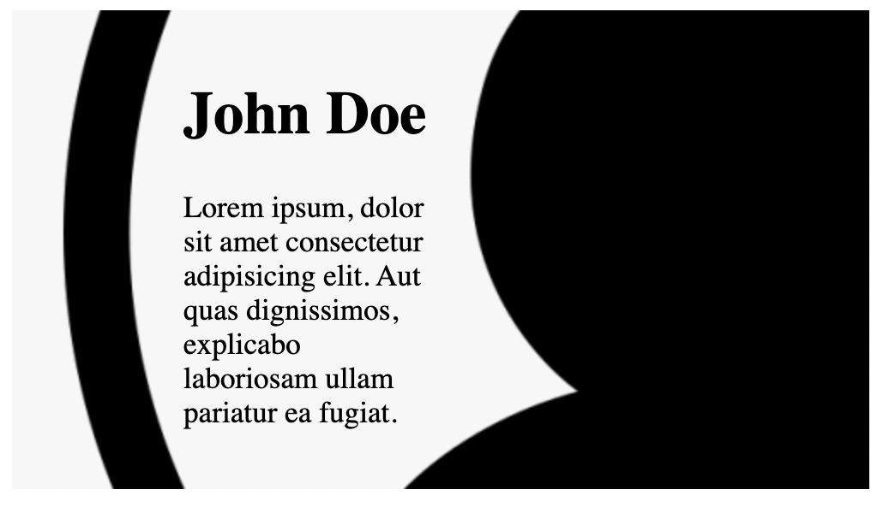

📎 [ex4.html](images/8KPWBO6p6JeOuAlm.html)

---

### **Défi** 5

A partir du même code et de la même image que l'exercice précédent

ASTUCES:

- Image de fond sur le div
- Image à 1em du top et de left, de 100px le large
- div de 600px de large et pas de hauteur avec un padding left de 132pxles autres de 1em
- Couleur du fond u div : #F7F7F7

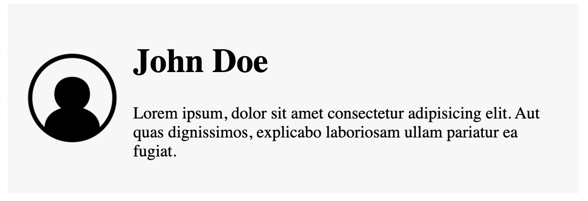

---

### **Défi** 6

Avec le même code et l'image suivante...

ASTUCES:

- Trebuchet MS pour le titre, Cambria pour le texte (1.2em)
- Div à 600px et marge intérieure de 1em partout et de 132px à gauche
- Fond en dégradé du rouge à l'orange à 90deg
- Image de fond sur le div en 90px, à 1em du bord gauche et center en vertical
- Ajoutez une ombre portée sur le div pour faire joli 😃 box-shadow: rgba(0,0,0,.5) 0 0 15px;

📎 [user3.png](images/gSbeMX6raBbowPgW.png)

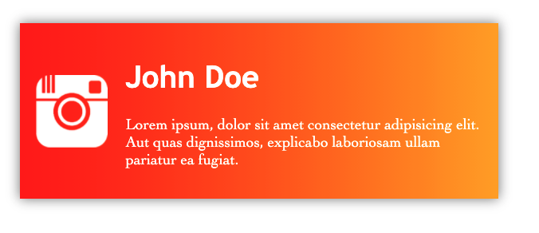

📎 [defi6.html](images/TVBr6CcFZYRQweXe.html)

---

### **Défi** 7

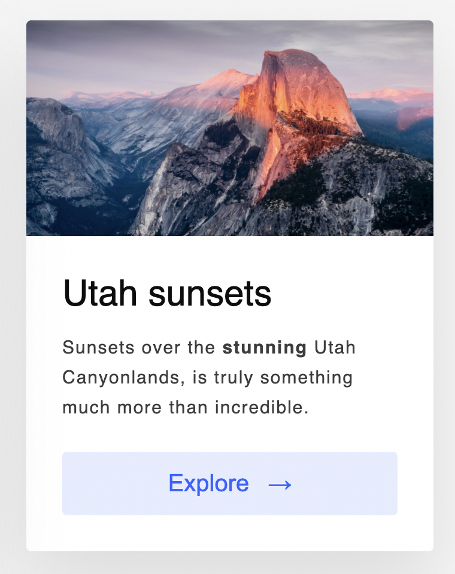

📎 [defi7.html](images/fOpGfSajyxa12UFA.html)

📎 [defi7bis.html](images/XHMsX91GbDEIIhLT.html)

---

## RÉFÉRENCES - POUR ALLER PLUS LOIN

- [background - CSS : Feuilles de style en cascade | MDN](https://developer.mozilla.org/fr/docs/Web/CSS/background)
- [background-size - CSS : Feuilles de style en cascade | MDN](https://developer.mozilla.org/fr/docs/Web/CSS/background-size)
