# 12-03. Des propriétés pour les boîtes

**IT DE SURVIE APPS STATIQUES > DES PROPRIÉTÉS POUR LES BOÎTES**

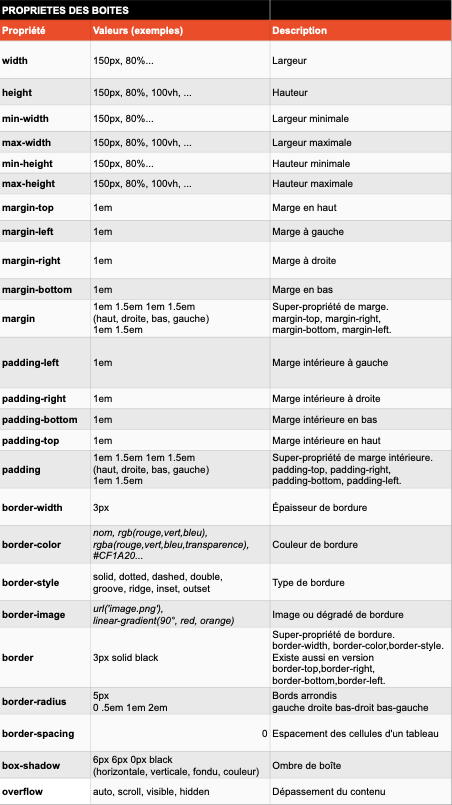

## 1. Des blocks et des inline-bocks "naturels"

Il existe de nombreuses balises de type block

- &lt;div>
- &lt;h1> ... &lt;h6>
- &lt;p>
- &lt;ul>, &lt;ol>, &lt;dl>, &lt;table>, &lt;tr>, &lt;thead>, &lt;tbody>
- &lt;li>, &lt;dt>, &lt;dd>, &lt;td>, &lt;th>
- &lt;blockquote>
- &lt;pre>
- &lt;form>
- &lt;figure>, &lt;figcaption>
- ...

Largeur = 100%Hauteur = hauteur du contenu

Et d'autres qui sont des inline-block

- &lt;input />
- &lt;textarea>
- &lt;button>
- &lt;select>
- &lt;img />, &lt;picture>
- ...

Largeur = largeur du contenuHauteur = hauteur du contenu

## 2. Changer le display d'un élément

La propriété display permet de changer le type d'affichage d'un élément

```css
a {
  display: inline-block;
}

li {
  display: inline-block;
}
```

## 2. Padding et margin

Petits rappels, le padding, c'est la marge intérieure, entre le content et le bord

Et le margin, c'est la marge extérieure, entre le bord et les objets adjacents

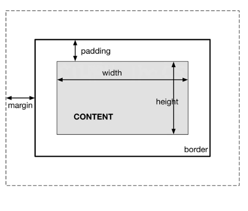

### A. Propriétés séparées

On peut définir chaque marge séparément

- `padding-left` et `margin-left`
- `padding-right` et `margin-right`
- `padding-top` et `margin-top`
- `padding-bottom` et `margin-bottom`

```css
.ma-boite {
  padding-left: 1em;
  padding-right: 1.1em;
  padding-top: .9em;
  padding-bottom: 1.4em;
}
```

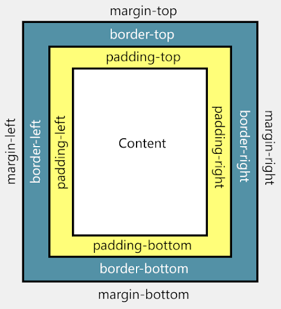

### B. Super-propriétés

On peut également écrire en raccourcis, mais il faut respecter le sens horaire en partant du top

#### Toutes de valeurs différentes

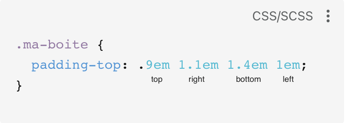

#### Mêmes valeurs en top/bottom et **en left/right**

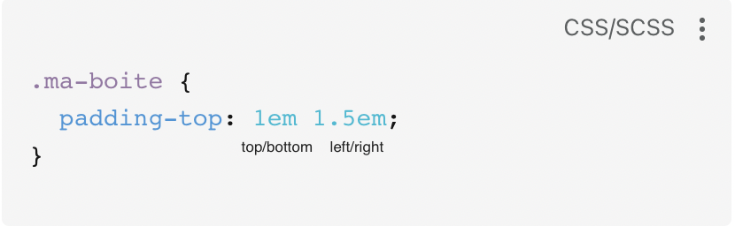

#### Mêmes valeurs en top, right, bottom et left

```css
.ma-boite {
  padding: 1em;
}
```

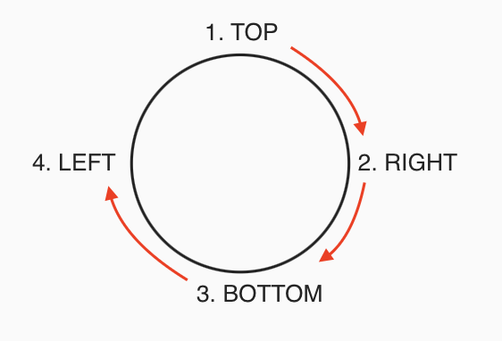

### C. Centrer horizontalement une boîte grâce au margin

Si on veut centrer horizontalement une boîte, on peut utiliser la propriété margin.

Quand on défini une marge à 'auto', on laisse le navigateur gérer selon l'espace disponible.

Si on défini une marge auto à gauche et à droite, l'élément est centré horizontalement...

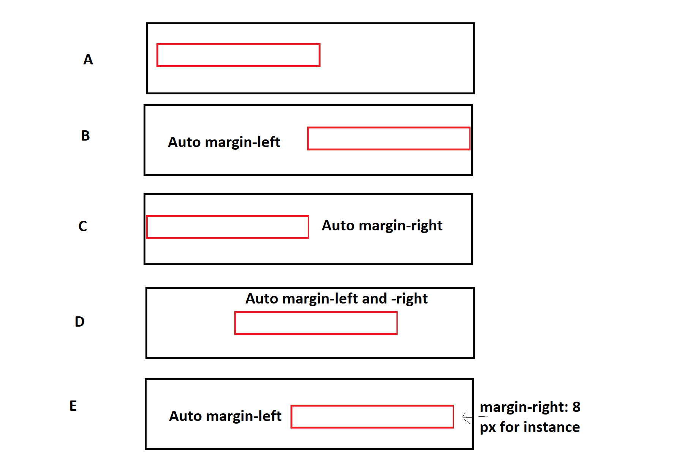

```css
.card-user {
  /* ... */
  width: 600px;
  margin: 1em auto;
}
```

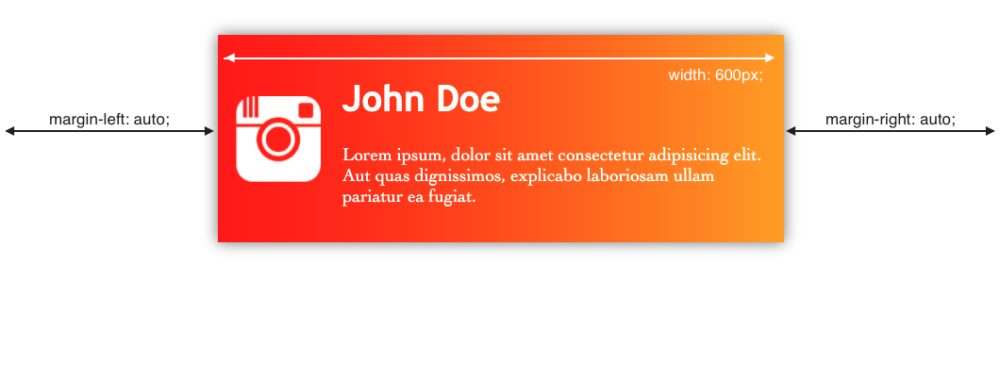

## 2. Width et height

Une balise bloc a par défaut 100% de large et un inline-block a par défaut la largeur de son contenu. Mais on peut modifier cette largeur par défaut avec la propriété width.

### A. Content-box vs border-box

Souvenez-vous que cette largeur, par défaut, n'inclue pas les marges intérieures et le bord. Il s'agit juste de la largeur du content. Si on veut que cette largeur inclue padding et border, on doit ajouter la spécification `box-sizing: border-box`

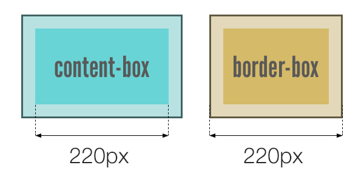

### B. Hauteur naturelle VS hauteur contrainte

Il est très rare que l'on fixe la hauteur d'un élément car la plupart du temps, dans une application dynamique, on ne connaît pas longueur du contenu puisque ça vient de la base de données.

On ne fixe la hauteur QUE

- pour les contenus figés
- et si on n'a pas le choix

Sinon, on laisse l'élément s'adapter à son contenu.

### C. Et si le contenu dépasse des dimensions imposées ?

La propriété overflow permet de gérer la manière dont va s'afficher ce qui dépasse... Par défaut on voit ce qui dépasse (overflow visible).

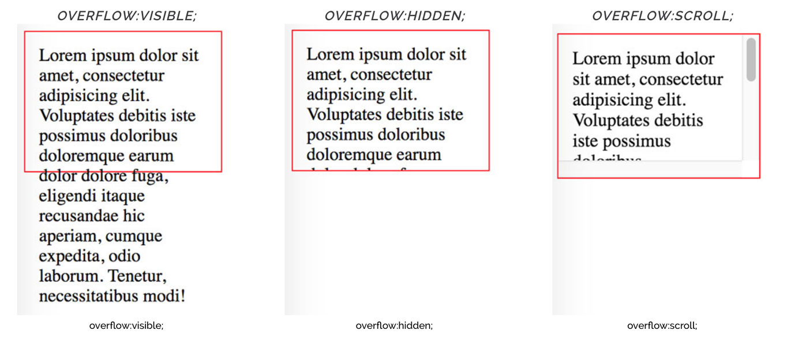

### D. Le container: Width et Responsive Design

Si on fixe la largeur d'un block à 900px par exemple, cela va poser un problème sur les plus petits écrans qui ne disposent pas de 900px...

Ce serait cool si cette boite pouvait faire 100% sur les petits écrans et 900px sur les grands écrans par exemple. C'est exactement ce qui va se passer si on utilise le max-width

- On met une largeur de 100% à l'élément
- Mais on lui dit aussi qu'il ne peut dépasser 900px !

Et le tour est joué ! 'est la logique MOBILE FIRST (la valeur par défaut est celle du mobile)

```css
.container {
  width: 100%;		/* 100% sur mobiles */
  max-width: 900px;	/* 900px si c'est possible */
  margin: auto;		/* On centre alors la boîte */
}
```

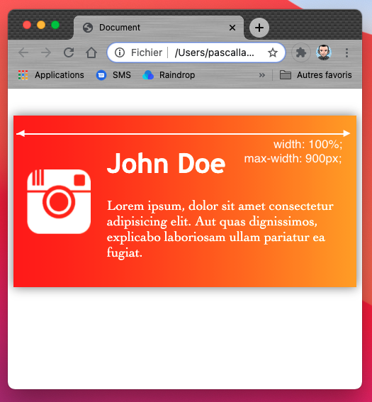

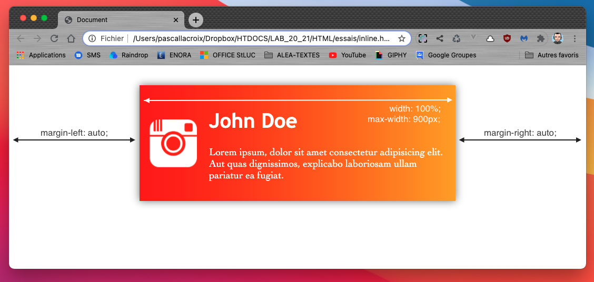

## 3. Box-shadow

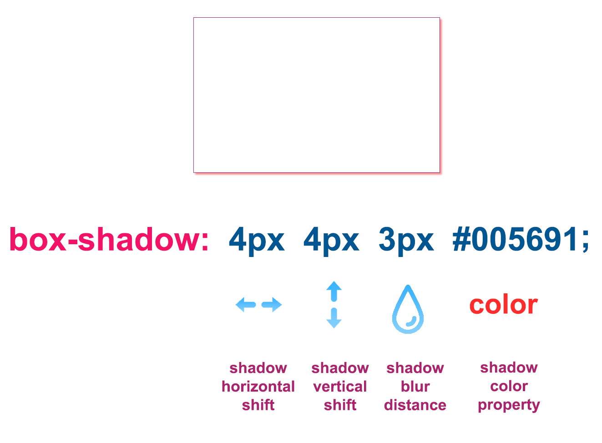

## 4. Utiliser l'inspecteur pour vérifier les boîtes

L'inpecteur permet d'expliciter toutes les propriétés de nos éléments.Clic-droit sur l'élément / inspecter

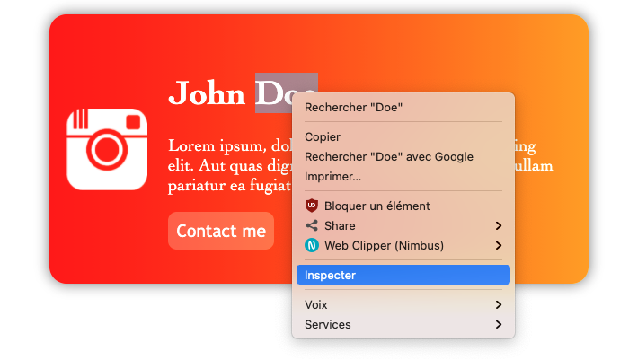

On peut alors prendre connaissance de toutes les propriétés de l'éléments et d'en tester en direct dans le navigateur.

En passant la souris sur l'élément, on voit les caractéristiques de la boite. On voit par exemple ici que le titre a un margin non nul en top et en bottom !!!

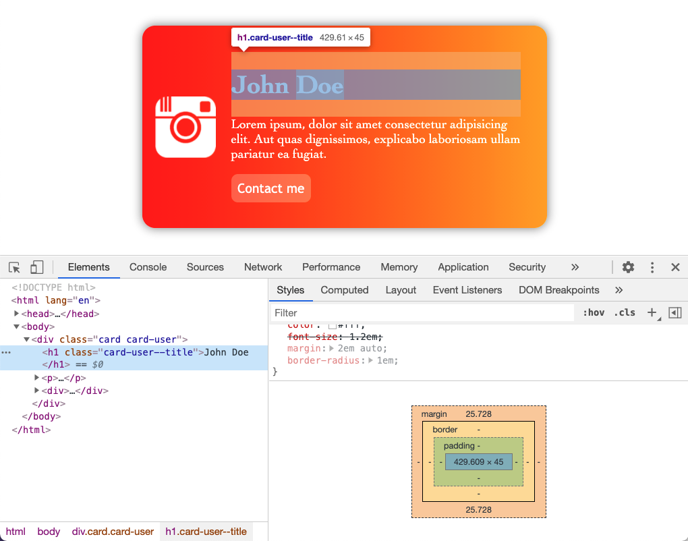

---

## **METTEZ-VOUS AU DÉFI !**

### Défi 1 - Les alertes de Bootstrap

[Alerts · Bootstrap](https://getbootstrap.com/docs/4.0/components/alerts/)

```html
<div class="alert alert-primary" role="alert">
  This is a primary alert—check it out!
</div>
<div class="alert alert-secondary" role="alert">
  This is a secondary alert—check it out!
</div>
<div class="alert alert-success" role="alert">
  This is a success alert—check it out!
</div>
<div class="alert alert-danger" role="alert">
  This is a danger alert—check it out!
</div>
<div class="alert alert-warning" role="alert">
  This is a warning alert—check it out!
</div>
<div class="alert alert-info" role="alert">
  This is a info alert—check it out!
</div>
```

**ASTUCES**

- Couleur primary: #CCE5FFCouleur secondary: #E2E3E5Couleur success: #D4EDDACouleur danger: #F8D7DACouleur warning: #FFF3CCCouleur info: #D1ECF1Police: Arial
- Mettez dans .alert tout ce qui est commun
- Mettez dans lea autres classes uniquement la couleur...

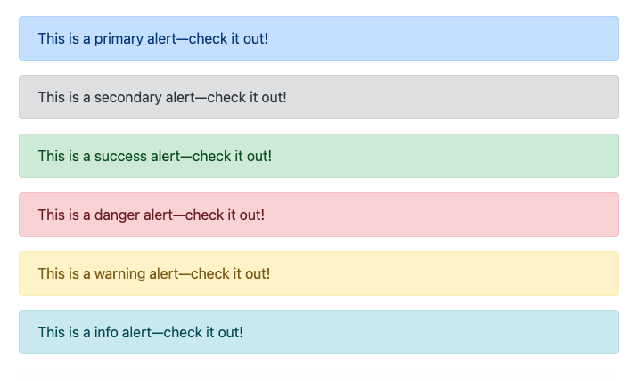

📎 [ex1.html](images/4I8ctUibPvmzvPYr.html)

---

### Défi 2 - Les badges de Bootstrap

[https://getbootstrap.com/docs/4.0/components/badge/](https://getbootstrap.com/docs/4.0/components/badge/)

```html
<h1>Example heading <span class="badge badge-primary">New</span></h1>
<h2>Example heading <span class="badge badge-secondary">New</span></h2>
<h3>Example heading <span class="badge badge-success">New</span></h3>
```

**ASTUCES**

- Couleur primary: #007BFFCouleur secondary: #6C757DCouleur success: #28A745Police de caractères: Arial
- Mettez ce qui est commun dans .badge et ce qui est spécifique dans les classes spécifiques

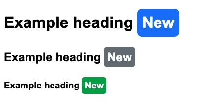

---

### Défi 3 - Le breadcrump de Bootstrap

[Breadcrumb · Bootstrap](https://getbootstrap.com/docs/4.0/components/breadcrumb/)

```html
<nav aria-label="breadcrumb">
  <ol class="breadcrumb">
    <li class="breadcrumb-item"><a href="#">Home</a></li>
    <li class="breadcrumb-item"><a href="#">Library</a></li>
    <li class="breadcrumb-item active" aria-current="page">Data</li>
  </ol>
</nav>
```

**ASTUCES**

- Mettez les li en inline-block
- Fond sur le .breadcrump avec coins arrondis
- Ajoutez un contenu ' / ' à la fin de chaque .breadcrump-item sauf au dernier

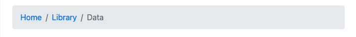

---

### Défi 4 - Les boutons de Bootstrap

[Buttons · Bootstrap](https://getbootstrap.com/docs/4.0/components/buttons/)

```html
<button type="button" class="btn btn-primary">Primary</button>
<button type="button" class="btn btn-secondary">Secondary</button>
<button type="button" class="btn btn-success">Success</button>
<button type="button" class="btn btn-danger">Danger</button>
<button type="button" class="btn btn-warning">Warning</button>
<button type="button" class="btn btn-info">Info</button>
```

**ASTUCES**

- Couleur primary: #007BFFCouleur secondary: #6C757DCouleur success: #28A745Couleur danger: #DC3545Couleur warning: #FEC107Couleur info: #1BA2B8Police de caractères: Arial
- Même logique que les défis précédents

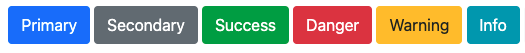

---

### Défi 5: Les card de Bootstrap

[Cards · Bootstrap](https://getbootstrap.com/docs/4.0/components/card/)

```html
<div class="card">
  
  <div class="card-body">
    <h5 class="card-title">Card title</h5>
    <p class="card-text">Some quick example text to build on the card title and make up the bulk of the card's content.</p>
    <a href="#" class="btn btn-primary">Go somewhere</a>
  </div>
</div>
```

📎 [286x180.svg](images/wr6GDGbFNTW6kf35.svg)

**ASTUCES**

- Mettez le .card à 286 de large et centrez le sur la page, avec un borderPas de padding !
- Mettez un padding sur le .card-body

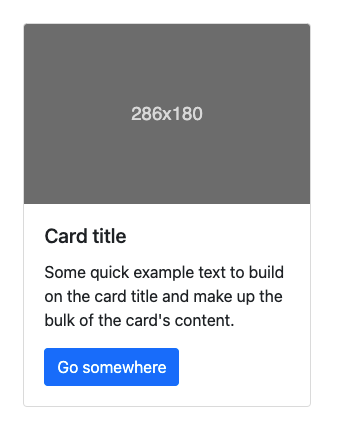

---

### Défi 6

A partir du code HTML suivant et de l'image à télécharger

- Doit faire 500px max, centrée sur la page
- Icône à 70px de large et 1em des bords
- Texte à (3em + 70px) du bord gauche, 2em des autres bords.
- Call-To-action (CTA): inline-block, blanc en 30%, opacité (rgba)
- Attention aux marges du titre ! (Regardez dans l'inspecteur)
- Mettez en place un effet lorsque l'on passe la souris sur le CTA@

```html
<div class="card-user">
  <h1 class="card-user--title">John Doe</h1>
  <p>Lorem ipsum, dolor sit amet consectetur adipisicing elit. Aut quas dignissimos, explicabo laboriosam ullam pariatur ea fugiat.</p>
  <div><a href="#" class="card-user--cta">Contact me</a></div>
</div>
```

📎 [user3.png](images/fv18AItX1es0b2ST.png)

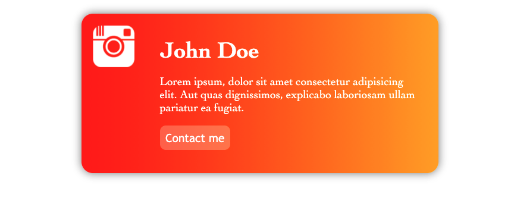

---

### Défi 7

Avec le même code et la même image

ASTUCES

    - .card-user en 300px de large

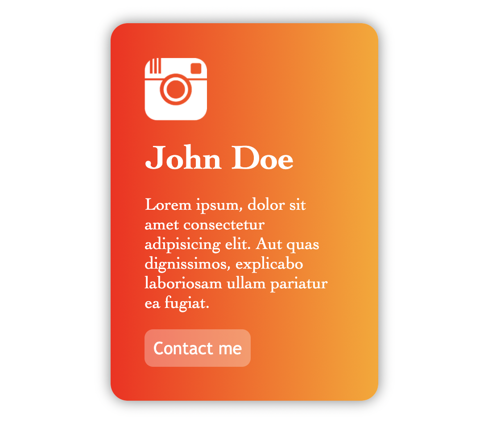

---

### Défi 8

A partir du code suivant

ASTUCES:

- Image de fond sur le .card-user
- Pas de padding sur le .card-user
- Padding sur le .card-user--title et le .card-user--content
- Fond blanc et coins arrondis en bas du .card-content
- Couleur du cta: lightsteelblue et steelblue en hover

```html
<div class="card-user">
  <h1 class="card-user--title">John Doe</h1>
  <div class="card-user--content">
    <p>Lorem ipsum, dolor sit amet consectetur adipisicing elit. Aut quas dignissimos, explicabo laboriosam ullam pariatur ea fugiat.</p>
    <div><a href="#" class="card-user--cta">Contact me</a></div>
  </div>
</div>
```

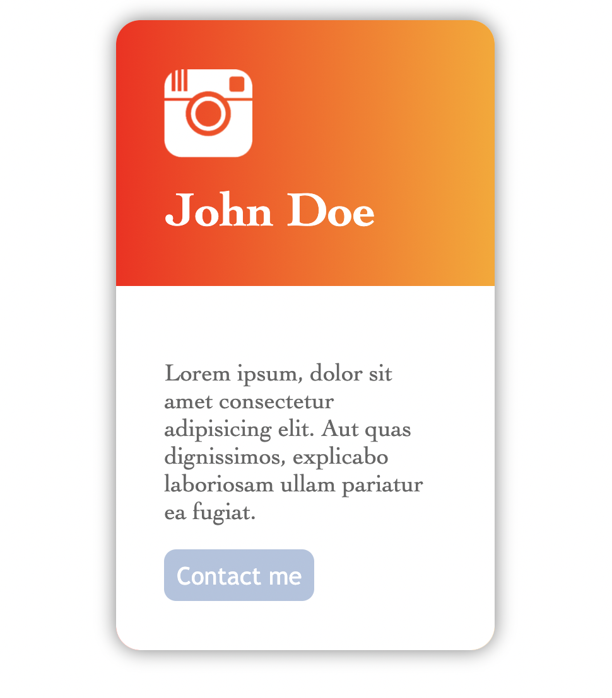

---

### Défi 9

Il vous faut ici prévoir 2 états: l'état normal à gauche et l'état hover à droite. A partie du code HTML suivant et de l'image à télécharger

```html
<div class="card">
  <div class="card-content">
    <h1 class="card-title">Mountain View</h1>
    <p>Check out all of these gorgeous mountain trips with beautiful views of, you guessed it, the mountains</p>
    <div><a href="#" class="cta">View Trips</a></div>
  </div>
</div>
```

📎 [montagnes.jpg](images/I9YhKOv2E8RrT6a8.jpg)

ASTUCES:

- Mettre l'image de fond sur le .card, pas de padding, une largeur max de 300px et une hauteur de 478px, centrée sur la page. Mettre l'image en cover. taille de police de 1.2em en Cambria.
- Le .card-content a une largeur de 100% et une hauteur de 100%. Mettez un padding de 2em. Mettez également un padding top de 380px pour le descendre. Du coup, ça dépasse donc cachez le qui dépasse du .card
- Mettez une taille de 1.5em pour le titre et un margin nul sauf en bottom de 3em.
- Lorsque l'on passe la souris sur le .card, on supprime le margin top du .card-content et on lui met un fond noir de 30% d'opacité. On change aussi le padding du .card-content en mettant 2em à gauche et à droite et 6em en top et en bottom. Changez le margin bottom du titre en 1em...
- Couleur du cta: #444


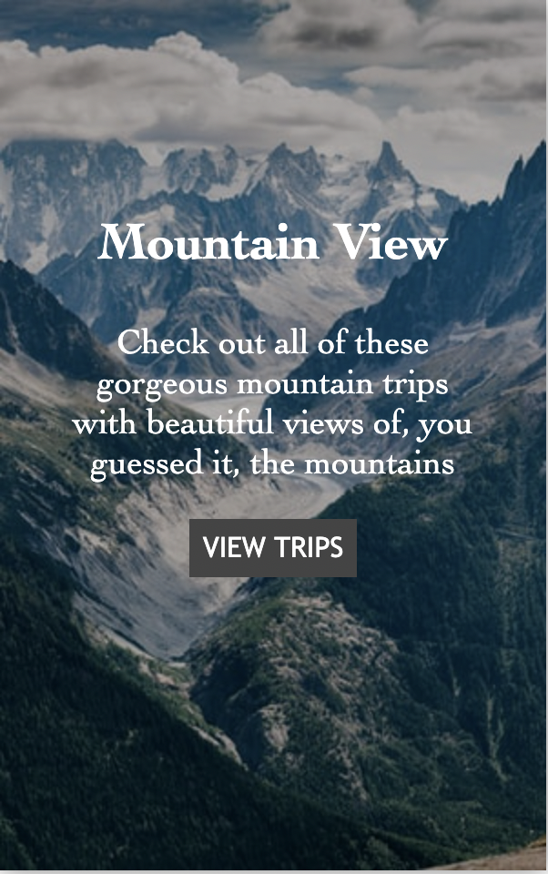

---

### Défi 10

A ârtir du code HTML suivant

```javascript
<div class="card">
  <h1 class="card-title">Card Title</h1>
  <div class="card-content">
    <p>Lorem ipsum dolor sit amet, consectetur adipiscing elit, sed do eiusmod tempor incididunt ut labore et dolore magna aliqua. Ut enim ad minim veniam, quis nostrud exercitation ullamco laboris nisi ut aliquip ex ea commodo consequat. Duis aute irure dolor in reprehenderit in voluptate velit esse cillum dolore eu fugiat nulla pariatur. </p>
    <div><a href="#" class="cta">Next</a></div>
   </div>
</div>
```

ASTUCES:

- Couleur: #FA8172
- La ligne est le bord inférieur du .card-title

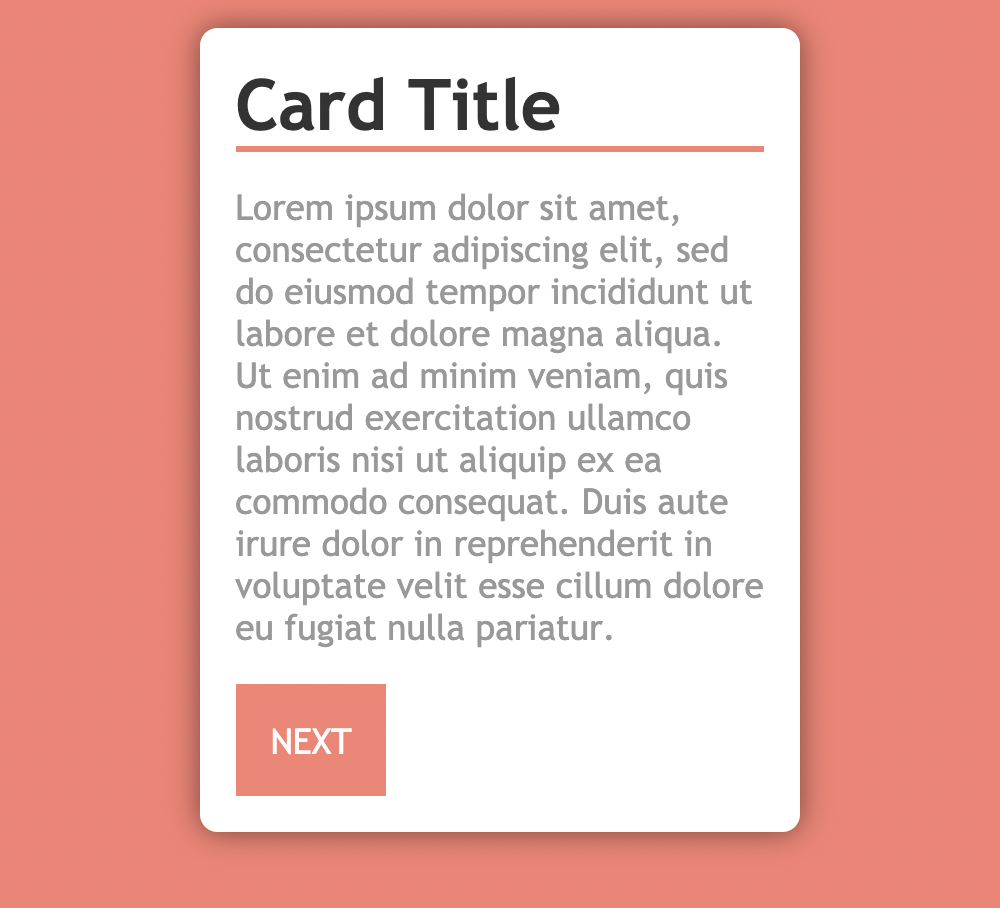

---

### Défi 11

En partant du code HTMK suivant et de l'image à télécharger

```html
<div class="card">
  <header class="card-header">
    <i class="icon icon-plane"></i>
    <h1 class="card-title">Plus</h1>
  </header>
  <div class="card-content">
    <ul>
      <li>Includes Basic Features</li>
      <li>Unlimited Websites</li>
      <li>Unlimited SSD Storage</li>
      <li>Unlimited Domains</li>
      <li>Unlimited Parked Domains</li>
      <li>Unlimited Sub Domains</li>
    </div>
    <div><a href="#" class="cta">Get Started</a></div>
  </div>
</div>
```

📎 [plane.png](images/iQNhZoJZfKX6HgUH.png)

ASTUCES:

- Fond #333 sur le body, police: Trebuchet MS
- Centrez le texte sur la .card. 350px max, texte en blanc, fond dégradé à 135°Couleur 1: #FFEC62, couleur2: #F322D6
- .icon en inline-block, 70px sur 70px. Background en cover sur le .icon-plane
- Jouez sur les margin du title
- Supprimez les puces et le padding du ullist-style: none;
- Une ligne bottom sur les li sauf le dernier

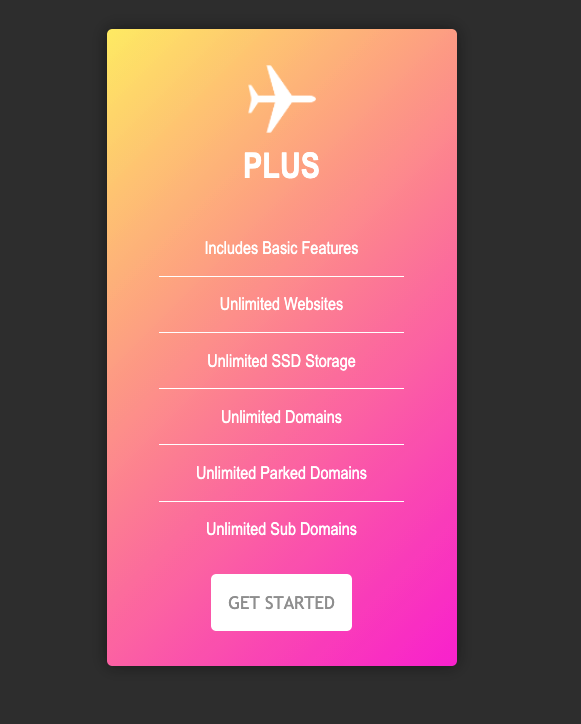

---

### Défi 12

```html
<table class="table table-alter">
  <thead class="table-head">
    <tr>
      <th class="strong">Name</th>
      <th>Wins</th>
      <th>Draws</th>
      <th>Losses</th>
      <th class="strong">Total</th>
    </tr>
  </thead>
  <tbody class="table-body">
    <tr>
      <td class="strong">Dick</td>
      <td>1</td>
      <td>2</td>
      <td>0</td>
      <td class="strong">3</td>
    </tr>
    <tr>
      <td class="strong">Harry</td>
      <td>2</td>
      <td>1</td>
      <td>1</td>
      <td class="strong">4</td>
    </tr>
    <tr>
      <td class="strong">Tom</td>
      <td>0</td>
      <td>2</td>
      <td>3</td>
      <td class="strong">4</td>
      </tr>
  </tbody>
</table>
```

**ASTUCES**

- Utilisez le border-spacing pour supprimer les espaces entre les cellules du .table
- Mettez tout ce qui concerne la tableau dans .table
- Mettez l'alternance des couleurs des cellules du .table-body dans le .table-alterMettez un fond à une tr sur 2...

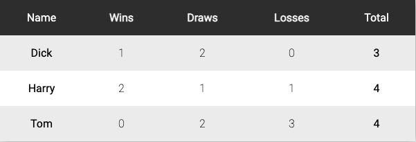

---

## RÉFÉRENCES - POUR ALLER PLUS LOIN

- [Composer le HTML avec les CSS - Apprendre le développement web | MDN](https://developer.mozilla.org/fr/docs/Apprendre/CSS)
- [https://developer.mozilla.org/fr/docs/Web/CSS/border](https://developer.mozilla.org/fr/docs/Web/CSS/border)
- [Power of Box-shadow in CSS - DEV Community](https://dev.to/__akash__19/power-of-box-shadow-in-css-4ki6)
- [11 Amazing Effects Created using CSS3 Box Shadows | SmashingApps.com](https://www.smashingapps.com/2015/09/18/11-amazing-effects-created-using-css3-box-shadows.html)
