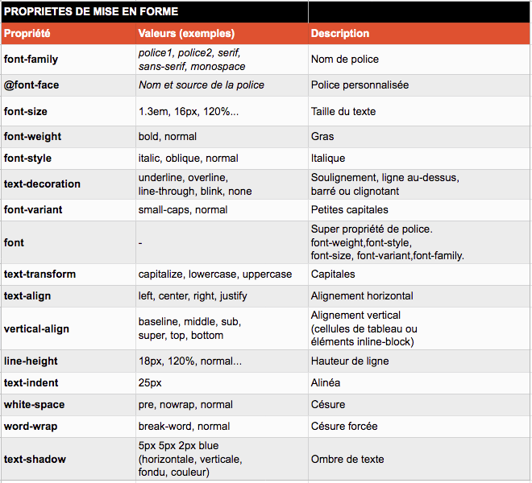
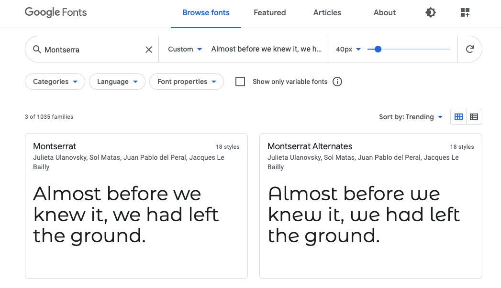
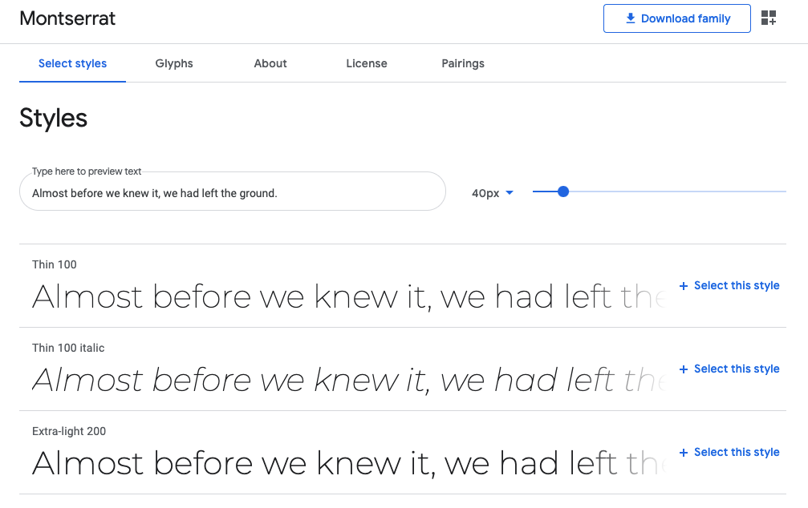
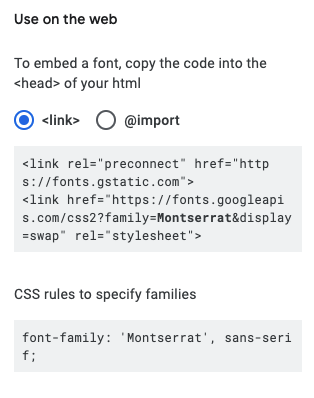
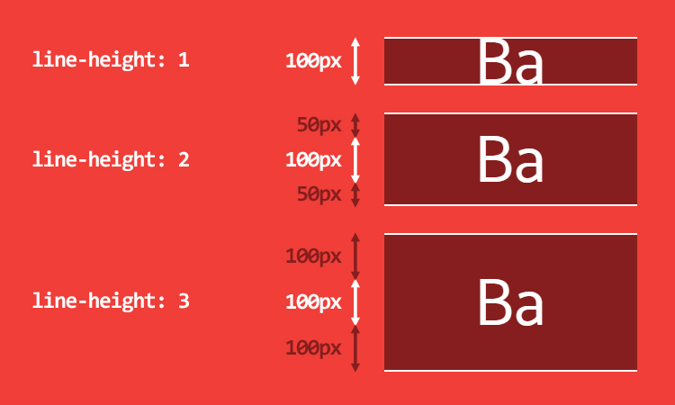
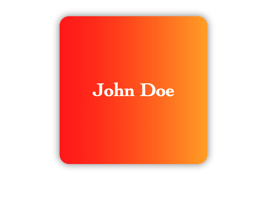
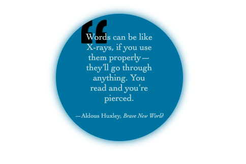
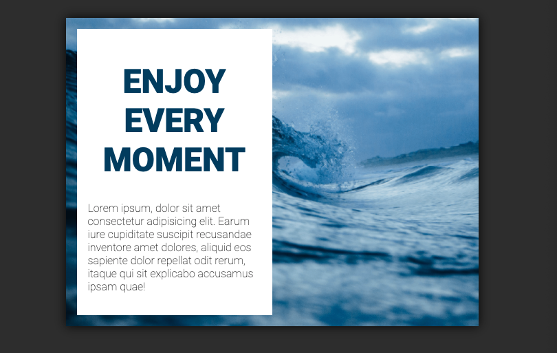

# 13-01. Des propriétés pour les textes

## **1. Mise en forme des textes en CSS**



## 1. Chargement d'une police Google Font

[Google Fonts](https://fonts.google.com/)

1. Choisir une font
2. Choisir le style de font (Thin , ... Black)On peut en choisir plusieurs
3. Copiez le link à placer dans votre code HTML







## 2. Alignement horizontal d'un inline-block

Lorsque je passe un élément en inline-block, il a toutes les caractéristiques d'un block et d'un élément inline. Il devient comme un mot dans un texte.

Donc, si je souhaite faire un alignement horizontal d'un inline-block, je dois utiliser text-align: center dans l'élément parent.

```html
<div class="center">
  <a class="cta">Get Started</a>
</div>
```

```css
.center {
  text-align: center;
}

.cta {
  /* BOX */
  display: inline-block;
  padding: 1em;
  background: orange;

  /* FONT */
  color: #fff;
}
```


## 3. Line-height pour centrer verticalement un texte court

Le line-hight, c'est la hauteur de ligne.

Par exemple, si la font-size est de 100px, une line-height aura 100px.

Mais si on augmente la taille de ce line-height, le texte sera centré verticalement sue cette ligne.

Cette technique est utile **SI il n'y a pas de passage à la ligne dans le texte** !!!



---

## **JE TE METS AU DÉFI**

### Défi 1

- [https://www.w3schools.com/css/exercise.asp](https://www.w3schools.com/css/exercise.asp)
- [https://www.w3schools.com/css/exercise.asp?filename=exercise_text1](https://www.w3schools.com/css/exercise.asp?filename=exercise_text1)
- [https://www.w3schools.com/css/exercise.asp?filename=exercise_font1](https://www.w3schools.com/css/exercise.asp?filename=exercise_font1)
- [https://www.w3schools.com/css/exercise.asp?filename=exercise_link1](https://www.w3schools.com/css/exercise.asp?filename=exercise_link1)

---

### Défi 2

```html
<div class="card-user">
  <h1 class="card-user--title">John Doe</h1>
</div>
```

**ASTUCES**

- Utilisez un line-height pour l'alignement vertical



---

### Défi 3

En partant du code HTML et de l'image suivante ...

```html
<div class="card-user user-pro">
        <header class="card-header">
            <figure>
                
                <figcaption>Ricky Park - User Interface Designer and Front-End Developer - New York</figcaption>
            </figure>
            <h1 class="card-title">Ricky Park</h1>
            <h2>New York</h2>
        </header>
        <div class="card-content">
            <div>User Interface Designer and Front-End Developer</div>
            <div>
                <a href="#" class="cta cta-primary">Message</a>
                <a href="#" class="cta cta-secondary">Following</a>
            </div>
        </div>
        <footer class="card-footer">
            <h3>Skills</h3>
            <a href="#" class="tag">UI/UX</a>
            <a href="#" class="tag">Front-End Development</a>
            <a href="#" class="tag">HTML</a>
            <a href="#" class="tag">CSS</a>
            <a href="#" class="tag">JavaScript</a>
            <a href="#" class="tag">React</a>
            <a href="#" class="tag">Node</a>
        </footer>
    </div>
```

📎 [ricky.jpg](images/uD8fvxIRRz98f8s4.jpg)

ASTUCES:

- Couleur de fond du body: #28223FCouleur de fond de la card et de l'ombre portée: #231E39Couleur de fond du footer: #1F1A36Couleur des bords des tags: #2D2747Couleur primaire: #03BFCBCouleur du texte: #B3B8CDCouleur de fond du 'pro': #FEBB0BPolice de caractères: MontSerra Regular
- .card-user en 350px max, coins arrondis à 5px sans padding (car le footer va de bords à bords)
- Ajouter un contenu en début de .card-user qui a un .user-proContenu: 'PRO', en inline-block avec fond
- Pour la figure...Masquez le figcaption avec un display: none;Bords arrondis à 50% pour l'image pour faire un rondBorders en couleur primaire avec un padding de .5em;
- Les CTA.cta qui ressemble au secondary (c'est le cta par défaut).ta-primary avec la couleur primaire en fond
- Le footerLes .tag en inline-block ...


---

### Défi 4

```html
<figure class="quote">
  <blockquote class="quote-content" cite="https://www.huxley.net/bnw/four.html">
    <p>Words can be like X-rays, if you use them properly—they’ll go through anything. You read and you’re pierced.</p>
  </blockquote>
  <figcaption class="quote-cite">—Aldous Huxley, <cite>Brave New World</cite></figcaption>
</figure>
```

📎 [quotation-mark.png](images/XnvUmDtEMpcSyjTm.png)

**ASTUCES**

- Couleur 1: #0C80ACCouleur texte: #B4D7DCPolice: Cambria
- Figure en border de 50% avec l'image en fond



---

### Défi 5

```html
<div class="card">
  <div class="card-content">
    <h1 class="card-title">Enjoy Every Moment</h1>
    <p>Lorem ipsum, dolor sit amet consectetur adipisicing elit. Earum iure cupiditate suscipit recusandae inventore amet dolores, aliquid eos sapiente dolor repellat odit rerum, itaque qui sit explicabo accusamus ipsam quae!</p>
  </div>
</div>
```

📎 [waves.png](images/QPETRCLCIIMoJ7UC.png)

ASTUCES:

- Couleur fond et police: #333Couleur title: #02456BPolice: Roboto Light et Black



---

## **RÉFÉRENCES**

- [Référence CSS - CSS : Feuilles de style en cascade | MDN](https://developer.mozilla.org/fr/docs/Web/CSS/Reference#s%C3%A9lecteurs)
- [CSS3 module: W3C Selectors](https://www.w3.org/Style/css3-selectors-updates/WD-css3-selectors-20010126.fr.html)
- [CSS Selectors Reference](https://www.w3schools.com/cssref/css_selectors.asp)
- [Sélecteurs CSS (simples et complexes) - Liste et utilisation - Pierre Giraud](https://www.pierre-giraud.com/liste-selecteurs-css-utilisation/)
- [Formation Découverte du CSS | Grafikart](https://grafikart.fr/formations/css)
- [CSS avancé : métriques des fontes, line-height et vertical-align - Vincent De Oliveira](https://iamvdo.me/blog/css-avance-metriques-des-fontes-line-height-et-vertical-align)
