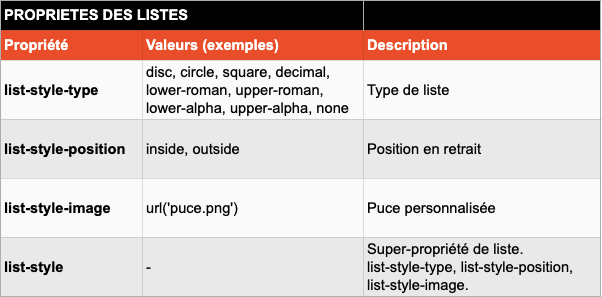
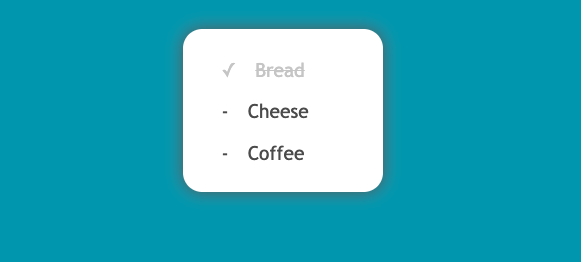

# 13-02. Des propriétés pour les listes



## **1. Sur quel élément placer ces spécifications ?**

Les spécifications relatives aux puces se placent sur les &lt;ul> ou le &lt;ol>

```html
<ul class="list-sans-puces">
  <li>Item 1</li>
  <li>Item 2</li>
  <li>Item 3</li>
</ul>
```

```css
.liste-sans-puces {
  list-style: none;
}
```

---

## **METTEZ-VOUS AU DÉFI !**

### Défi 1

```html
<ul class="tasks-list">
  <li class="task done">Bread</li>
  <li class="task">Cheese</li>
  <li class="task">Coffee</li>
</ul>
```

**ASTUCES**

- Couleur de fond: #1BA2B8Police: Trebuchet MS
- Fond blanc et coins arrondis sur le tasks-listPas de puces
- Barrer, mettre en #ccc et un contenu de '✓' sur les tasks qui sont .done



📎 [defi1.html](images/Kl6VrX5yQ7xPd0EG.html)

---

## **RÉFÉRENCES**

- [Référence CSS - CSS : Feuilles de style en cascade | MDN](https://developer.mozilla.org/fr/docs/Web/CSS/Reference#s%C3%A9lecteurs)
- [CSS3 module: W3C Selectors](https://www.w3.org/Style/css3-selectors-updates/WD-css3-selectors-20010126.fr.html)
- [CSS Selectors Reference](https://www.w3schools.com/cssref/css_selectors.asp)
- [Sélecteurs CSS (simples et complexes) - Liste et utilisation - Pierre Giraud](https://www.pierre-giraud.com/liste-selecteurs-css-utilisation/)
