# 14-01. La propriété FLOAT

## 1. Des boites flottantes

La propriété `float` permet de créer un habillage d'un block par me contenu qui le suit dans le code HTML.

Dans cet exemple ci, l'idée est d'attribuer la propriété float: left à l'objet en vert. Les éléments suivants entoureront l'objet vert. À LA CONDITION que l'objet vert n'ait pas une dimension de 100% !!!!

```css
.boite-flotante-gauche {
  float: left;
  margin: 0 1em 1em 0;
}
```

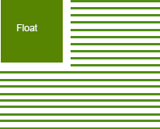

## 2. Dimension des boites flottantes

Attention, lorsque l'on met une propriété float à un objet, la largeur de cet objet devient AUTOMATIQUEMENT la largeur max de son contenu !!!

S'il s'agit d'un objet avec du texte, la largeur de l'élément va devenir la largeur du texte. Et si le texte prend toute la largeur, voire plusieurs lignes, alors, le block restera à 100% et le float n'aura aucun effet !!!

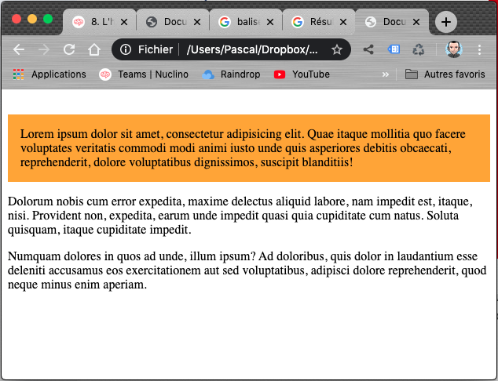

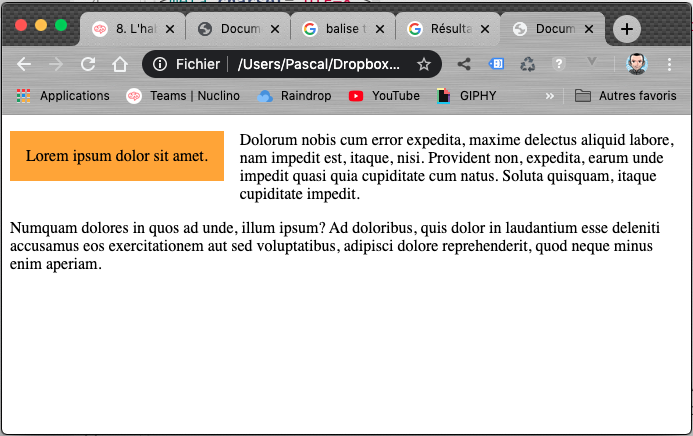

Si par contre, le contenu du bloc en float n'est pas de 100%, par exemple si le texte est plus court, alors là, le bloc prendra cette largeur et le float marchera !!!

Donc, en gros, la dimension automatique d'un bloc mis en float sera celle de son contenu !!!

Le mieux est de donner une dimension à ce bloc histoire d'avoir un certain contrôle sur ce qui se passe...

```css
.boite-flotante {
  float: left;
  width: 20%;
  margin: 0 1em 1em 0;
}
```

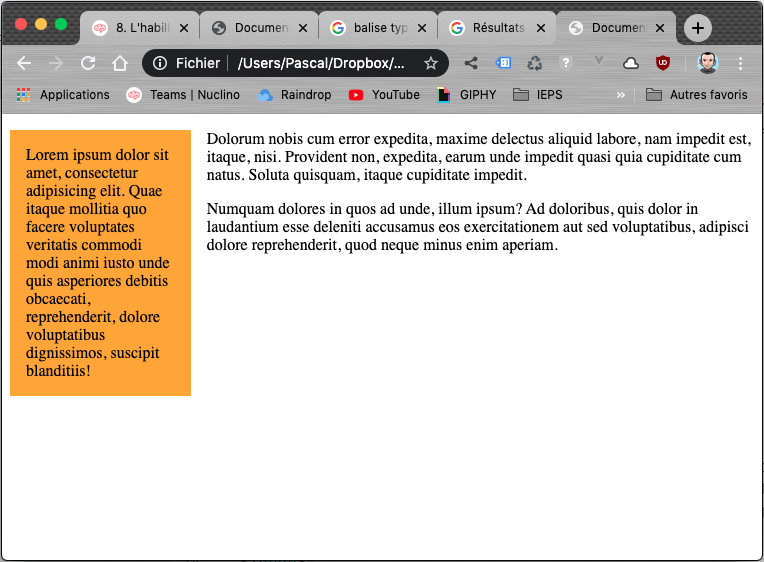

## 3. Comment passer sous la boite flottante ? La propriété clear

Imaginons que nous souhaitions faire passer le 2ème paragraphe sous la boite comme dans l'image ci-dessus... Il faut annuler l'habillage ...

Pour ça, il y a la propriété **clear.**..

```css
.clear {
   clear: left;
}
```

Et on collera cette étiquette au second paragraphe !!!

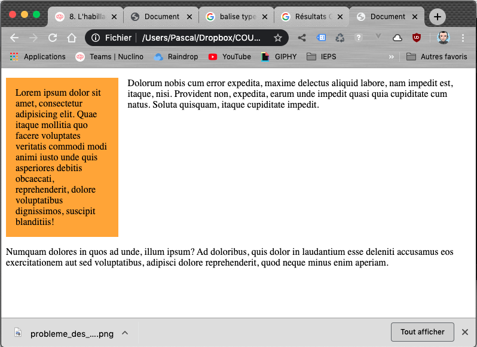

La propriété clear peut prendre comme valeur:

- left: pour annuler un habillage à gauche
- right: pour annuler un habillage à droite
- both: pour annuler tous les habillages

## 4. Le problème du float...

La hauteur des objets HTML est TOUJOURS celle de leur contenu. Par exemple, la hauteur d'un paragraphe est celle du texte qu'il y a dedans. Logique tout de même...

Mais lorsqu'on applique un float à un objet, celui-ci SORT du contenu de l'objet qui le contient et donc la hauteur de ce container devient celle du contenu restant...

La boite noire contient la boite rouge. Celle-ci est en float: left... Donc, la hauteur de la boite conteneur devient celle du contenu restant...

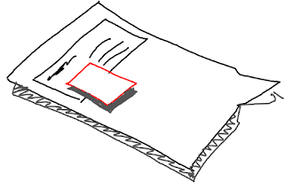

Par exemple, dans cet exemple, on a un code HTML comme suit:

```html
<div style="background: #ccc;">
  <p class="boite-flottante-gauche">
     Lorem ipsum...
  </p>
  <p>Dolorum nobis...</p>
  <p>Numquam dolores...</p>
</div>
```

On voit que la hauteur du div (en gris) est liée au 2 derniers paragraphes car le premier est sorti du flux !!! Il ne compte plus pour la hauteur du conteneur...

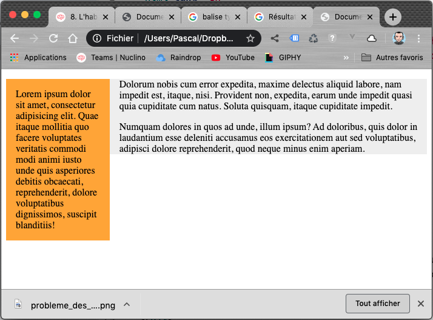

<video src="images/LscksfhWRyqFrNeN.mp4" autoplay loop muted playsinline controls></video>

Si je veux que la hauteur du conteneur inclue la boite flottante, il y a 2 techniques:

### Technique 1: un objet en clear

L'idée est d'ajouter un objet vide à la fin du div conteneur et de coller un `clear: both` à ce nouvel objet.. Il passera donc sous l'habillage et tirera la hauteur du conteneur... Reste juste à enlever le coucou...

```html
<div style="background: #ccc;">
  <p class="boite-flottante-gauche">
     Lorem ipsum...
  </p>
  <p>Dolorum nobis...</p>
  <p>Numquam dolores...</p>
  <div style="clear: both;">Coucou</div>
</div>
```


### Technique 2: un rien plus moderne et moins invasive ! Le :after

On va ajouter le même élément HTML à la fin du div conteneur, mais cette fois, ARTIFICIELLEMENT en CSS grâce au pseudo-élément `:after`

```javascript
<div class="clear-container">
  <p class="boite-flottante-gauche">
    Lorem ipsum...
  </p>
  <p>Dolorum nobis...</p>
  <p>Numquam dolores...</p>
</div>
```

```css
.clear-container:after {
  content: '';
  display: block;
  clear: both;
}
```

Et voilà !!! Oufti !!!

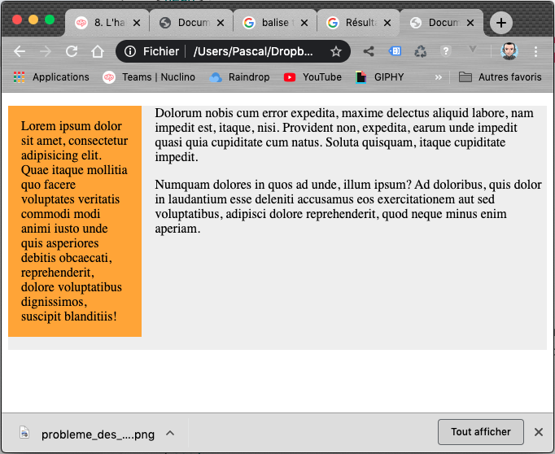

<video src="images/w0eCyJR0uTcd4Hfw.mp4" autoplay loop muted playsinline controls></video>

## 5. Plusieurs boites flottantes

Si on met une propriété float sur plusieurs objets consécutifs, ils se mettent l'un à coté de l'autre ...

```html
<div>
  <p>Lorem ipsum.</p>
  <p>Consequatur, sint?</p>
  <p>Ullam, quod.</p>
  <p>Harum, cumque?</p>
</div>
```

```css
p {
    float: left;
    background: orange;
    padding: 1em;
    width: 10%;
    margin-right: 10px
  }
```

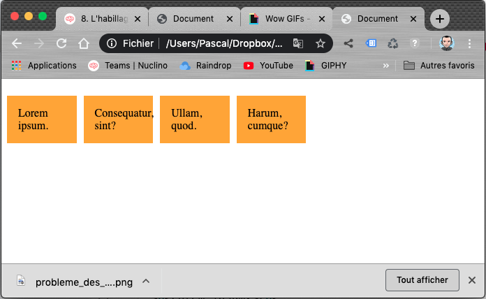

## 6. Compatibilité

Cette propriété est largement compatible avec tous les navigateurs, anciens et modernes. FEU VERT donc !

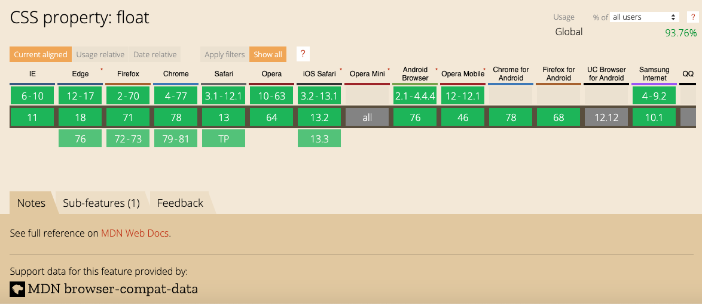

---

## JE TE METS AU DÉFI

### Défi 1: Des boites flottantes à gauche et à droite

Défi: 4 étiquettes

- `.container`
- `.habillage--gauche`
- `.habillage--droite`
- `.citation`

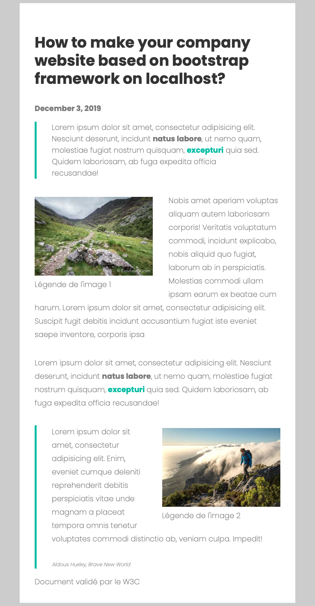

Et on part du code HTML suivant:

```html
<!DOCTYPE html>
<html lang="en">
  <head>
    <meta charset="UTF-8" />
    <meta name="viewport" content="width=device-width, initial-scale=1.0" />
    <meta http-equiv="X-UA-Compatible" content="ie=edge" />
    <title>Projet 1</title>
    <link
      href="https://fonts.googleapis.com/css?family=Poppins:200,400,700&display=swap"
      rel="stylesheet"
    />
  </head>
  <body>
    <section class="container">
      <article>
        <header>
          <h1>
            How to make your company website based on bootstrap framework on
            localhost?
          </h1>
          <div>
            <time datetime="2019-12-03">December 3, 2019</time>
          </div>
        </header>
        <!-- p*3>lorem -->
        <blockquote class="citation">
          Lorem ipsum dolor sit amet, consectetur adipisicing elit. Nesciunt
          deserunt, incidunt <strong>natus labore</strong>, ut nemo quam,
          molestiae fugiat nostrum quisquam, <a href="#">excepturi</a> quia sed.
          Quidem laboriosam, ab fuga expedita officia recusandae!
        </blockquote>
        <!-- Cette figure devrait être une boite flottante à gauche -->
        <figure class="habillage-droite">
          
          <figcaption>Légende de l'image 1</figcaption>
        </figure>
        <p>
          Nobis amet aperiam voluptas aliquam autem laboriosam corporis!
          Veritatis voluptatum commodi, incidunt explicabo, nobis aliquid quo
          fugiat, laborum ab in perspiciatis. Molestias commodi ullam ipsam
          earum ex beatae cum harum. Lorem ipsum dolor sit amet, consectetur
          adipisicing elit. Suscipit fugit debitis incidunt accusantium fugiat
          iste eveniet saepe inventore, corporis ipsa
        </p>
        <p>
          Lorem ipsum dolor sit amet, consectetur adipisicing elit. Nesciunt
          deserunt, incidunt <strong>natus labore</strong>, ut nemo quam,
          molestiae fugiat nostrum quisquam, <a href="#">excepturi</a> quia sed.
          Quidem laboriosam, ab fuga expedita officia recusandae!
        </p>
        <!-- Cette figure devrait être une boite flottante à droite -->
        <figure class="habillage-gauche">
          
          <figcaption>Légende de l'image 2</figcaption>
        </figure>
        <blockquote class="citation" cite="http://www.aldoushuxley.com">
          <p>
            Lorem ipsum dolor sit amet, consectetur adipisicing elit. Enim,
            eveniet cumque deleniti reprehenderit debitis perspiciatis vitae
            unde magnam a placeat tempora omnis tenetur voluptates commodi
            distinctio ab, veniam culpa. Impedit!
          </p>
          <footer>
            <cite>Aldous Huxley, Brave New World</cite>
          </footer>
        </blockquote>
      </article>
      <footer>Document validé par le W3C</footer>
    </section>
  </body>
</html>
```

---

### **Défi 2: Un menu horizontal avec la propriété float**

Défi: 5 étiquettes (elles sont déjà placées dans le code HTML)

- `.menu--horizontal`
- `.boite--fixe`
- `.active`
- `.boite-couleur--1`
- `.boite--droite`

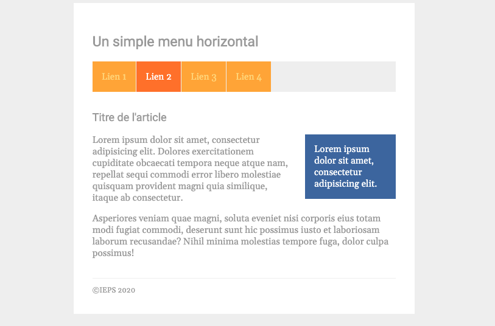

Partons du code HTML suivant:RQ:

- Les polices sont déjà chargées
- Couleurs:
    - orange,
    - rgb(255,214,105) (orange clair - texte de liens off),
    - rgb(255,114,5) (orange foncé - fond liens active et hover),
    - #3D64A2 (bleu)

```html
<!DOCTYPE html>
<html lang="en">
<head>
  <meta charset="UTF-8">
  <meta name="viewport" content="width=device-width, initial-scale=1.0">
  <meta http-equiv="X-UA-Compatible" content="ie=edge">
  <title>Un simple menu horizontal - FLOAT</title>
  <link href="https://fonts.googleapis.com/css?family=Gelasio|Roboto&display=swap" rel="stylesheet">
  <style>
    /* CODE CSS DE BASE */
    * {
      box-sizing: border-box;
    }
    body {
      background: #eee;
      font-family: 'Gelasio', serif;
      font-size: 1.2em;
      color: #999;
    }
    h1 {
      font-family: 'Roboto', sans-serif;
    }
    footer {
      border-top: #eee 1px solid;
      padding-top: 1em;
      font-size: .8em;
    }
    main {
      margin: 2em 0;
    }
    /* FIN DE CODE CSS DE BASE */
    /* ------------------------------------------------------ */
    /* ICI VIENT VOTRE CODE CSS */
    /* FIN DE VOTRE CODE CSS */
  </style>
</head>
<body>
<section class="boite--fixe">
  <header>
    <h1>Un simple menu horizontal - FLOAT</h1>
    <nav class="menu--horizontal">
      <ul>
        <li><a href="#">Lien 1</a></li>
        <li class="active"><a href="#">Lien 2</a></li>
        <li><a href="#">Lien 3</a></li>
        <li><a href="#">Lien 4</a></li>
      </ul>
    </nav>
  </header>
  <main>
    <article>
      <h1>Titre de l'article</h1>
      <aside class="boite-couleur--1 boite--droite">Lorem ipsum dolor sit amet, consectetur adipisicing elit.</aside>
      <p>Lorem ipsum dolor sit amet, consectetur adipisicing elit. Dolores exercitationem cupiditate obcaecati tempora neque atque nam, repellat sequi commodi error libero molestiae quisquam provident magni quia similique, itaque ab consectetur.</p>
      <p>Asperiores veniam quae magni, soluta eveniet nisi corporis eius totam modi fugiat commodi, deserunt sunt hic possimus iusto et laboriosam laborum recusandae? Nihil minima molestias tempore fuga, dolor culpa possimus!</p>
    </article>
  </main>
  <footer>
    <div>&copy;IEPS 2020</div>
  </footer>
</section>
</body>
</html>
```

---

### **Défi 3: Le même exercice mais comme ceci.**

Défi: on n'ajoute qu'une seule étiquette `.menu-etendu` au `nav`Astuce.. On va juste travailler sur la dimension des li ...

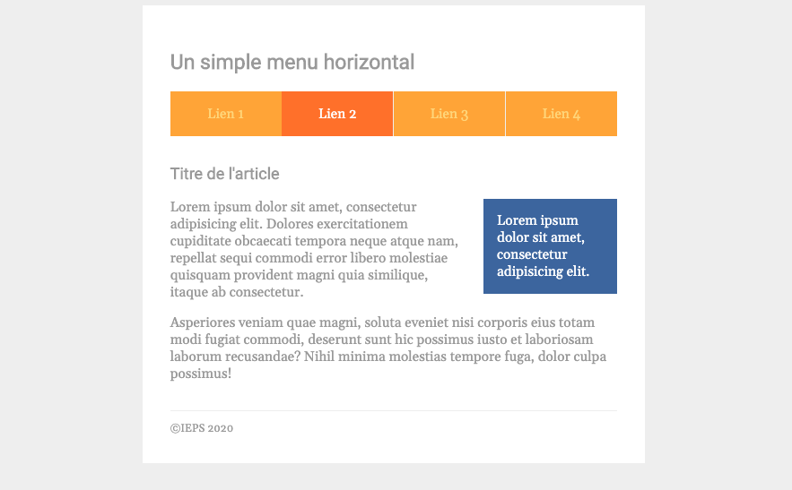

<video src="images/rQ89Kd9wQsrRaBB9.mp4" autoplay loop muted playsinline controls></video>

---

## **RÉFÉRENCES**

- [Référence CSS - CSS : Feuilles de style en cascade | MDN](https://developer.mozilla.org/fr/docs/Web/CSS/Reference#s%C3%A9lecteurs)
- [Propriétés par ordre alphabétique](http://www.css-faciles.com/proprietes-css-liste-alphabetique.php)
- [La propriété CSS float - Pierre Giraud](https://www.pierre-giraud.com/html-css-apprendre-coder-cours/float/)
