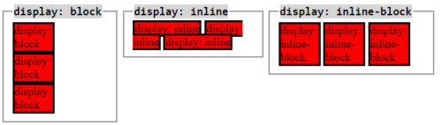
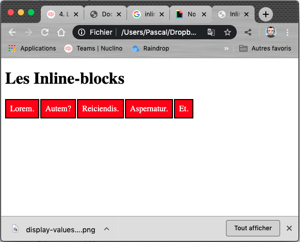
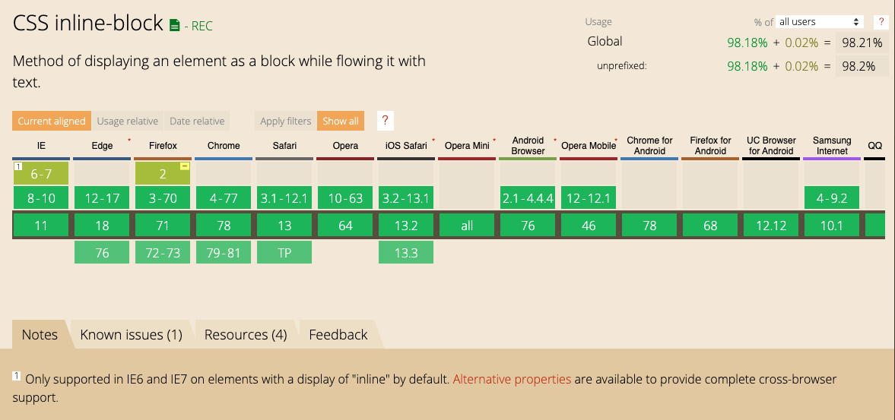
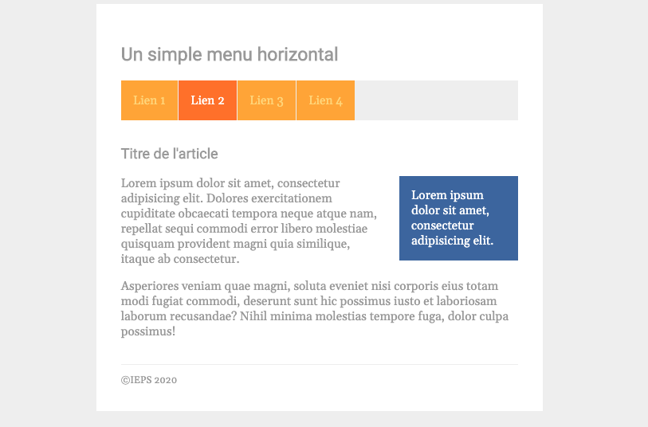
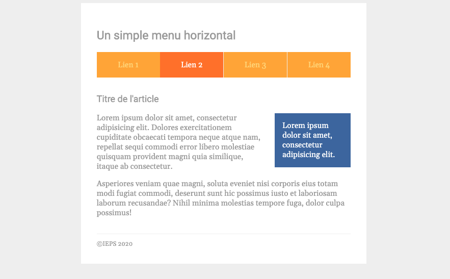

# 15-01. Les INLINE-BLOCKS

## 1. Des blocks inline quoi...

Si on colle une propriété display: inline-block à un élément, il aura automatiquement

- **Les caractéristiques d'un élément de type block:**Des margins, padding, width, height, ... (les éléments inline n'ont pas de width de height ou de margin..)
- **Les caractéristiques d'un élément de type inline**
    - Sa largeur sera celle de son contenu (comme les float)
    - Il sera considéré comme un mot dans un paragraphe, c'est à dire avec un espace avant et après.



```html
<div class="conteneur">
  <div>Lorem ipsum...</div>
  <div>Lorem ipsum...</div>
  <div>Lorem ipsum...</div>
</div>
```

```css
.conteneur > div {
  display: inline-block;
  width: 20%;
}
```

## 2. Le problème de l'espace entre les inline-block...

L'espace qu'il y a entre les inline-block est la taille d'un caractère `' '`, l'espace qu'il y a entre 2 mots quoi ... Cet espace dépend donc de la font-size ... Donc si on veut contrôler précisément la dimension de cet espace (le mettre à 1px par exemple) on est un peut embêtés car on ne va tout de même pas mettre la taille de police à 1px, si ?

<video src="images/Cx7iCvF8j4CsM3sJ.mp4" autoplay loop muted playsinline controls></video>

Bon, on va devoir passer par une astuce un rien foireuse... Supposons qu'on a le code HTML suivant:

```
<div class="conteneur">
  <div>Lorem ipsum...</div>
  <div>Lorem ipsum...</div>
  <div>Lorem ipsum...</div>
</div>
```

Et que l'on veuille mettre les div du contenu en inline-block avec 1px entre chaque block... On va:

- Mettre la taille de police du conteneur à 0 😱Du coup y a plus d'espace du tout entre les mots... Bon d'accord, y a plus de mots non plus dans les div ...
- Puis, on va remettre une taille de police aux div. Comme ça, les div auront une taille de police mais pas entre les div !!! Oufti, fallait y penser tout de même non ?

```css
/* 1. On met la police à 0 
      pour le conteneur */
  .conteneur {
    font-size: 0;
  }
/* 2. On défini une police 
      pour les div */
  .conteneur > div {
    font-size: 1rem;
  }
/* 3. On gère l'espace entre les block 
      avec un margin-right 
      sauf pour le dernier !!! */
  .conteneur > div:not(last-of-type){
    margin-right: 2px;
  }
```



## 3. C'est quoi ce REM ?

Vous aurez remarqué le 1rem et non 1em !!! C'est quoi ce truc de 1rem ???

Et bien si on met 1em, ce sera 100% de la taille de police par défaut pour le block, c'est à dire 100% de 0... Ca reste fort 0 !!!

Du coup, on va passer par un 1rem, c'est 100% de la taille définie pour l'élément ROOT (Racine), le body quoi !!! Et hop, le tour est joué !!!

<video src="images/Y7rCacddjcv5tIAF.mp4" autoplay loop muted playsinline controls></video>

## 4. Compatibilité

Cette propriété est largement compatible avec tous les navigateurs, anciens et modernes. FEU VERT donc !



---

## JE TE METS AU DÉFI

On va reprendre l'exercice des float mais on va utiliser la propriété display inline-block pour le menu !!! On laisse la boite flottante qui ne peut se faire qu'avec un float !!!

### **Défi 1: Un menu horizontal en inline-blocks**

Défi: 5 étiquettes (elles sont déjà placées dans le code HTML)

- `.menu-horizontal`
- `.boite-fixe-centree`
- `.active`
- `.boite-couleur--1`
- `.boite-flottante--droite`



Partons du code HTML suivant:RQ:

- Les polices sont déjà chargées
- Couleurs:
    - orange,
    - rgb(255,214,105) (orange clair - texte de liens off),
    - rgb(255,114,5) (orange foncé - fond liens active et hover),
    - #3D64A2 (bleu)

```html
<!DOCTYPE html>
<html lang="en">
<head>
  <meta charset="UTF-8">
  <meta name="viewport" content="width=device-width, initial-scale=1.0">
  <meta http-equiv="X-UA-Compatible" content="ie=edge">
  <title>Un simple menu horizontal - FLOAT</title>
  <link href="https://fonts.googleapis.com/css?family=Gelasio|Roboto&display=swap" rel="stylesheet">
  <style>
    /* CODE CSS DE BASE */
    * {
      box-sizing: border-box;
    }
    body {
      background: #eee;
      font-family: 'Gelasio', serif;
      font-size: 1.2em;
      color: #999;
    }
    h1 {
      font-family: 'Roboto', sans-serif;
    }
    footer {
      border-top: #eee 1px solid;
      padding-top: 1em;
      font-size: .8em;
    }
    main {
      margin: 2em 0;
    }
    /* FIN DE CODE CSS DE BASE */
    /* ------------------------------------------------------ */
    /* ICI VIENT VOTRE CODE CSS */
    /* FIN DE VOTRE CODE CSS */
  </style>
</head>
<body>
<section class="boite-fixe-centree">
  <header>
    <h1>Un simple menu horizontal - FLOAT</h1>
    <nav class="menu-horizontal">
      <ul>
        <li><a href="#">Lien 1</a></li>
        <li class="active"><a href="#">Lien 2</a></li>
        <li><a href="#">Lien 3</a></li>
        <li><a href="#">Lien 4</a></li>
      </ul>
    </nav>
  </header>
  <main>
    <article>
      <h1>Titre de l'article</h1>
      <aside class="boite-couleur--1 boite-flotante--droite">Lorem ipsum dolor sit amet, consectetur adipisicing elit.</aside>
      <p>Lorem ipsum dolor sit amet, consectetur adipisicing elit. Dolores exercitationem cupiditate obcaecati tempora neque atque nam, repellat sequi commodi error libero molestiae quisquam provident magni quia similique, itaque ab consectetur.</p>
      <p>Asperiores veniam quae magni, soluta eveniet nisi corporis eius totam modi fugiat commodi, deserunt sunt hic possimus iusto et laboriosam laborum recusandae? Nihil minima molestias tempore fuga, dolor culpa possimus!</p>
    </article>
  </main>
  <footer>
    <div>&copy;IEPS 2020</div>
  </footer>
</section>
</body>
</html>
```

---

### **Défi 2: Le même exercice mais comme ceci.**

Défi: on n'ajoute qu'une seule étiquette `.menu-centre` au `nav`Astuce.. On va juste travailler sur la dimension des li ...



<video src="images/5TI4y8zrcUuFbHF4.mp4" autoplay loop muted playsinline controls></video>

---

## RÉFÉRENCES: POUR ALLER PLUS LOIN

- [Display inline-block, une valeur trop peu utilisée - Alsacreations](https://www.alsacreations.com/article/lire/1209-display-inline-block.html)
- [Les niveaux ou "types" d'éléments HTML block et inline - Pierre Giraud](https://www.pierre-giraud.com/html-css-apprendre-coder-cours/block-inline/)
- [CSS Layout - inline-block](https://www.w3schools.com/css/css_inline-block.asp)
- [Propriétés par ordre alphabétique](http://www.css-faciles.com/proprietes-css-liste-alphabetique.php)
