# 16-01. Les FLEXBOXES

## 1. Définir le conteneur: Display: flex

Le simple fait de mettre un display flex à un conteneur fait en sorte que les éléments contenus se mettent AUTOMATIQUEMENT en ligne, comme s'ils étaient en float, mais sans les ennuis du float, ou comme s'ils étaient en inline-block sans les espaces entre... COOL !!!

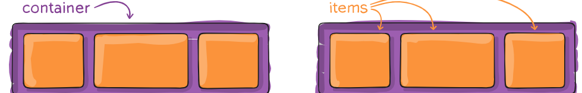

```html
<div class="conteneur-flexible">
  <div>DIV 1 - Lorem ipsum.</div>
  <div>DIV 2 - Repudiandae, quo.</div>
  <div>DIV 3 - Expedita, ab.</div>
</div>
```

```css
.conteneur-flexible {
  display: flex;
}
```

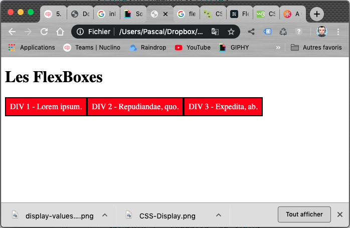

<video src="images/w3tS8M7IZ823TnTq.mp4" autoplay loop muted playsinline controls></video>

## 2. Les propriétés du conteneur

### A. Flex-direction

On peut modifier la direction des éléments: en ligne ou en colonnes, en ordre normal ou inverse

- Direction row → horizontale (par défaut)
- Direction column → verticale

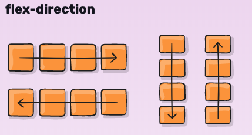

```css
.conteneur-flexible {
  display: flex;
  /* flex-direction: 
     column| column-reverse | 
     row (par défaut)  | 
     row-reverse */
  flex-direction: row-reverse;
}
```

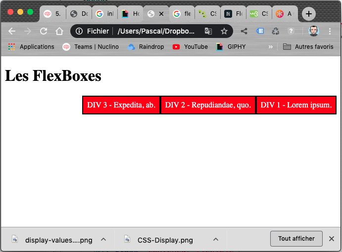

### B. Flex-wrap

On défini ici le passage ou non à la ligne des items

Par défaut, tous les items restent sur la même ligne et rapetissent s'il n'y a pas assez de place. Mais on peut les faire passer à la ligne s'il n'y a pas assez de place...

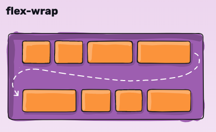

```html
<div class="conteneur-flexible">
    <div>Lorem ipsum.</div>
    <div>Ratione, amet!</div>
    <div>Sed, quas!</div>
    <div>Eligendi, laudantium.</div>
    <div>Minima, placeat!</div>
    <div>Accusantium, hic.</div>
    <div>Sint, totam.</div>
    <div>Neque, iste.</div>
    <div>Voluptatem, illum.</div>
    <div>Distinctio, velit?</div>
  </div>
```

```css
.conteneur-flexible {
  display: flex;
  /* flex-wrap: nowrap (par défaut) | 
     wrap | wrap-reverse */
  flex-wrap: wrap;
}
```

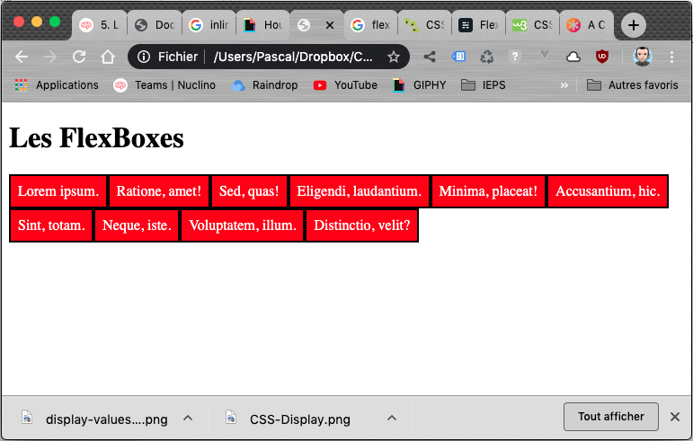

### C. Flex-flow

C'est un raccourcis pour définir en un coup la direction et le wrap

```css
.conteneur-flexible {
  display: flex;
  /* flex-flow: flex-direction flex-wrap */
  flex-flow: row-reverse wrap;
}
```

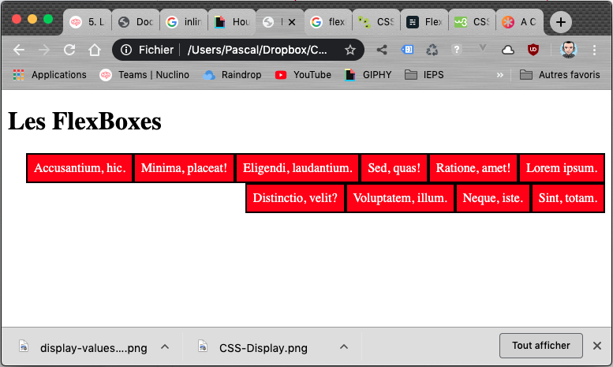

### D. Justify-content

Définit l'alignement des items dans la direction principale:

- Direction row (horizontale) → alignement horizontal
- Direction column (verticale) → alignement vertical

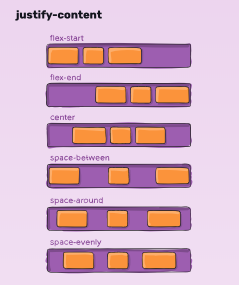

```css
.conteneur-flexible {
  display: flex;
  /* justify-content: 
     flex-start (par défaut) | 
     flex-end | center | 
     space-between | space-around | 
     space-evenly | start | end | 
     left | right */
  justify-content: center;
}
```

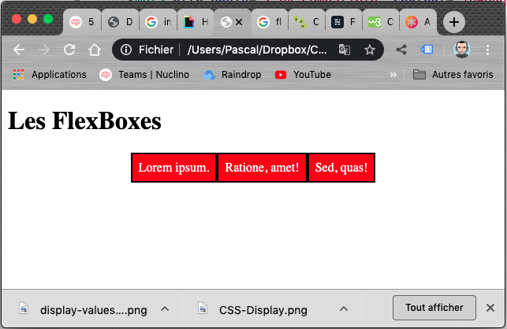

### E. Align-items

Définit l'alignement des items les uns par rapport aux autres (visible uniquement s'ils n'ont pas la même hauteur...)

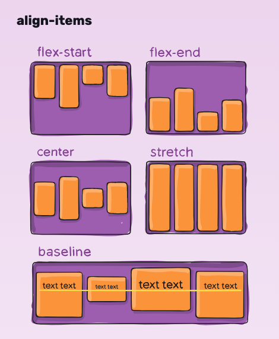

```css
.conteneur-flexible {
  display: flex;
  /* align-items: stretch (par défaut) |
     flex-start | flex-end | 
     center | baseline | first baseline |
     last baseline | start | end | 
     self-start | self-end */
  align-items: center;
}
```

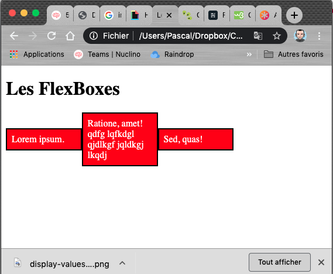

### F. Align-content

Définit l'alignement des items dans la direction secondaire:

- Direction row (horizontale) → alignement vertical
- Direction column (verticale) → alignement horizontal

Cette propriété n'est pertinente que si on défini une hauteur particulière au conteneur...

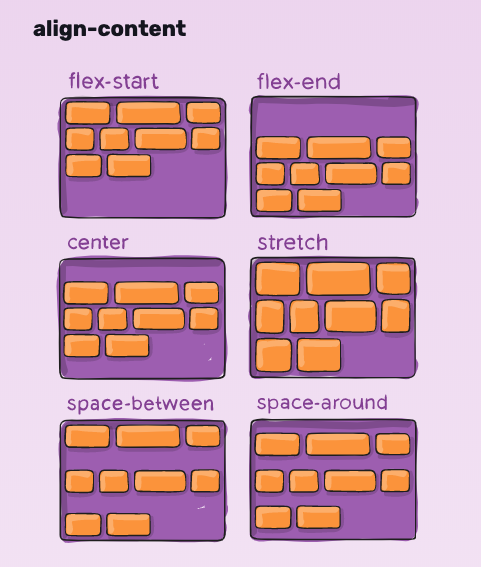

```css
.conteneur-flexible {
  border: #000 2px solid;
  height: 300px;
  display: flex;
  /* Alignement horizontal */
     justify-content: center; 

  /* Alignement des items entre eux */
     align-items: center; 

  /* align-content: flex-start | 
     flex-end | center | space-between | 
     space-around | space-evenly | 
     stretch (par défaut) | start | 
     end | baseline | first baseline | 
     last baseline */
  align-content: center;
}
```

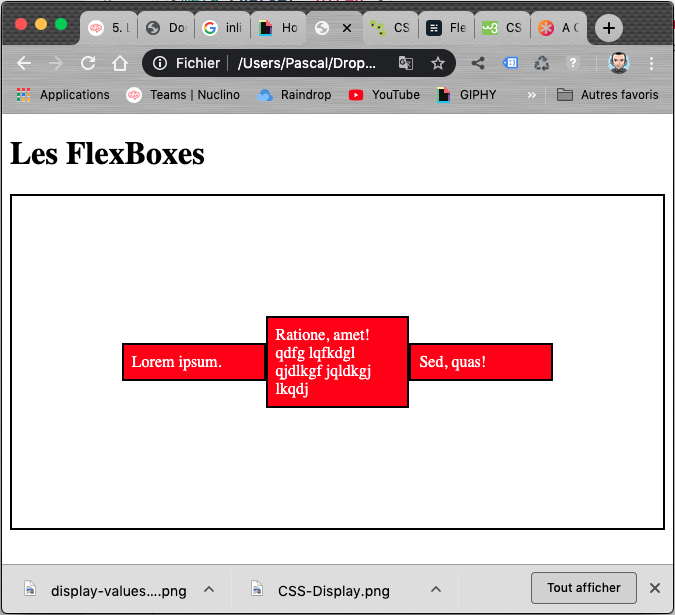

## 3. Les propriétés des items

### A. Order

Permet de spécifier l'ordre des items. On peut aller en positif ou en négatif !!! Si 2 élément on la même valeur d'ordre, l'ordre sera déterminé par l'ordre dans le code HTML.

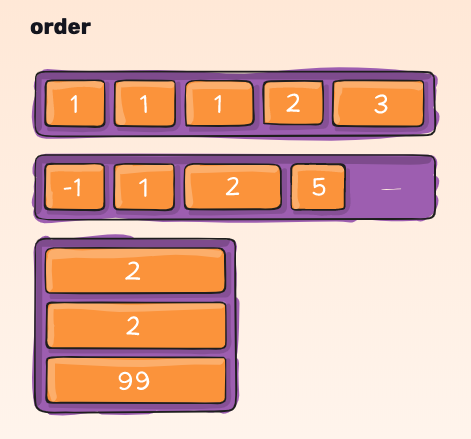

```css
.item {
  order: 1; /* 0 par défaut */
}
```

### B. Flex-grow

C'est un truc bizarre ceci. Il faut imaginer une situation où les items ne prennent pas toute la largeur du conteneur ce qui est possible puisque la margeur des item devient la largeur de leur contenu.

```html
<div class="flex">
  <div>Lorem ipsum dolor.</div>
  <div class="item">
    Voluptatibus, consequatur, quod.
  </div>
  <div>
    Quisquam, exercitationem, 
    laudantium.
  </div>
</div>
```

```css
.flex {
  display: flex;
}
```

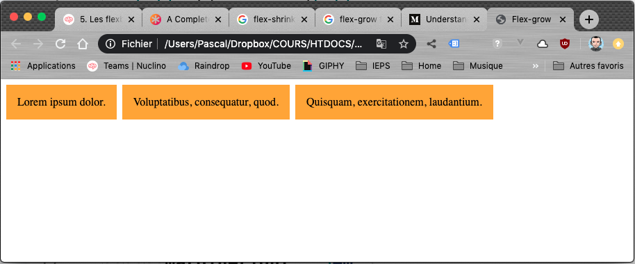

### Un seul item avec un flex-grow

Si on défini un flex-grow à un des items (par exemple le 2ème), alors il va AUTOMATiQUEMENT grandir pour occuper l'espace disponible restant.

```css
.item {
  flex-grow: 1;
}
```

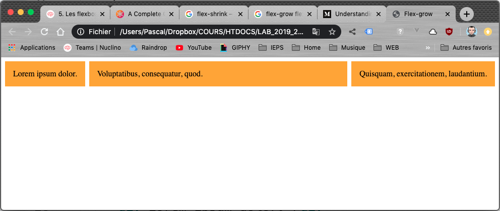

### Plusieurs items avec un flex-grow

Si on défini un flex-grow sur plusieurs items, alors ils se répartiront l'espace disponible proportionnellement à leur flex-grow. Un flex-grow 2 prendra 2 fois plus de place qu'un flex-grow 1 quoi...

```css
.item-1 {
  flex-grow: 1;
}
.item-2 {
  flex-grow: 2;
}
```

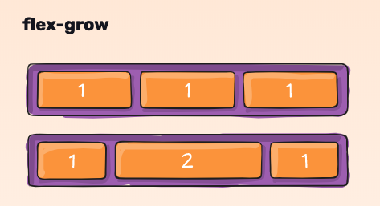

### C. Flex-shrink

C'est la manière dont l'élément va rétrécir ... On va pas trop s'étendre ici mais juste souligner qu'un élément avec un flex-shrink de 0 NE RETRECIRA JAMAIS !!!

```css
.item {
  flex-shrink: 0;
}
```

### D. Flew-grow et Flex-shrink

Dans nos mises en page, on va régulièrement associer des éléments en flex-shrink et en flex-grow. Il faut retenir ceci:

- Les élément en flex-shrink auront une largeur fixe
- Les éléments en flex-grow se partagent l'espace restant et sont fluide (ils grandissent si la fenêtre s'élargi) proportionnellement à leur valeur de grow

```css
.sidebar__logo {
  flex-shrink: 0;
}
.sidebar__nav {
  flex-grow: 1;
}
.sidebar__profile {
  flex-shrink: 0;
}
```

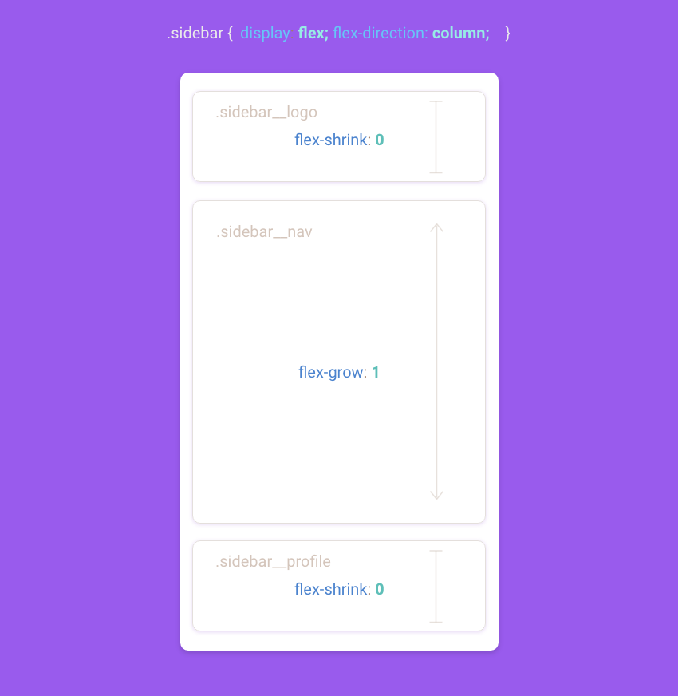

### E. Flex-basis

En gros, c'est la largeur de l'item.

```css
.item {
  flex-basis: 50%;
}
```

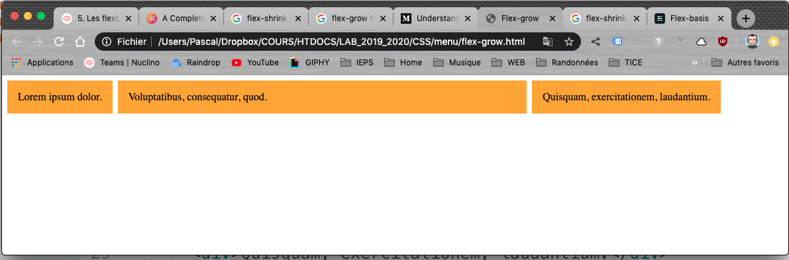

### D. Align-self

Alignement de l'item

- Direction row (horizontale) → alignement vertical
- Direction column (verticale) → alignement horizontal

```css
.item {
  /* auto | flex-start | flex-end | center | baseline | stretch */
  align-self: flex-end;
}
```

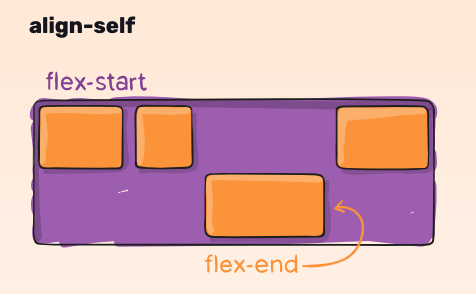

Voilà... C'est tout...Allez courage, ça va aller !

<video src="images/j9w8cFhT4L6HBjly.mp4" autoplay loop muted playsinline controls></video>

## 4. Compatibilité

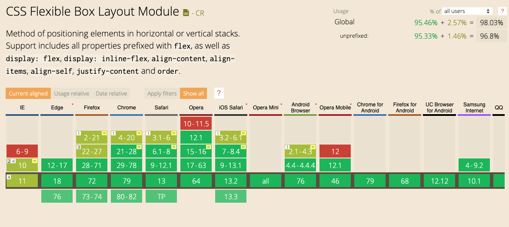

D'après caniuse.com, le support d'IE est partiel et cela serait dû à un large nombre de bugs ...

<video src="images/cOOijecRwwPtx4TL.mp4" autoplay loop muted playsinline controls></video>

---

## JE TE METS AU DÉFI

On va reprendre l'exercice des float mais on va utiliser la propriété display inline-block pour le menu !!! On laisse la boite flottante qui ne peut se faire qu'avec un float !!!

### **Défi 1: Un menu horizontal en FLEXBOXES**

Défi: 5 étiquettes (elles sont déjà placées dans le code HTML)

- `.menu-horizontal`
- `.boite-fixe-centree`
- `.active`
- `.boite-couleur--1`
- `.boite-flottante--droite`

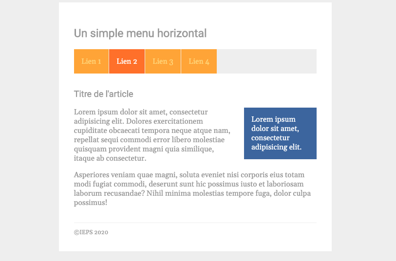

Fichiers de départ

📎 [documents.zip](images/AymT3jYsRB0eMUvL.zip)

---

### **Défi 2: Le même exercice mais comme ceci.**

Défi: on n'ajoute qu'une seule étiquette `.menu-centre` au `nav`Astuce.. On va juste travailler sur la dimension des li ...

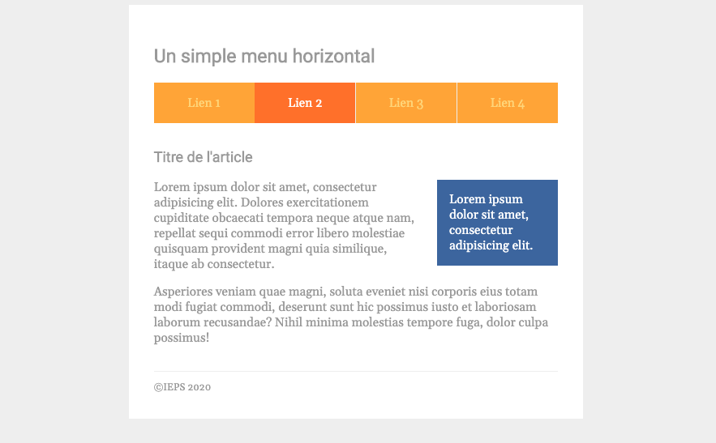

---

### Défi 3


Fichiers de départ:

📎 [documents-...zip](images/XkGZydKjjHWVWYDA.zip)

Astuce:

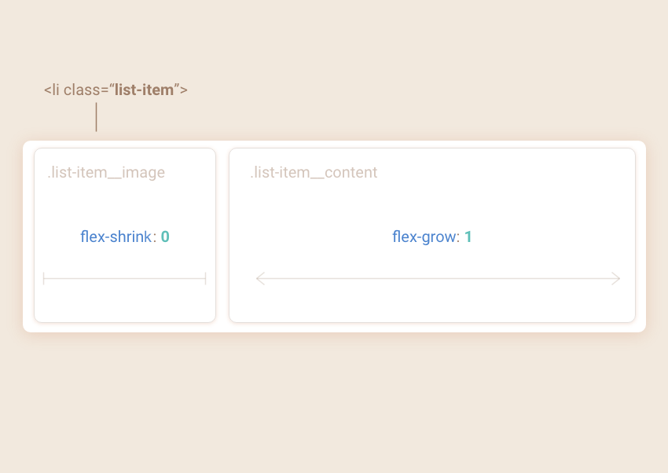

---

### Défi 4


Fichiers de départ:

📎 [documents-...zip](images/foKgFz6AflPCYvFG.zip)

Astuce:


---

### Défi 5

A partir du fichier HTML suivant, réalisez les mises en pages ci-dessous (solutions [Exercices Web (HTML/CSS)](https://mescours.ovh/ex10.html))

📎 [documents-4.zip](images/S8XAitRe65ALb8o5.zip)

RQ: Dans les mises en page suivantes, les éléments prennent toute la hauteur de la fenêtre (100vh)

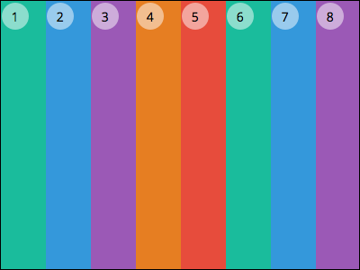

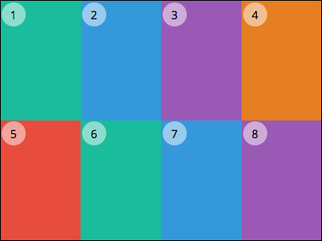

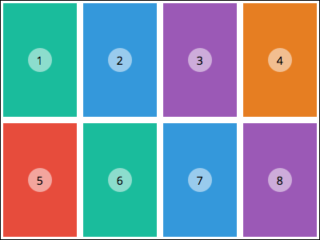

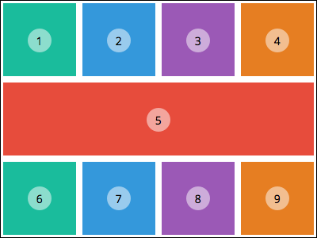

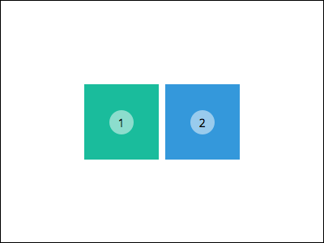

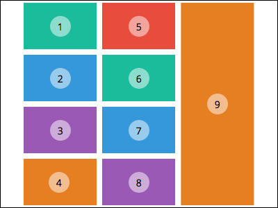

<video src="images/a8lMngNtbkd8v70c.mp4" autoplay loop muted playsinline controls></video>

---

### Défi 6: Un exercice plus avancé...

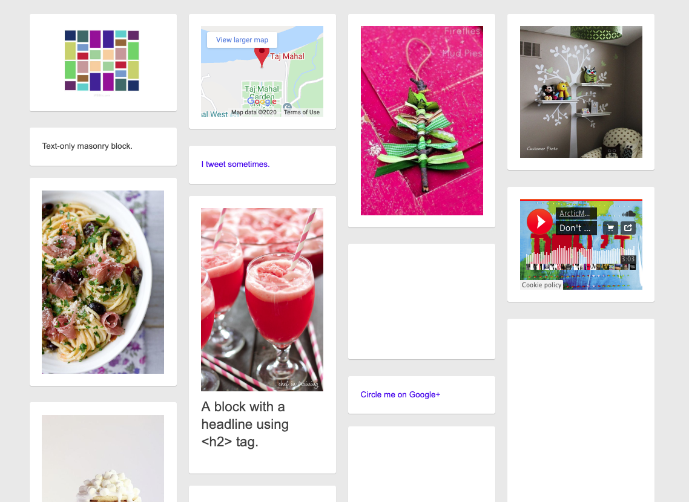

---

### Défi 7: Et encore un...


---

### Défi 8: Ou encore...

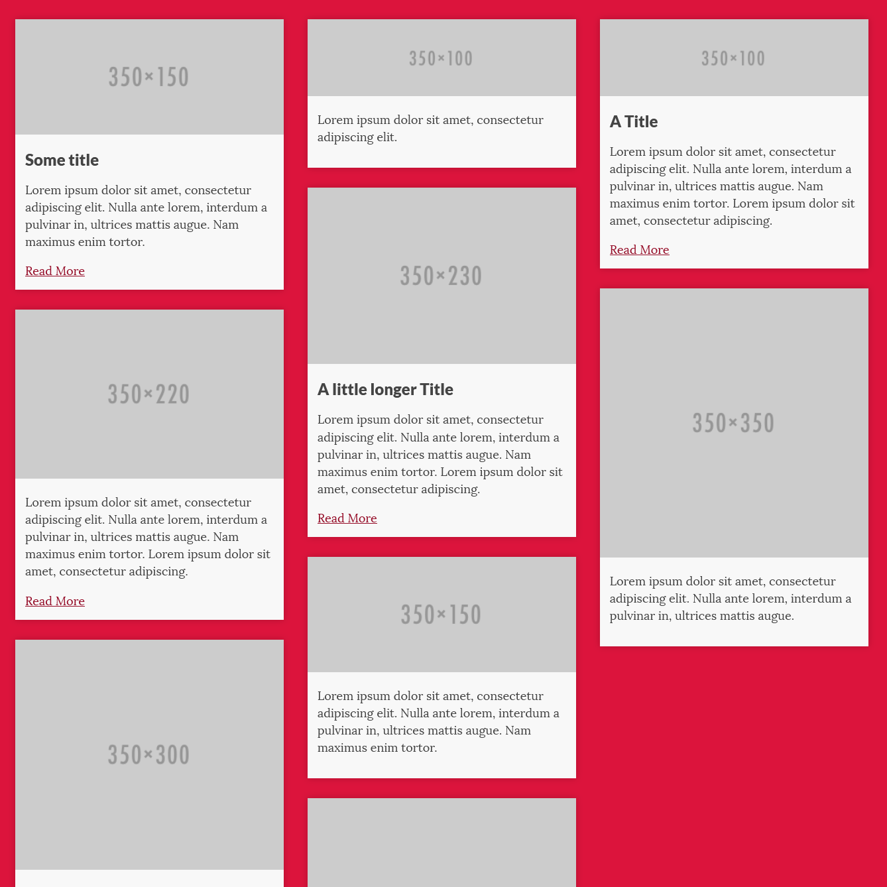

---

## RÉFÉRENCES: POUR ALLER PLUS LOIN

- Un excellent guide sur les Flexboxes: [A Complete Guide to Flexbox | CSS-Tricks](https://css-tricks.com/snippets/css/a-guide-to-flexbox/)
- Un guide très visuel: [How Flexbox works — explained with big, colorful, animated gifs](https://www.freecodecamp.org/news/an-animated-guide-to-flexbox-d280cf6afc35/?source=userActivityShare-fad5c503993b-1545860854&_branch_match_id=577122395897674495)
- Un résumé: [Flexbox Cheatsheet Cheatsheet – Joni Bologna](https://jonibologna.com/blog/flexbox-cheatsheet)
- Un guide visuel: [Flexbox Cheat Sheet & Bootstrap 4 Flex Reference PDF Download](https://bootstrapcreative.com/resources/flexbox-cheat-sheet/)
- [Flexbox | Codrops CSS Reference](https://tympanus.net/codrops/css_reference/flexbox/)
- [Flexbox Cheatsheet](http://apps.workflower.fi/css-cheats/?name=flexbox)
- [Les concepts de base pour flexbox](https://developer.mozilla.org/fr/docs/Web/CSS/CSS_Flexible_Box_Layout/Concepts_de_base_flexbox)
- [Understanding Flex Shrink, Flex Grow, and Flex Basis, and...](https://medium.com/@tiffnogueira/understanding-flex-shrink-flex-grow-and-flex-basis-and-using-these-properties-to-their-full-e4b4afd2c930)
- [Flexbox Froggy - A game for learning CSS flexbox](http://flexboxfroggy.com/#fr)
- Une super site pour tester les propriétés des flexboxes: [https://codepen.io/enxaneta/full/adLPwv/](https://codepen.io/enxaneta/full/adLPwv/)
- [Flexbox Playground](http://flexiting.com/playground/)
- [Flexbox Playground - Outpan](https://www.outpan.com/app/1b970b008f/flexbox-playground?ref=webdesignernews.com)
- [Faites votre mise en page avec Flexbox - Apprenez à créer...](https://openclassrooms.com/fr/courses/1603881-apprenez-a-creer-votre-site-web-avec-html5-et-css3/3298561-faites-votre-mise-en-page-avec-flexbox)
- [Les concepts de base pour flexbox - CSS : Feuilles de style en cascade | MDN](https://developer.mozilla.org/fr/docs/Web/CSS/CSS_Flexible_Box_Layout/Concepts_de_base_flexbox)
- [CSS Flexbox (Flexible Box)](https://www.w3schools.com/css/css3_flexbox.asp)
- [Flexbox, guide complet](https://la-cascade.io/flexbox-guide-complet/)
- [CSS3 Flexbox Layout module - Alsacreations](https://www.alsacreations.com/tuto/lire/1493-css3-flexbox-layout-module.html)
- [https://webdesign.tutsplus.com/tutorials/exercises-in-flexbox-simple-web-components--cms-28049](https://webdesign.tutsplus.com/tutorials/exercises-in-flexbox-simple-web-components--cms-28049)
- [Exercices Web (HTML/CSS)](https://mescours.ovh/ex10.html)
- [CSS Masonry layouts: Responsive, Lightweight, and EASY!](https://w3bits.com/css-masonry/)
- [Flexy Boxes — CSS flexbox playground and code generation tool](https://the-echoplex.net/flexyboxes/)

---

## RESSOURCES

📎 [b4-flexbox-cheat-sheet-v400.pdf](images/MdmwmriQxrVKOTLd.pdf)

📎 [Bad-Flexbox-devfest.pdf](images/y3AgDMYStHidD2m3.pdf)

📎 [flexrox.pdf](images/s34XvDvTiDm9uUgc.pdf)

📎 [memento_flexbox.zip](images/vaBFuawvfcvtIC7k.zip)

---

## MEMENTOS

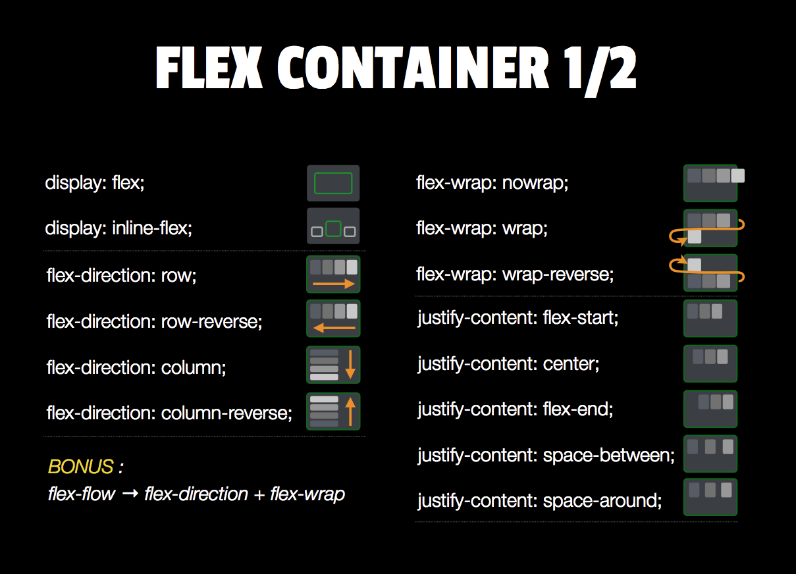

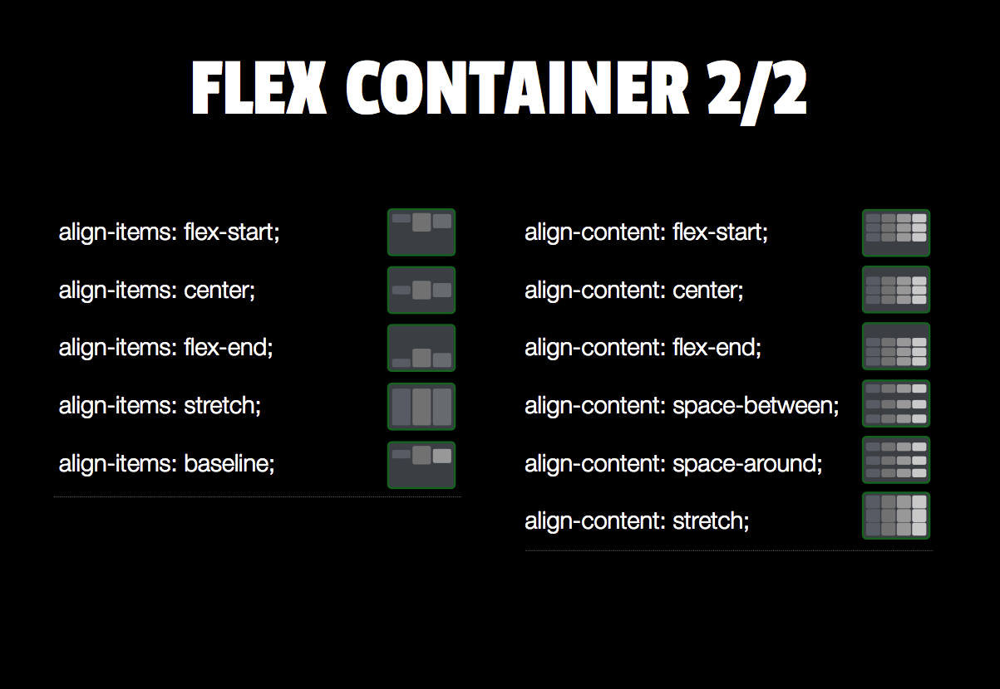

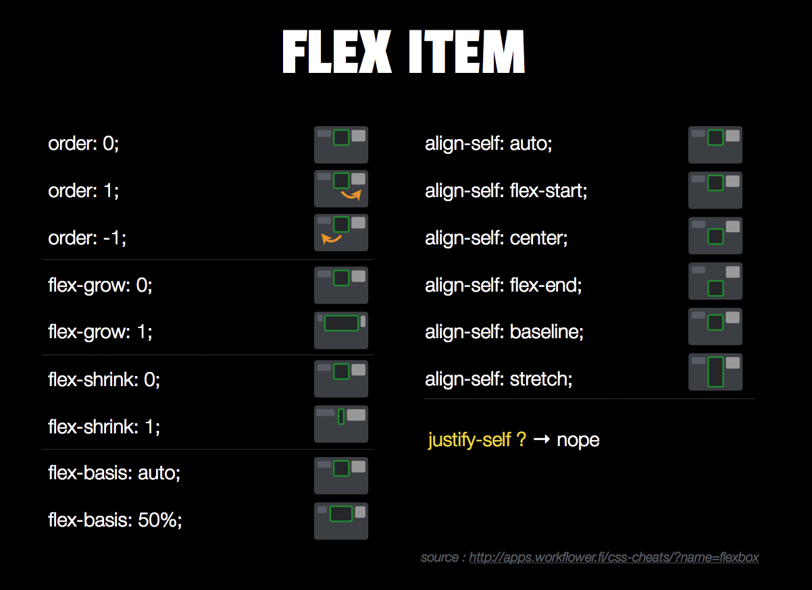
