# 17-01. Les GRIDS

## 1. C'est quoi une grille ?

Lorsque l'on défini un conteneur en display grid, on défini un ensemble de colonnes et de lignes, une grille quoi, avec gouttières éventuellement, qui pourra servir à positionner les items à l'intérieur de cette grille.

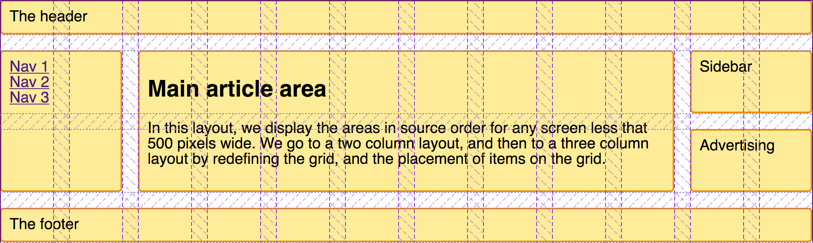

On pourra donc utiliser une grille qui va correspondre à celle que l'on utilise lors de la création de nos templates dans Adobe XD par exemple...

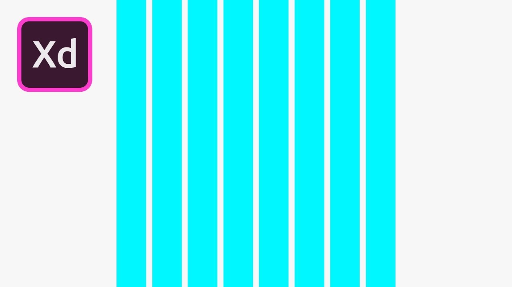

## 2. Display: grid | inline-grid ...

Si je mets un display:grid à un conteneur, les objets à l'intérieur ne se mettent pas automatiquement en colonnes comme un display: flex par exemple...

Si je choisis 'grid', les enfants seront des block. Si je choisis un inline-grid, les enfants seront des inline-block...

```html
<div class="grid">
  <div>DIV 1 - Lorem ipsum.</div>
  <div>DIV 2 - Repudiandae, quo.</div>
  <div>DIV 3 - Expedita, ab.</div>
</div>
```

```css
.conteneur-flexible {
  display: grid;
}
```

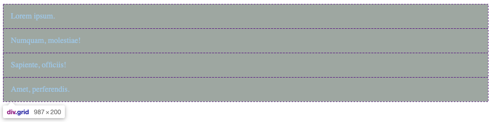

```css
.conteneur-flexible {
  display: inline-grid;
}
```

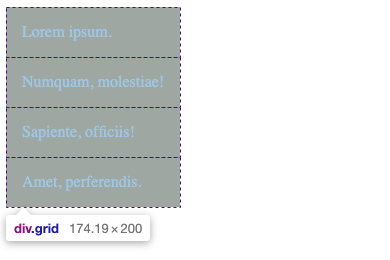

## 2. Les propriétés du conteneur

### A. Grid-template-columns et grid-template-rows

Permet de définir le pattern de la grille en colonnes et en lignes

- Grid-template-columns → Nombre et dimension des colonnes
- grid-template-rows → Nombre et dimension des lignes

```css
.grid {
  grid-template-columns: 40px 50px auto 50px 40px;
  grid-template-rows: 25% 100px auto;
}
```

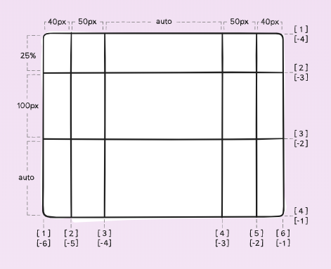

### Une grille de mise en page

En général, pour définir un système de grille comme dans Adobe XD, l'idée sera de définir des colonnes de même dimension pour répartir les items en fonction du nombre de colonnes ou de lignes occupées par l'item. On utilise alors la dimension 'fr', c'est-à-dire 'fraction'. Les colonnes vont donc se répartir de manière égale l'espace disponible.

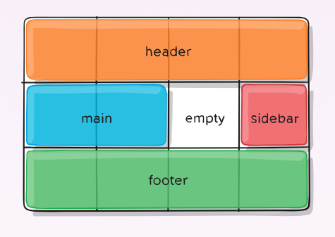

```css
.grid {
  display: grid;
  grid-template-columns: 1fr 1fr 1fr 1fr;
  /* OU */
  grid-template-columns: repeat(4, 1fr);
}
```

Dès que je mets un nombre de colonnes, les enfants directs du conteneur se placent automatiquement dans les colonnes !!!

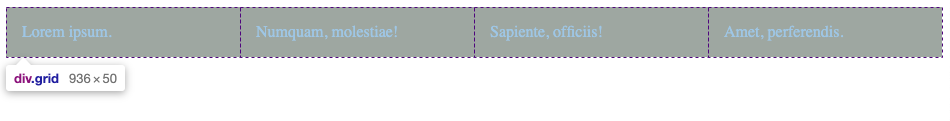

Et si j'ajoute un div dans le conteneur, il passera automatiquement à la ligne suivante. Il n'y a donc pas besoin de définir les rows, elles se créent au fur et à mesure du contenu !

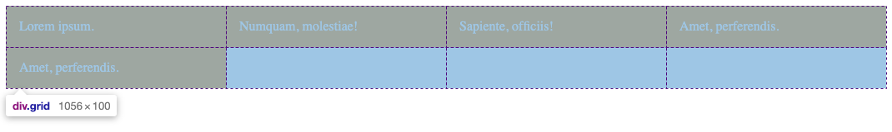

### B. Grid-row-gap et grid-column-gap ou grid-gap

Permet de définir les gouttières verticales et horizontales de la grille

```css
.grid {
  display: grid;
  grid-template-columns: repeat(3, 1fr);
  /* Gouttières */
  grid-row-gap: 15px;
  grid-column-gap: 10px;
  /* OU */
  /* row column */
  grid-gap: 15px 10px; 
   /* OU */
   /* row et column de même valeur */
  grid-gap: 1em; 
}
```

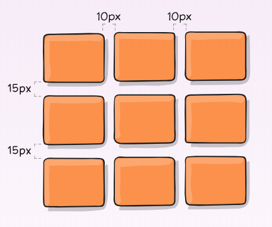

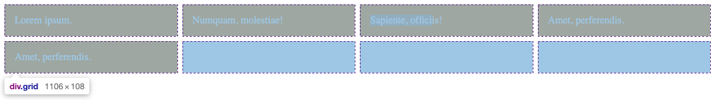

### C. Justify-items

Alignement horizontal du contenu cellules. Par défaut: stretch

```css
.grid {
  display: grid;
  grid-template-columns: repeat(3, 1fr);
  justify-items: start | end | center | stretch;
}
```

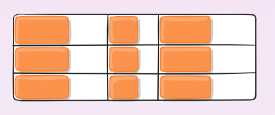

*justify-items: start;*

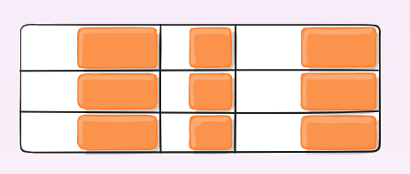

*justify-items: end;*

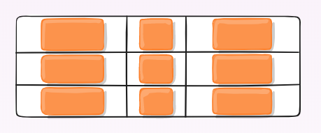

*justify-items: center;*

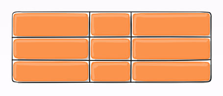

*justify-items: stretch;*

### D. Align-items

Alignement vertical du contenu cellules. Par défaut: stretch.

```css
.grid {
  display: grid;
  grid-template-columns: repeat(3, 1fr);
  align-items: start | end | center | stretch;
}
```

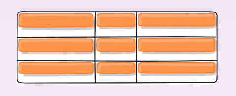

*align-items: start;*

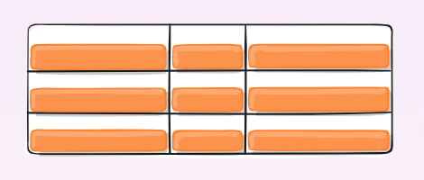

*align-items: end;*

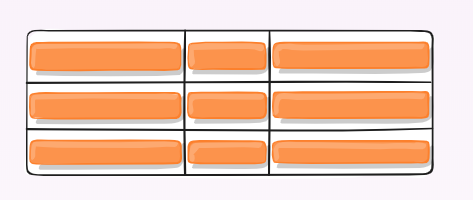

*align-items: center;*

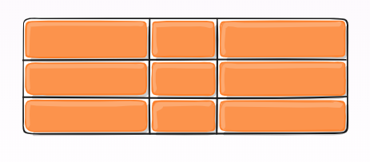

*align-items: stretch;*

## 3. Les propriétés des items

### A. Grid-column-start et grid-column-end ou grid-column

Permet de définir le nombre de colonnes prises par un item en définissant où est placé l'item.

**Stratégie 1: Où on commence et où on finit ...**

```css
.grid {
  display: grid;
  grid-template-columns: repeat(4, 1fr);
  grid-gap: .5em;
}
#div1 {
  grid-column-start: 2; /* Inclus : on commence au 2 */
  grid-column-end: 4;   /* Exclus: on finit au 3 */
  /* OU */
  grid-column: 2 / 4;
}
```

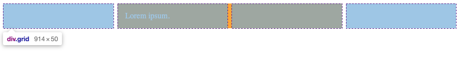

**Stratégie 2: Où on commence et sur combien de colonnes on s'étend**

```css
.grid {
  display: grid;
  grid-template-columns: repeat(4, 1fr);
  grid-gap: .5em;
}
#div1 {
  grid-column-start: 2; /* Inclus : on commence au 2 */
  grid-column-end: span 2;   /* Prend 2 colonnes */
  /* OU */
  grid-column: 2 / span 2;
}
```


Et si on ne définit que l'étendue ...

```css
#div1 {
  grid-column-end: span 2;   /* Prend 2 colonnes */
  /* OU */
  grid-column: span 2;
}
```

### B. Grid-row-start et grid-row-end ou grid-row

Pareil mais pour la répartition en lignes...

```
<div class="flex">
  <div id="div1">Lorem ipsum dolor.</div>
  <div>Voluptatibus, consequatur, quod.</div>
  <div>Quisquam, exercitationem, laudantium.</div>
  <div>Voluptatibus, consequatur, quod.</div>
  <div>Quisquam, exercitationem, laudantium.</div>
</div>
```

**Stratégie 1: Où on commence et où on finit ...**

```css
.grid {
  display: grid;
  grid-template-columns: repeat(4, 1fr);
  grid-gap: .5em;
}
#div1 {
  grid-row-start: 1; /* Inclus : on commence au 1 */
  grid-row-end: 3;   /* Exclus: on finit au 2 */
  /* OU */
  grid-row: 1 / 3;
}
```


**Stratégie 2: Où on commence et sur combien de colonnes on s'étend**

```css
#div1 {
  grid-row-start: 1; /* Inclus : on commence au 1 */
  grid-row-end: span 2;   /* On s'étend sur 2 lignes */
  /* OU */
  grid-row: 1 / span 2;
}
```

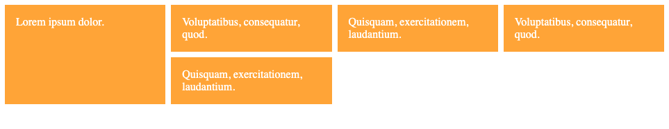

### C. Justify-self

Alignement horizontal de l'item

```css
.item {
  justify-self: start | end | center | stretch;
}
```

### D. Align-self

Alignement vertical de l'item

```
.item {
  align-self: start | end | center | stretch;
}
```

Voilà, j'ai boycotté certaines propriétés que vous pourrez voir dans les liens ci-dessous mais bon ... Ceci est largement suffisant pour créer nos grilles !!! Au boulot !

<video src="images/6n2at6Wp7UzbcHBy.mp4" autoplay loop muted playsinline controls></video>

## 4. Compatibilité

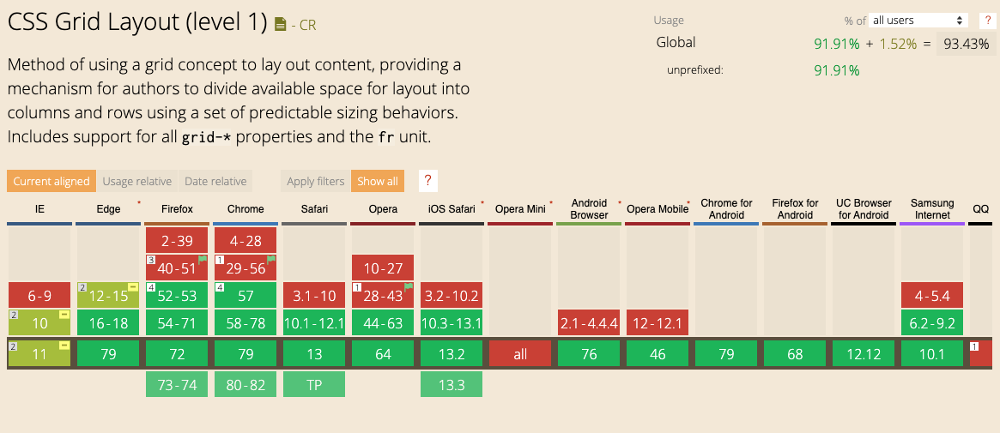

D'après caniuse.com, le support d'IE est partiel ... 🙄

<video src="images/QOeu67U2zGmfxo6d.mp4" autoplay loop muted playsinline controls></video>

---

## JE TE METS AU DÉFI

En partant du code suivant

```html
<div>Header</div>
<div>Nav</div>
<div>Section</div>
<div>Aside</div>
<div>Footer</div>
```

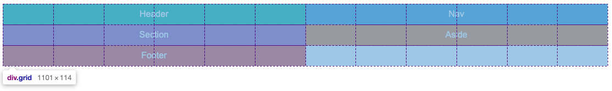

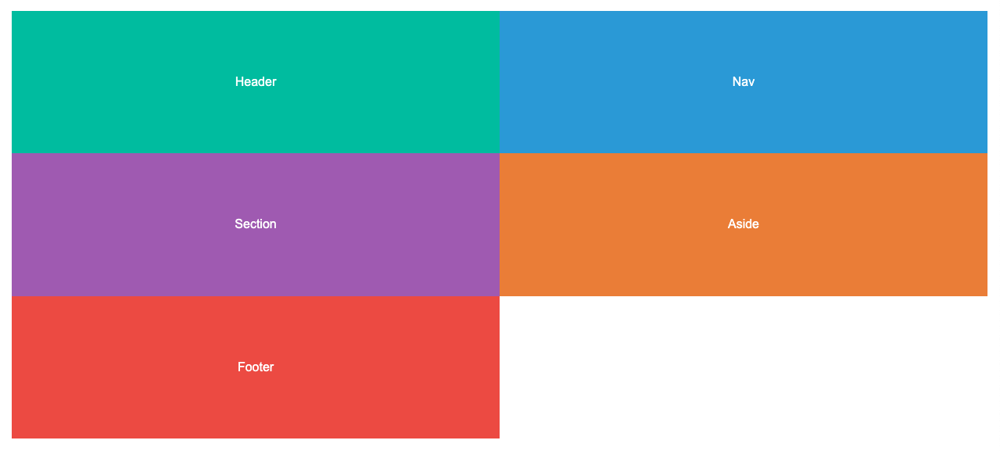

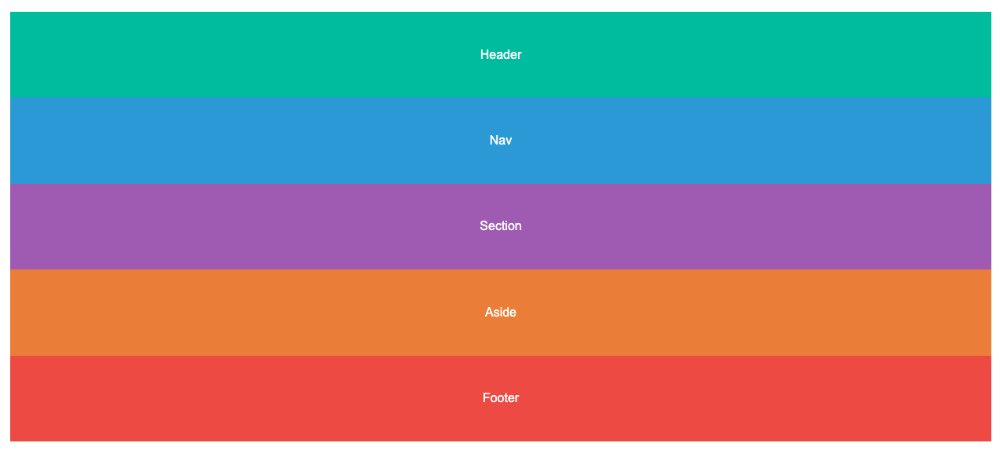

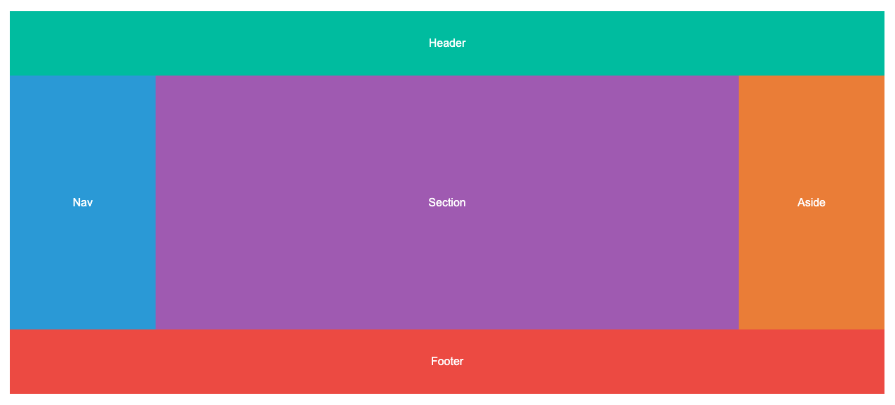

Astuce: (sans créer de row, uniquement avec un grid-row...)

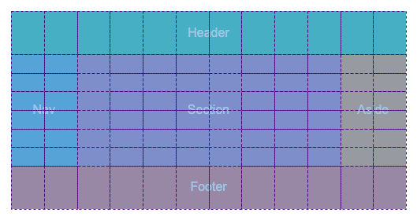

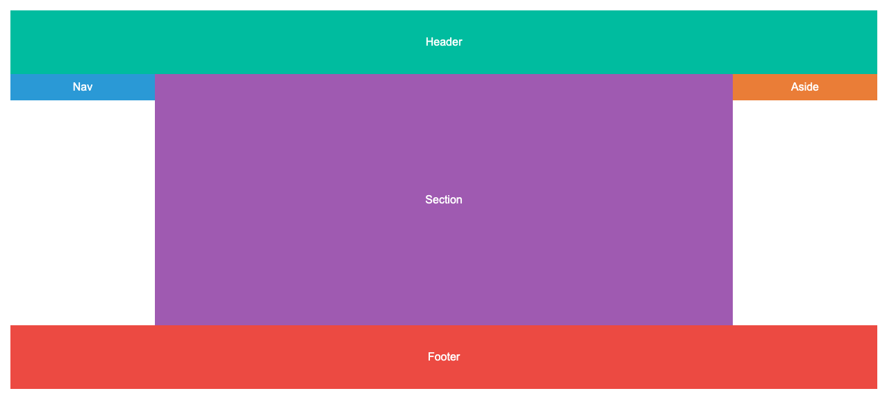

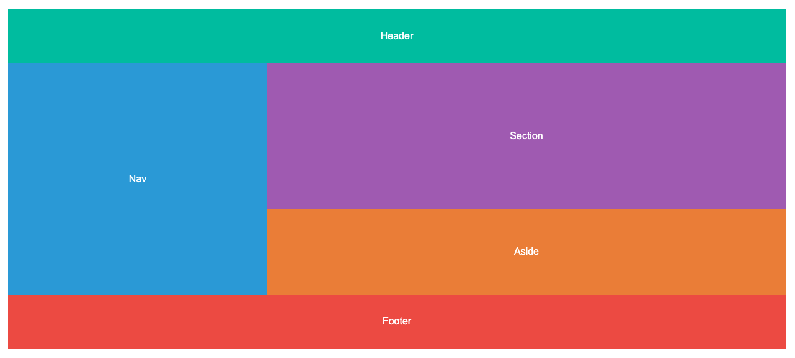

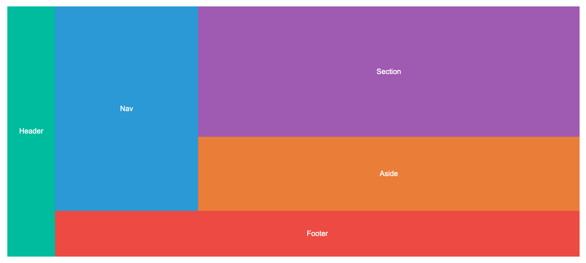

Astuce:

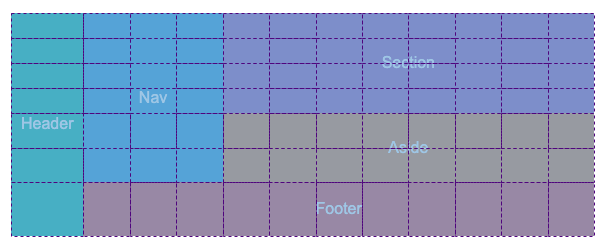

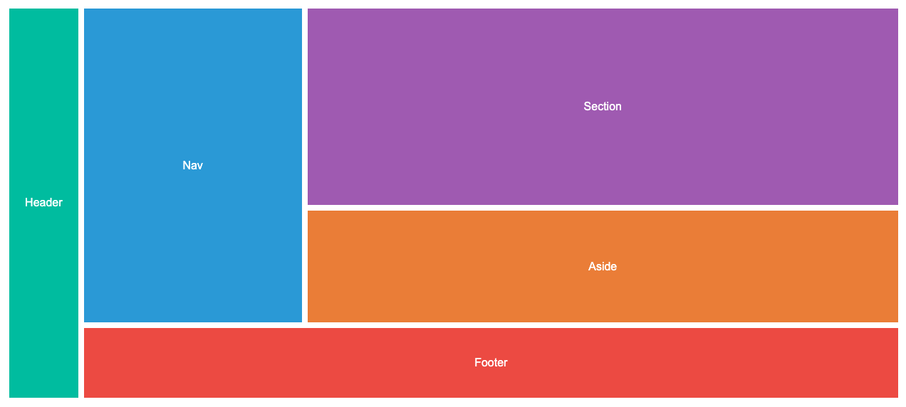

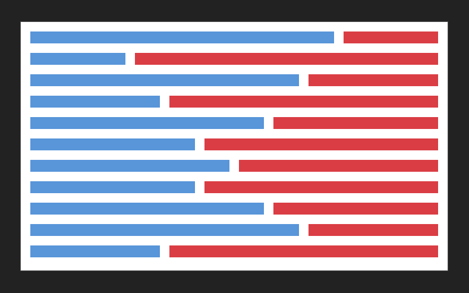

---

## RÉFÉRENCES

- Un excellent guide sur les Grids: [A Complete Guide to Grid | CSS-Tricks](https://css-tricks.com/snippets/css/complete-guide-grid/)
- Un guide formidable plein d'humour: [50 nuances de grilles](https://speakerdeck.com/goetter/50-nuances-de-grilles?slide=84)
- [Grid by Example](https://gridbyexample.com/)
- [Learn CSS Grid - A Guide to Learning CSS Grid](https://learncssgrid.com/)
- [Grid Examples • Real sites using CSS Grid Layout](https://gridexamples.com/)
- [Exercices Web (HTML/CSS)](https://mescours.ovh/ex11.html)
- [Grilles CSS (CSS Grid)](https://developer.mozilla.org/fr/docs/Web/CSS/CSS_Grid_Layout)
- [CSS Grid Layout](https://www.w3schools.com/css/css_grid.asp)
- [CSS Grid Container](https://www.w3schools.com/css/css_grid_container.asp)
- [CSS Grid Item](https://www.w3schools.com/css/css_grid_item.asp)
- [Learn to Build a Masonry Gallery Layout Using Pure CSS](https://medium.com/better-programming/learn-to-build-a-masonry-gallery-layout-using-pure-css-50331dbc1e15)
- [19 CSS Grid Examples](https://freefrontend.com/css-grid-examples/?ref=webdesignernews.com)

---

## RESSOURCES

📎 [grid-cheatsheet (1).pdf](images/DzuvWsvLpxDMgE7G.pdf)

📎 [grids.pdf](images/1haPU9tP5D0o3pID.pdf)

📎 [grid-layout-atelier-v2.pdf](images/m2hR8r4D8a6RVQLh.pdf)
