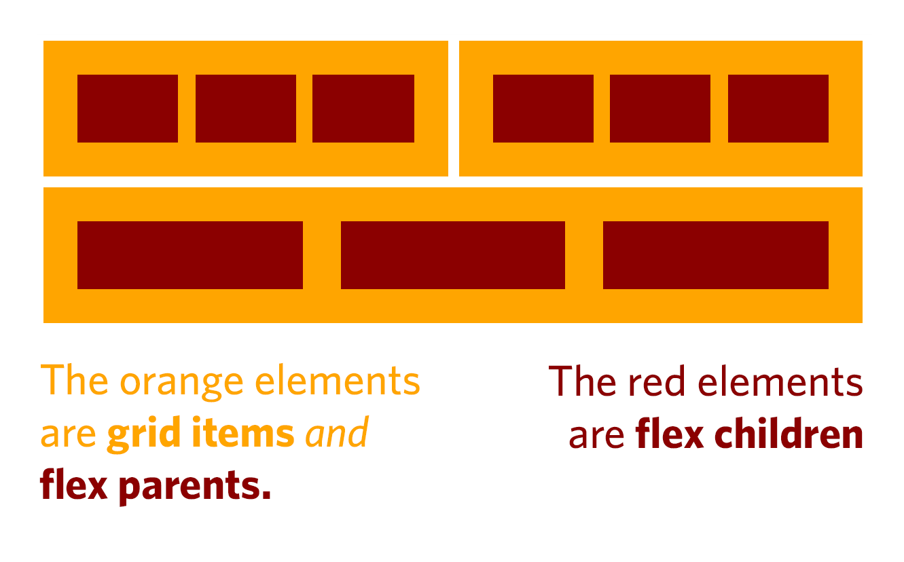
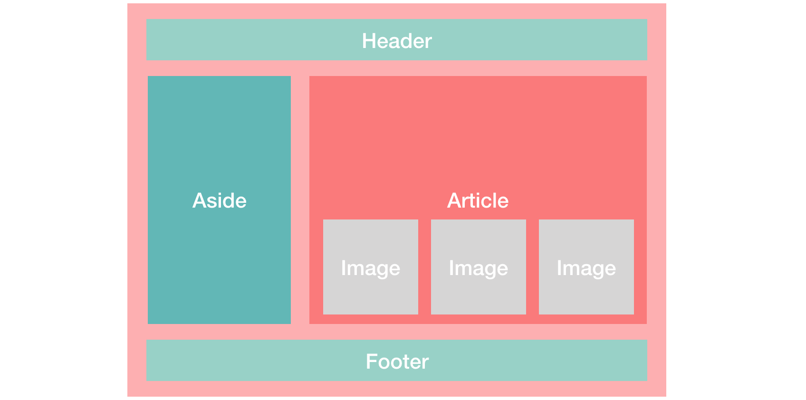
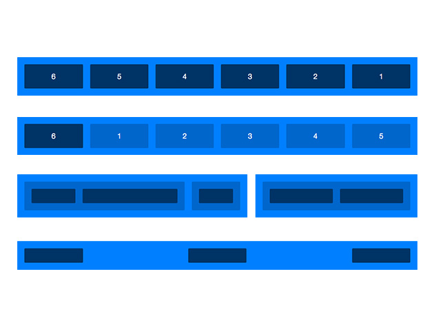

# 17-02. Articulation des Grids et des Flexboxes

## Grids et Flexboxes pour les mises en pages complexes

Pour réaliser nos mises en pages, il ne va pas falloir choisir entre les grids et les flexboxes. On va utiliser les 2.

L'idée va être d'utiliser une grille générale pour la mise en page, avec grid, puis, à l'intérieur de cette grille, on va utiliser les flexboxes .

---

## JE TE METS AU DÉFI !

### Défi 1

---

### Défi 2

---

### Défi 3

---

### Défi 4

---

### Défi 5

---

## RÉFÉRENCES: POUR ALLER PLUS LOIN

- [CSS Grid ou Flexbox : les deux bien sûr ! par Benjamin - BigInt](https://bigint.fr/blog/2018-12-19/CSS-Grid-ou-Flexbox-les-deux-bien-sr)
- [How I use CSS Grid and Flexbox to Create a One-page Website](https://medium.com/swlh/how-i-use-css-grid-and-flexbox-to-create-a-one-page-website-262aeea3592a)
- [CSS Grid Layout Guide with Flexbox Fallbacks](https://seesparkbox.com/foundry/css_grid_layout_guide_with_flexbox_fallbacks)
- [http://esajuhana.com/posts/2016-11-26-building-a-responsive-product-grid-with-css-flexbox](http://esajuhana.com/posts/2016-11-26-building-a-responsive-product-grid-with-css-flexbox)
