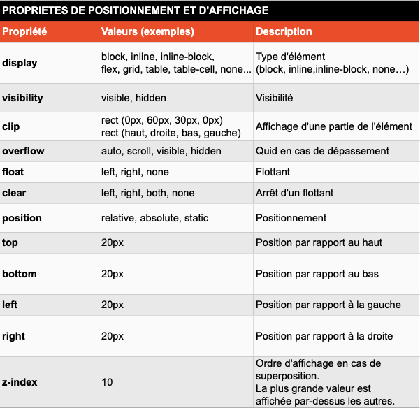
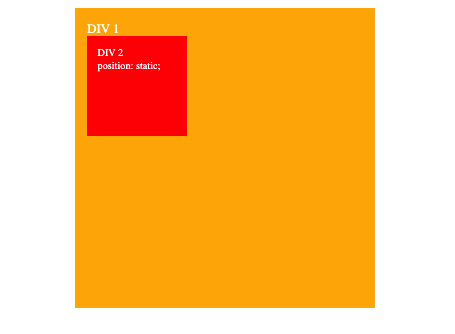
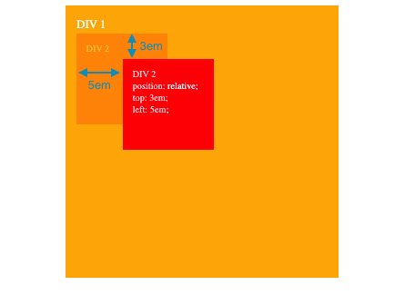
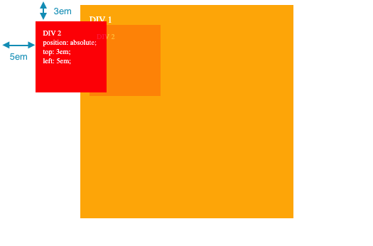
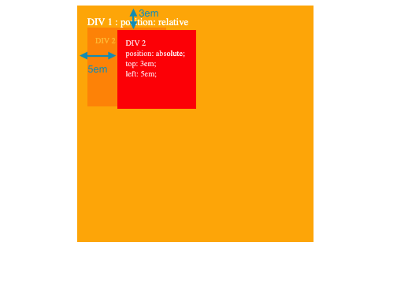
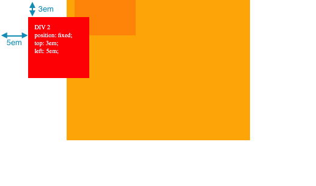
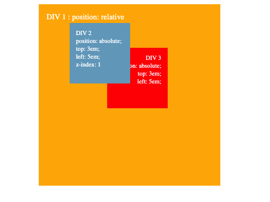
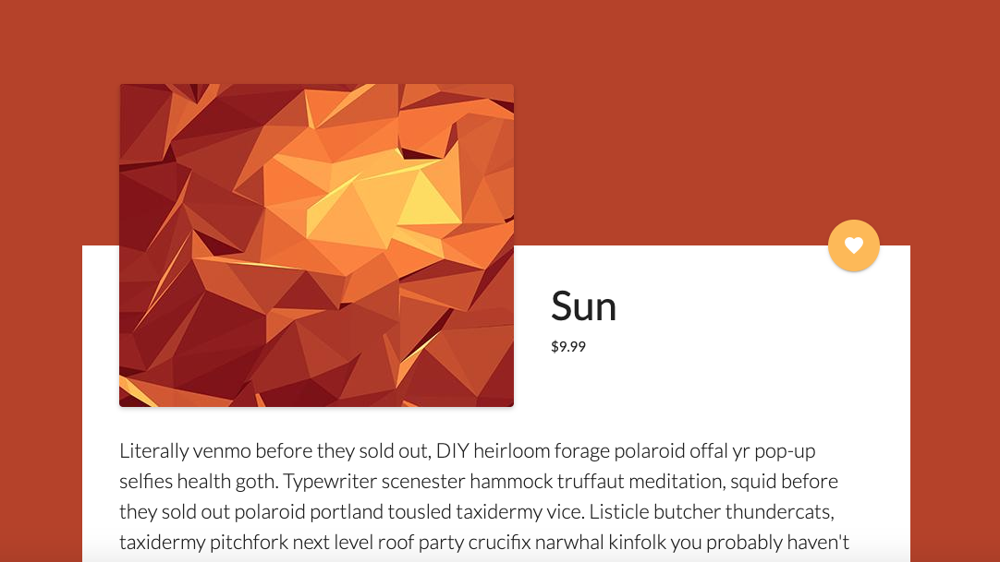

# 18-01. Les positionnements CSS

**VIDÉOS:**

▶️ [Vidéo](https://www.youtube.com/watch?v=frjm3jCXRU0)

---



## Positions CSS : Attention, on sort du flux !

Jusqu'à présent, les objets s'affichent les uns après les autres, sauf dans le cas d'un float qui défini là ou l'objet se positionne par rapport à ce qui le suit.

Mais il est également possible de définir la position des objets sans tenir compte de là où ils se trouvent dans le code... La propriété 'position' peut prendre différentes valeurs :

- absolute : la position de l'objet est définie par rapport aux bords (top, right, bottom, left) DU PREMIER OBJET POSITIONNÉ QUI LE CONTIENT (Le body s'il n'y en a aucun !!!)
- fixed: position figée par rapport à la fenêtre du navigateur
- relative: position par rapport à la position naturelle de l'objet
- static: valeur par défaut
- sticky: Position collante par rapport à la fenêtre du navigateur

## Position: static - Le positionnement naturel

```html
<div id="div1">
   DIV 1
   <div id="div2">DIV 2</div>
</div>
```

Le positionnement static, c'est comme si on n'avait rien mis... L'élément se positionne à sa position naturelle dans le code HTML



## Position relative - Par rapport à la position naturelle

La position relative d'un objet est définie par rapport à sa position naturelle. Ca permet de déplacer l'objet (en top, left, bottom ou right) par rapport à la position qu'il occuperait naturellement.



## Position: absolute - Par rapport à l'objet référent

Par défaut, l'objet référent est le body, la fenêtre du navigateur quoi...





Mais si il y a un parent qui est positionné, alors, c'est lui qui devient l'objet référent...

## Position: fixed - Figé par rapport à la fenêtre

La position fixed est comme une position absolue par rapport à la fenêtre du navigateur mais l'objet ne bougera pas si on scrolle...



## Position: sticky - Collé à l'élément parent

Un élément en position sticky aura d'abord sa position naturelle tant qu'il ne sera pas à la position top définie par rapport à la fenêtre du navigateur.Puis, il restera à cette position top de la fenêtre jusqu'à la fin de l'objet parent... restera collé à l'élément parent lorsque l'on scrolle. Il sera en position

<video src="images/YwRX4Tb3saWpuOYc.mp4" autoplay loop muted playsinline controls></video>

## Avec les positions CSS, on passe en 3D !

Attention, une fois une position définie, la boite SORT littéralement du flux et peut chevaucher d'autres objets... Elle est passée sur une autre couche. En fait, dès qu'on touche aux positionnement, on introduit une troisième dimension dans l'espace de la page.

Sans positions CSS, le document est en 2D : horizontal et vertical. Avec les positionnements, on introduit la profondeur, la dimension z que l'on peut définir via la propriété z-index de chaque élément positionné.



---

## A RETENIR...

```css
position: static;   /* Valeur par défaut */
position: relative; /* Position par rapport à position naturelle de l'élément */
position: absolute; /* Position par rapport au premier parent positionné */
position: fixed;    /* Position figée par rapport à la fenêtre du navigateur */
position: sticky;   /* Position collante par rapport au bord de la fenêtre du navigateur */
top:    20px; /* Position par rapport au bord supérieur de l'objet de référence */
left:   20px; /* Position par rapport au bord gauche de l'objet de référence */
right:  20px; /* Position par rapport au bord droit de l'objet de référence */
bottom: 20px; /* Position par rapport au bord inférieur de l'objet de référence */
```

---

## JE TE METS AU DÉFI !

### Défi 1



---

### Défi 2: [W3Schools CSS Exercise](https://www.w3schools.com/css/exercise.asp?filename=exercise_positioning1)

---

## RÉFÉRENCES: POUR ALLER PLUS LOIN

- [Guide de survie du positionnement CSS](https://www.alsacreations.com/article/lire/53-guide-de-survie-du-positionnement-css.html)
- [position](https://developer.mozilla.org/fr/docs/Web/CSS/position)
- [CSS position property](https://www.w3schools.com/cssref/pr_class_position.asp)
- [CSS Layout - The position Property](https://www.w3schools.com/css/css_positioning.asp)
- [https://fr.learnlayout.com/position.html](https://fr.learnlayout.com/position.html)
- [Gérer le positionnement avec la propriété CSS position - Pierre Giraud](https://www.pierre-giraud.com/html-css-apprendre-coder-cours/position/)
- [position | CSS-Tricks](https://css-tricks.com/almanac/properties/p/position/)
