# 19-01. Les transformations CSS

## Les transformations 2D

```embed
title: "CSS - Les transformations"
image: "https://i.ytimg.com/vi/--VPWwxYVT4/hqdefault.jpg"
description: "Vidéo YouTube · Pascal LACROIX"
url: "https://www.youtube.com/watch?v=--VPWwxYVT4"
favicon: ""
aspectRatio: "56.25"
```

### Déplacer ou translation avec translate()

```css
#div1 {
  transform: translateX(100px);
}

#div1 {
  transform: translateY(50px);
}

#div1 {
  transform: translateZ(50px);
}

#div1 {
  transform: translate(100px, 50px);
}

#div1 {
  transform: translate3D(100px, 50px, 50px);
}
```

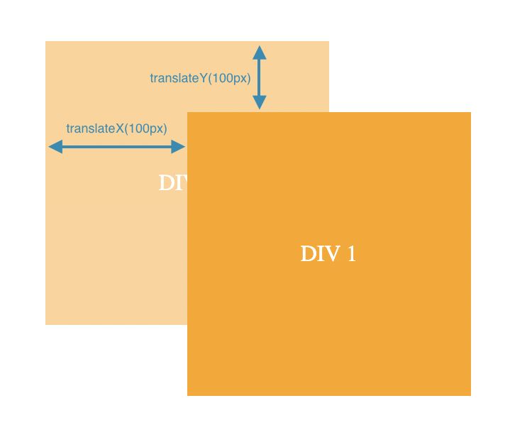

### La rotation avec rotate()

```css
#div1 {
  transform: rotateX(45deg);
}

#div1 {
  transform: rotateY(45deg);
}

#div1 {
  transform: rotate(45deg);
}
```

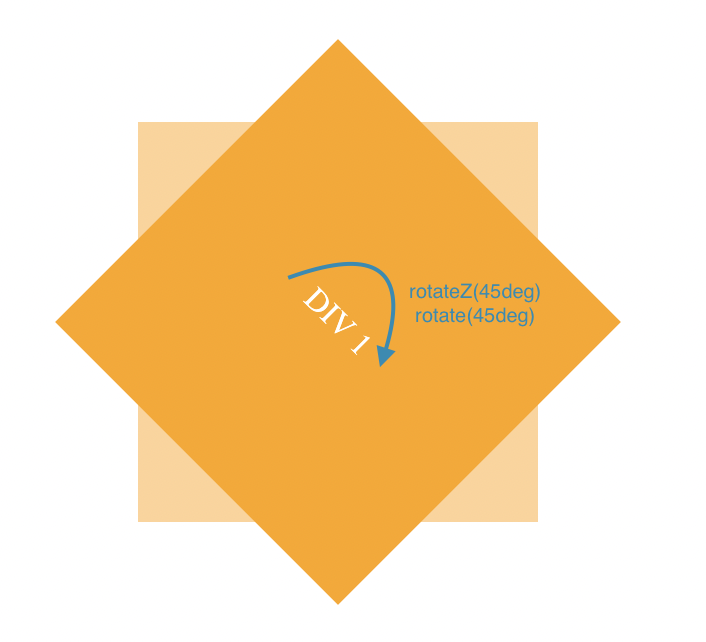

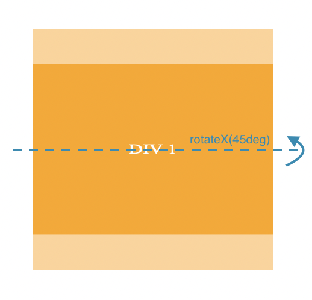

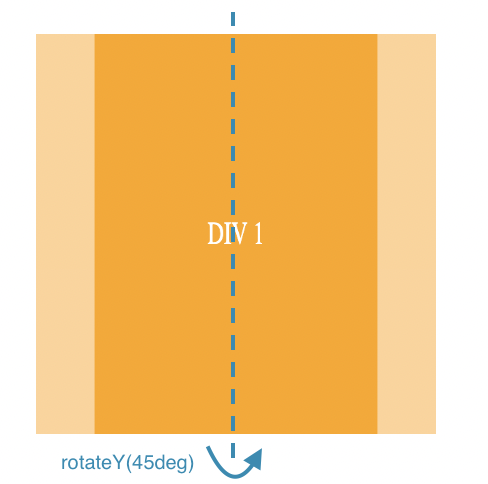

### L'homothétie ou mise à échelle avec scale()

```css
#div1 {
  transform: scaleX(1.5);
}

#div1 {
  transform: scaleY(1.5);
}

#div1 {
  transform: scale(1.5);
}
```

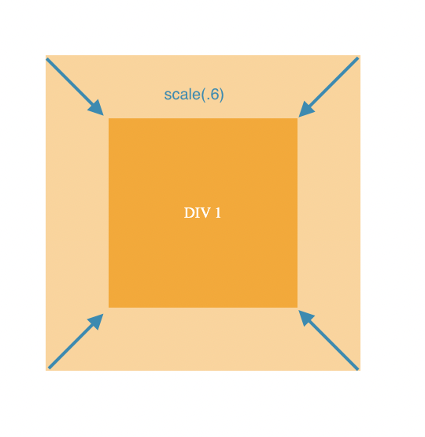

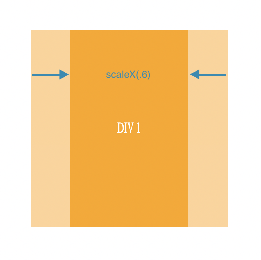

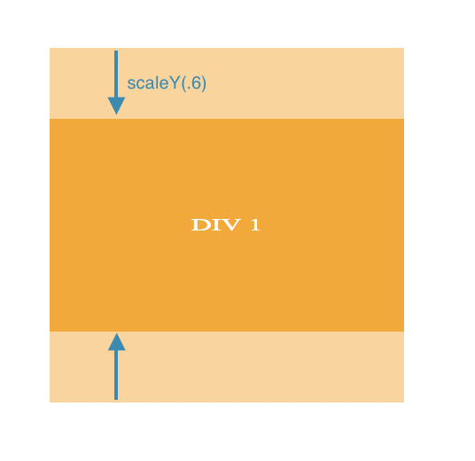

### La déformation avec skew()

```css
#div1 {
  transform: skewX(20deg);
}

#div1 {
  transform: skewY(40deg);
}

#div1 {
  transform: skew(20deg, 40deg);
}
```

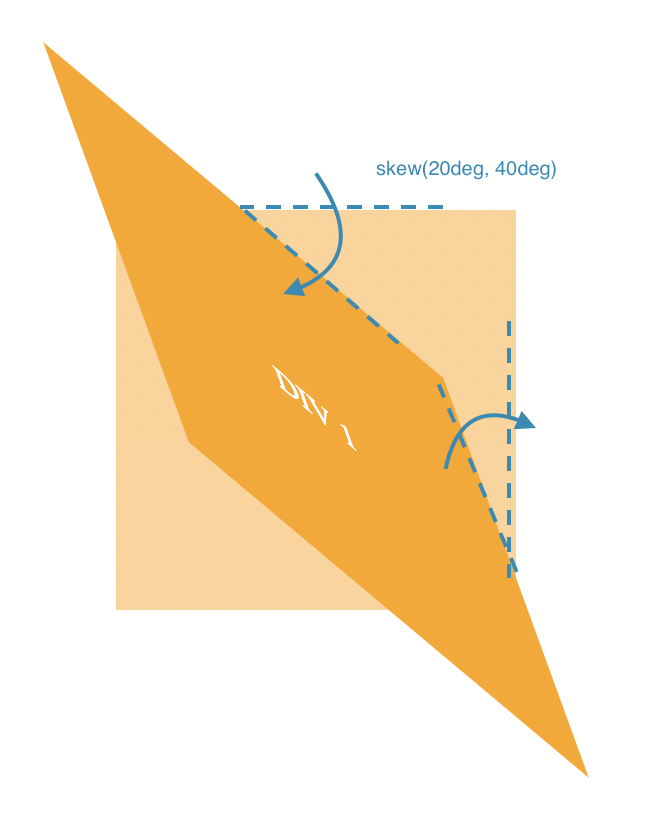

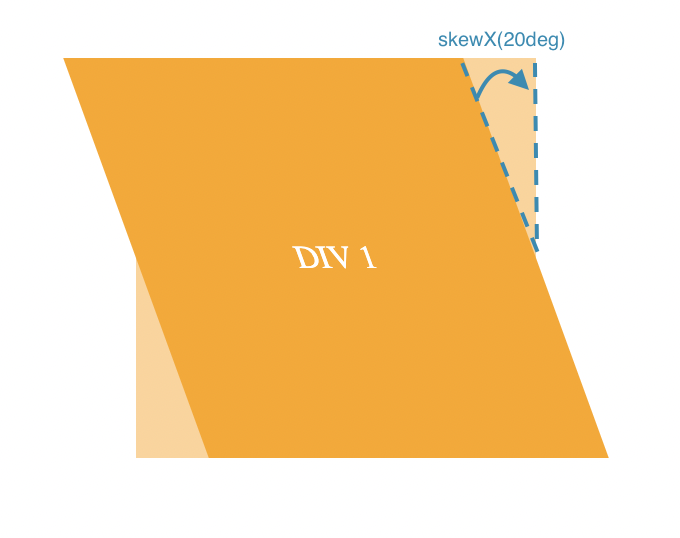

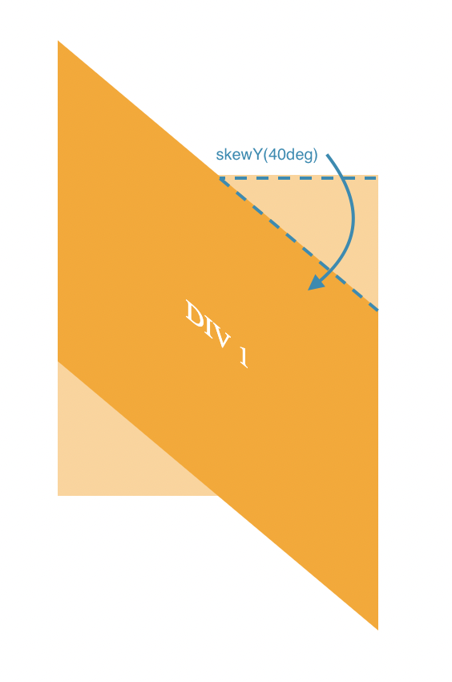

### La super-propriété matrix()

```
transform: matrix(scaleX(),skewY(),skewX(),scaleY(),translateX(),translateY());
```

### Le point d'origine de la transformation

Par défaut, le point d'origine de la transformation est le centre de l'objet (pour la rotation), mais je peux modifier la position de ce point de transformation.

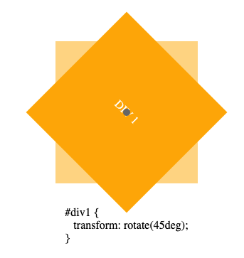

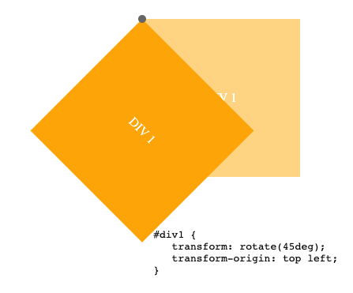

### Appliquer plusieurs transformations

```css
#div1 {
  transform: scale(1.5) rotate(45deg) skew(20deg);
}
```

## Les transformations 3D et la perspective

Si on regarde attentivement les transformations précédentes et notamment la rotation, on remarque qu'il n'y a aucun effet 3D et aucune perspective.

Ce n''est pas parce qu'il n'y a pas de perspective, c'est parce que la caméra est placée trop loin par défaut, elle est placée à l'infini... Du coup on ne voit pas la perspective.


### La propriété perspective

Si on rapproche la caméra, on verra la perspective. Et pour rapprocher la caméra, on utilise la propriété perspective.

```css
body {
  perspective: 25em;
}

#div1 {
  transform: rotateY(45deg);
}
```

Plus on rapproche la caméra et plus on voit la perspective.

La propriété perspective se place dans un conteneur de l'objet (ici le body par exemple)

<video src="images/EjeddjDRvkh6sCMo.mp4" autoplay loop muted playsinline controls></video>

▶️ [Vidéo](https://codepen.io/pascallllacroix/embed/XWMKeQQ)

### La rotation 3D

<video src="images/WXZ1jQBmDhNZXgmp.mp4" autoplay loop muted playsinline controls></video>

<video src="images/Ld91gXeT5TGfjBUA.mp4" autoplay loop muted playsinline controls></video>

### La translation 3D

La translation selon l'axe des Z permet de rapprocher ou d'éloigner un objet de la caméra.

<video src="images/9euU1pIdnOMrDYhs.mp4" autoplay loop muted playsinline controls></video>

Mais ATTENTION !!! L'axe des Z change de direction avec l'objet !!!! L'axe des Z est celui qui est perpendiculaire à la surface due l'objet. ce qui veut dire que si on fait une rotation selon l'axe X ou Y, la direction du Z change aussi ...

<video src="images/pr8QqNkiEHm1YwhY.mp4" autoplay loop muted playsinline controls></video>

<video src="images/xV4V7GM2gkhAjB45.mp4" autoplay loop muted playsinline controls></video>

▶️ [Vidéo](https://codepen.io/pascallllacroix/embed/VwpjMEv)

### Respecter la perspective d'un objet complexe

Si on construit un objet complex en 3D et qu'on souhaite le faire tourner ou le déplacer dans l'espace par rapport à la caméra, il faut bien spécifier qu'il faut garder la position respective de chaque élément.

```html
<div id="div">
  <div id="div1">DIV 1</div>
  <div id="div2">DIV 2</div>
</div>
```

<video src="images/PnxdETD1qVN35ICx.mp4" autoplay loop muted playsinline controls></video>

▶️ [Vidéo](https://codepen.io/pascallllacroix/embed/xxqOXmv)

---

## JE TE METS AU DÉFI

### Défi 1

[W3Schools CSS Exercise](https://www.w3schools.com/css/exercise.asp?filename=exercise_css3_2dtransforms1)

---

### Défi 2: Un menu bizeauté

```html
<nav class="menu--horiz menu--bizeau">
  <ul>
    <li><a href="#"><span>Lien 1</span></a></li>
    <li class="active"><a href="#"><span>Lien 2</span></a></li>
    <li><a href="#"><span>Lien 3</span></a></li>
    <li><a href="#"><span>Lien 4</span></a></li>
    <li><a href="#"><span>Lien 5</span></a></li>
  </ul>
</nav>
```


📎 [ex_transfos_1.html](images/LrP7hodRcqNlvzis.html)

▶️ [Vidéo](https://codepen.io/pascallllacroix/embed/abJZLqM)

---

Défi 3

```html
<article class="card">
  <header class="card-header">
    <h1 class="card-title">Lorem, ipsum dolor.</h1>
    <div><time class="card-published-at">2021-01-01</time></div>
  </header>
  <div class="card-content">
    <p>Lorem ipsum dolor sit, amet consectetur adipisicing elit. Dolores impedit corrupti blanditiis, odit dolorum rerum repellendus non fugiat eligendi consequatur omnis dolor, explicabo odio nostrum eos excepturi doloribus voluptatem. Alias?</p>
  </div>
  <footer class="card-footer">
    <div>Author: lorem2</div>
  </footer>
</article>
```

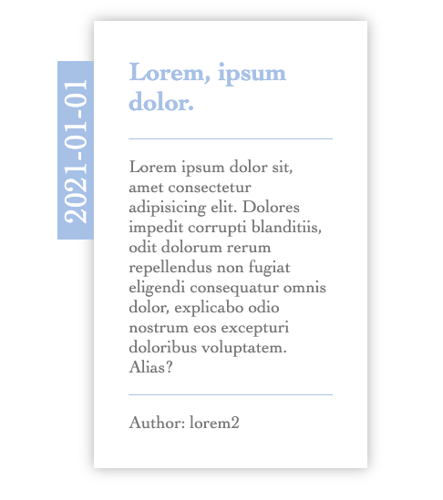

📎 [ex_transfos_2.html](images/65PuLBgThtUBtwIi.html)

▶️ [Vidéo](https://codepen.io/pascallllacroix/embed/RwpRLyr)

---

### Défi 2 - Le cube CSS

En partant du code suivant

```html
<div class="cube">
  <div class="cube__face cube__face--1">1</div>
  <div class="cube__face cube__face--2">2</div>
  <div class="cube__face cube__face--3">3</div>
  <div class="cube__face cube__face--4">4</div>
  <div class="cube__face cube__face--5">5</div>
  <div class="cube__face cube__face--6">6</div>
</div>
>
```

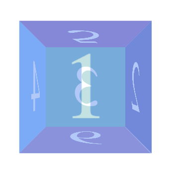

📎 [cube3D_2_sans_scripts.html](images/SnOt5nXF0TWM5WPd.html)

▶️ [Vidéo](https://codepen.io/pascallllacroix/embed/poebWed)

---

## RÉFÉRENCES - POUR ALLER PLUS LOIN

- [CSS 2D Transforms](https://www.w3schools.com/css/css3_2dtransforms.asp)
- [CSS 3D Transforms](https://www.w3schools.com/css/css3_3dtransforms.asp)
- [transform](https://developer.mozilla.org/fr/docs/Web/CSS/transform)
- [Utilisation des transformations CSS](https://developer.mozilla.org/fr/docs/Web/CSS/CSS_Transforms/Utilisation_des_transformations_CSS)
