# 20-01. Les clips paths

## C'est quoi l'idée ?

Par défaut, les objets HTML ont une forme rectangulaire. Les clip -paths permettent de dessiner ces forme de manière personnalisé. C'est un peu comme un masque sur l'objet puisque le clip-path empêche la partie qui est à l'extérieur du path de s'afficher.


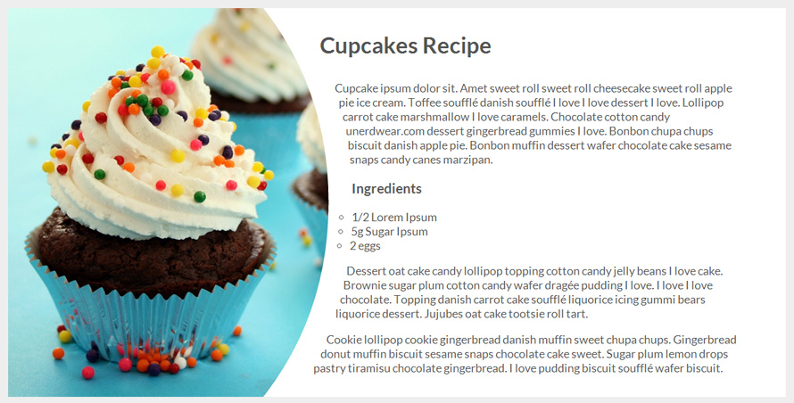

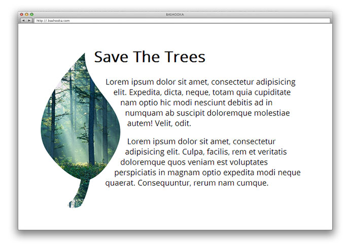

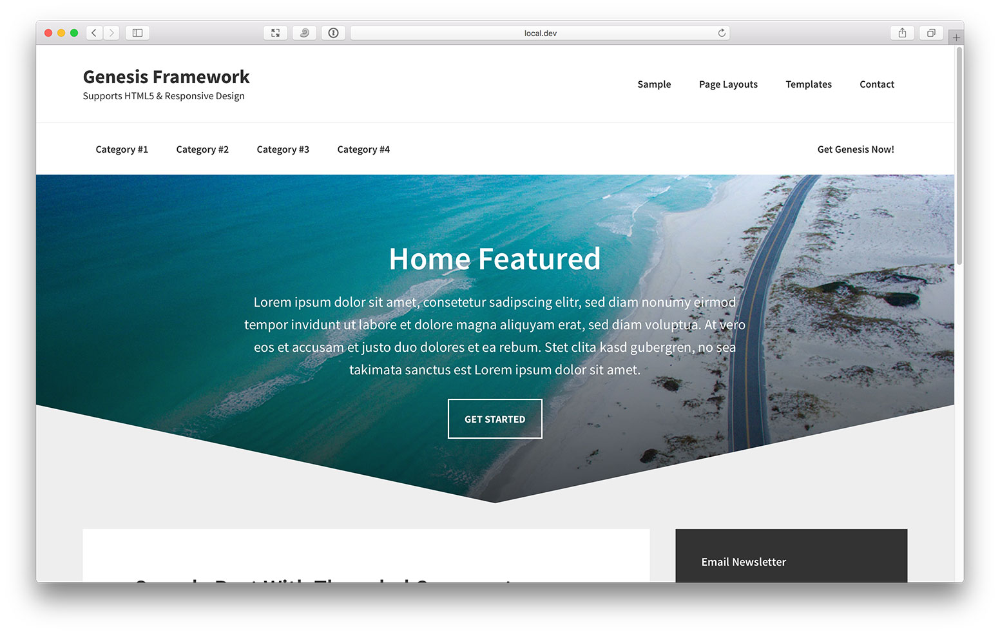

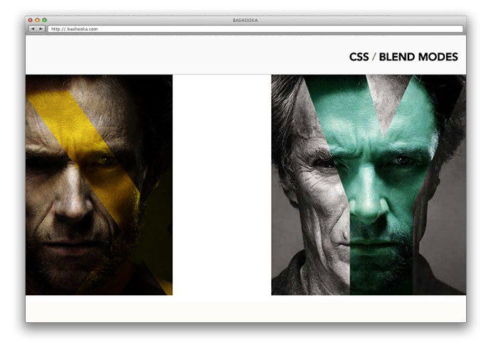


## Comment définir la forme du clip-path ?

### A. Inset: par rapport aux bords du conteneur

#### Une seule valeur -> Même valeur pour top, right, bottom et left

<video src="images/c22vVRPcY6mCMzW1.mp4" autoplay loop muted playsinline controls></video>

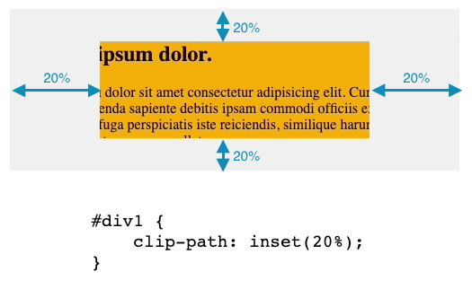

#### On peut définir une valeur différente pour chaque bord

<video src="images/obdS9XEcCD0OdGVX.mp4" autoplay loop muted playsinline controls></video>

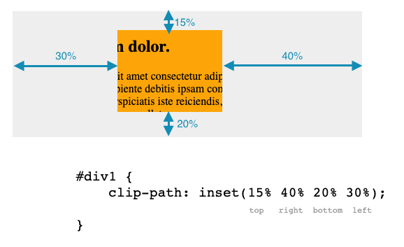

#### On peut également arrondir certaines parties

<video src="images/CyLujF5IdbiSkkwQ.mp4" autoplay loop muted playsinline controls></video>

<video src="images/hoWadt9WmuaWNtW9.mp4" autoplay loop muted playsinline controls></video>

### B. Circle: un cercle

Défini par son rayon et son centre (par défaut 50% 50%).

<video src="images/9uOcinPrxRoUdJ5U.mp4" autoplay loop muted playsinline controls></video>

<video src="images/aBkKGrsBoQM9OaHl.mp4" autoplay loop muted playsinline controls></video>

### C. Ellipse

Ben un ellipse quoi... Définie par 2 axes et par une position (par défaut 50% 50%).

<video src="images/BX8a0pndngUkNL2z.mp4" autoplay loop muted playsinline controls></video>

<video src="images/yl8MdWYKBWacDwyN.mp4" autoplay loop muted playsinline controls></video>

### D. Polygon

L'idée est de définir les coordonnées de chaque sommet du polygone dans le sens des aiguilles d'une montre...

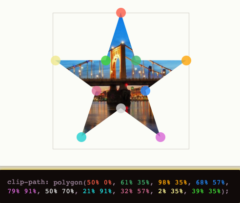

### E. URL: Une forme SVG comme masque

Le format SVG (Scalable Vector Graphics) est un format d'image vectoriel utilisable dans un navigateur web. Il s'agit de décrire l'image non pas comme un ensemble de pixels maiss comme un ensemble de paths de tracés, comme des points, des droites des surfaces...

Je vous renvois à la doc du format SVG pour en savoir davantage:

- [SVG | MDN](https://developer.mozilla.org/fr/docs/Web/SVG)
- [SVG Tutorial](https://www.w3schools.com/graphics/svg_intro.asp)

Il s'agit d'un code XML. XML est un langage balisé comme le HTML. Le HTML est un sous-ensemble du XML. Chaque document XML obéit à un DOCTYPE particulier et le HTML obéit au DOCTYPE HTML. Le SVG obéit à une autre spécification et donc a recours à d'autre balises.

#### A. Création de l'image SVG

La balise `<svg></svg>` permet de définir le conteneur de l'image. On lui donne une dimension.Dans cette balise, on peut créer notre image avec des éléments vectoriels simples (circle, rectangle, ellipse, line, polyline, polygon, path)

```html
<svg class="svg">
  <clipPath id="circle">
  	<circle cx="50" cy="50" r="40" />
  </clipPath>
</svg>
```


#### Utilisation de cette image SVG comme clip-path

```css
#div1 {
  clip-path: url('#circle');
}
```

<video src="images/vZSdAXJXTJWncykW.mp4" autoplay loop muted playsinline controls></video>

▶️ [Vidéo](https://codepen.io/pascallllacroix/embed/zYZBEVQ)

## Compatibilité

Petits problème avec l'utilisation des URL SVG ... Le reste semble OK sauf pour ... 🙄

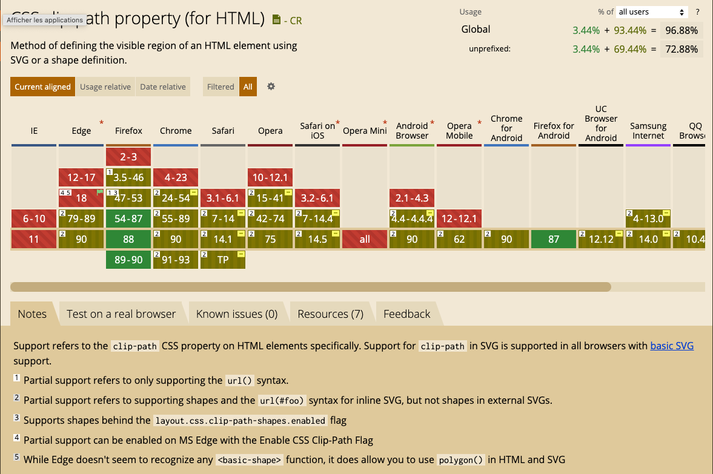

## Un outil en ligne pour générer ses clips-paths

### Clippy : [Clippy — CSS clip-path maker](https://bennettfeely.com/clippy/)

<video src="images/aNxZWQ4vpsh4lJM4.mp4" autoplay loop muted playsinline controls></video>

## Faire un habillage non rectangulaire: shape-outside

Définir une forme pour un objet, on voit maintenant comment on fait... les clip-paths...mais ça ne règle pas le problème d'un habillage de texte qui suit cette nouvelle forme... On va avoir besoin d'une autre propriété: shape-outside.

En fait, l'idée est de faire un habillage classique avec la propriété float et de définir la forme externe de cet habillage (shape-ouside)

▶️ [Vidéo](https://codepen.io/pascallllacroix/embed/mdWEBqV)

```html

<div>
  <h1>Lorem, ipsum dolor.</h1>
  <p>Lorem ipsum dolor sit amet consectetur, adipisicing elit. A cum beatae, quam earum voluptate doloremque provident excepturi neque soluta, laudantium saepe. Odit consequatur debitis a accusamus adipisci voluptate nostrum aut!</p>
  <p>Blanditiis magni autem, incidunt, vero libero reiciendis accusantium quos nesciunt tempore ea optio beatae itaque! Delectus, mollitia exercitationem assumenda rem saepe ipsam adipisci sit laborum inventore accusamus cumque commodi provident.</p>
  <p>Asperiores harum, exercitationem illo ea dicta expedita error, suscipit aspernatur pariatur dolorem maxime. Eius qui aliquam totam delectus obcaecati suscipit asperiores sunt facilis numquam. Quaerat voluptates aperiam reprehenderit soluta adipisci?</p>
</div>
```

```css
.float-left {
  float: left;
  clip-path: circle(80% at 0 50%);
  shape-outside: circle(90% at 0 50%);
}
```

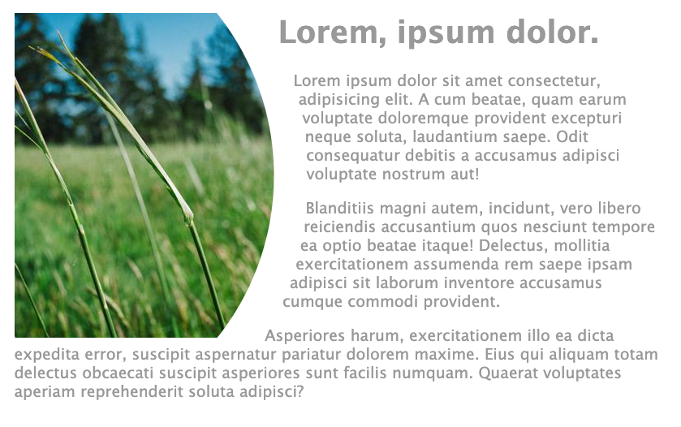

### Compatibilité du shape-outside

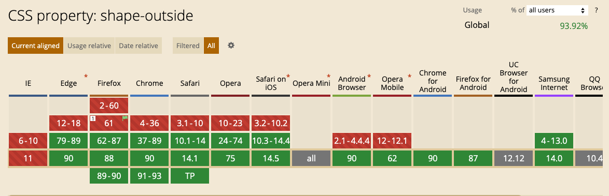

---

## JE TE METS AU DÉFI !

### Défis 1

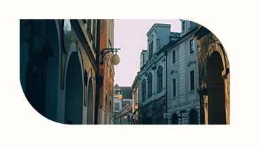


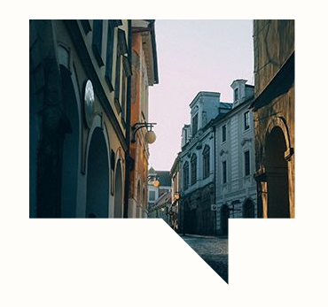

Solutions: [Comprendre Clip Path](https://la-cascade.io/comprendre-clip-path/)

---

### Défi 2

En partant du code suivant:

```html
<div class="container">
  <section class="section">
    <h1>Lorem, ipsum dolor.</h1>
    <p>Lorem ipsum dolor sit amet consectetur adipisicing elit. Odio exercitationem doloribus harum ullam nesciunt consectetur qui repudiandae ad, quidem aliquid libero expedita veritatis eaque id dicta porro tempora laborum sequi!</p>
  </section>
  <section class="section">
    <h1>Exercitationem, nihil odit.</h1>
    <p>Lorem ipsum dolor sit amet consectetur adipisicing elit. Odio exercitationem doloribus harum ullam nesciunt consectetur qui repudiandae ad, quidem aliquid libero expedita veritatis eaque id dicta porro tempora laborum sequi!</p>
  </section>
  <section class="section">
    <h1>Reiciendis, dolore veritatis!</h1>
    <p>Lorem ipsum dolor sit amet consectetur adipisicing elit. Odio exercitationem doloribus harum ullam nesciunt consectetur qui repudiandae ad, quidem aliquid libero expedita veritatis eaque id dicta porro tempora laborum sequi!</p>
  </section>
  <section class="section">
    <h1>Unde, officia natus.</h1>
    <p>Lorem ipsum dolor sit amet consectetur adipisicing elit. Odio exercitationem doloribus harum ullam nesciunt consectetur qui repudiandae ad, quidem aliquid libero expedita veritatis eaque id dicta porro tempora laborum sequi!</p>
  </section>
  <section class="section">
    <h1>Unde, officia natus.</h1>
    <p>Lorem ipsum dolor sit amet consectetur adipisicing elit. Odio exercitationem doloribus harum ullam nesciunt consectetur qui repudiandae ad, quidem aliquid libero expedita veritatis eaque id dicta porro tempora laborum sequi!</p>
  </section>
</div>
```

<video src="images/vQyeJNLWlvPUUjDh.mp4" autoplay loop muted playsinline controls></video>

📎 [clip-path_test.html](images/K56GJfTGebzXTYqQ.html)

---

### Défi 3

<video src="images/yfKyfvCKnNnzKzUc.mp4" autoplay loop muted playsinline controls></video>

Solution: [Comprendre Clip Path](https://la-cascade.io/comprendre-clip-path/)

---

### Défi 4

<video src="images/2BXwcsa6AoyJXTE0.mp4" autoplay loop muted playsinline controls></video>

Solution: [Comprendre Clip Path](https://la-cascade.io/comprendre-clip-path/)

---

### Défi 5

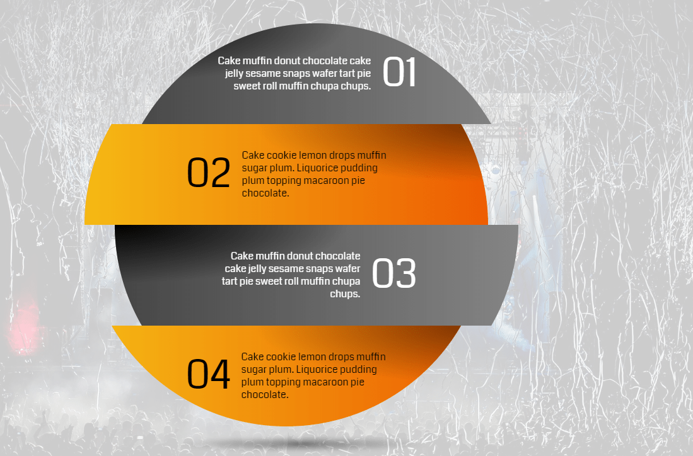

Solution: [https://codepen.io/thebabydino/pen/bQRaZo](https://codepen.io/thebabydino/pen/bQRaZo)

---

## RÉFÉRENCES

- [clip-path - CSS : Feuilles de style en cascade | MDN](https://developer.mozilla.org/fr/docs/Web/CSS/clip-path)
- [clip-path | CSS-Tricks](https://css-tricks.com/almanac/properties/c/clip-path/)
- [CSS clip-path property](https://www.w3schools.com/cssref/css3_pr_clip-path.asp)
- [Understanding Clip Path in CSS - Ahmad Shadeed](https://ishadeed.com/article/clip-path/)
- [Clippy — CSS clip-path maker](https://bennettfeely.com/clippy/)
- [Building A Circular Navigation with CSS Clip Paths | CSS-Tricks](https://css-tricks.com/building-a-circular-navigation-with-css-clip-paths/)
- [shape-outside - CSS : Feuilles de style en cascade | MDN](https://developer.mozilla.org/fr/docs/Web/CSS/shape-outside)
- [shape-outside | CSS-Tricks](https://css-tricks.com/almanac/properties/s/shape-outside/)

---

## Autres défis

- [Creating Non-Rectangular Headers | CSS-Tricks](https://css-tricks.com/creating-non-rectangular-headers/)
