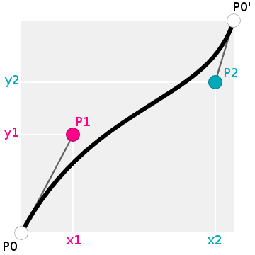

# 21-01. Les transitions CSS

## Syntaxe générale

```css
transition: all duree acceleration delai;

transition: propriete1 duree1 acceleration1 delai1, 
            propriete2 duree2 accelaration2 delai2, 
            ...;

transition-property: propriete1, prorpiete2, ...
tansition-duration: duree1, duree2, ...
transition-timing-function: acceleration1, acceleration2, ...
transition-delay: delai1, delai2, ...
```

## Une transition animée entre 2 états différents

Pour qu'il y ait une transition, il faut 2 états avec des différences. Pas de différence = pas de transition

```css
/* ÉTAT A */
#div1 {
	width:  100px;
  height: 100px;
  background: orange;
  box-shadow: #999 0 0 15px;
}
```

```css
/* ÉTAT B */
#div1:hover {
	width:  200px;
  height: 100px;
  background: red;
  box-shadow: #999 0 0 15px;
}
```


### Une transition symétrique: dans l'état A

Si je place la transition dans l'état A, la transition sera la même à l'aller et au retour

```css
/* ÉTAT A */
#div1 {
	width:  100px;
  height: 100px;
  background: orange;
  box-shadow: #999 0 0 15px;
  transition: all 300ms ease-in-out;
}
```

```css
/* ÉTAT B */
#div1:hover {
	width:  200px;
  height: 100px;
  background: red;
  box-shadow: #999 0 0 15px;
}
```

<video src="images/C4YqZOmsOXlW3SZ2.mp4" autoplay loop muted playsinline controls></video>

### Une transition différente à l'aller et au retour

Si je place une propriété transition dans les 2 états,

- A -> RETOUR
- B -> ALLER

```css
/* ÉTAT A */
#div1 {
	width:  100px;
  height: 100px;
  background: orange;
  box-shadow: #999 0 0 15px;
  transition: all 1200ms ease-in-out;
}
```

```css
/* ÉTAT B */
#div1:hover {
	width:  200px;
  height: 100px;
  background: red;
  box-shadow: #999 0 0 15px;
  transition: all 300ms ease-in-out;
}
```

<video src="images/a7FWR9f8H6ZzvZAV.mp4" autoplay loop muted playsinline controls></video>

### Une transition différente pour chaque propriété

```css
/* ÉTAT A */
#div1 {
	width:  100px;
  height: 100px;
  background: orange;
  box-shadow: #999 0 0 15px;
  transition: width 1200ms ease-in-out 300ms,
              background 300ms ease-in-out;
-out,;
}
```

```css
/* ÉTAT B */
#div1:hover {
	width:  200px;
  height: 100px;
  background: red;
  box-shadow: #999 0 0 15px;
  transition: width 300ms ease-in-out 300ms,
              background 300ms ease-in-out;
}
```

<video src="images/YWoDywfYsOBiTaHw.mp4" autoplay loop muted playsinline controls></video>

### Une accélération en courbe de Bézier

L'accélération est souvent un élément donnant un aspect plus naturel à un mouvement ar il paraît moins figé. La propriété transition-timing-function permet de spécifier le type d'accélération de la transition.

```css
transition-timing-function: linear;      // Même vitesse tout le long (0, 0, 1, 1)
transition-timing-function: ease;		     // Lent puis accélération puis lent (0.25, 0.1, 0.25, 1) 
transition-timing-function: ease-in;     // Lent puis accélération (0.42, 0, 1, 1)
transition-timing-function: ease-out;    // Lent à la fin (0, 0, 0.58, 1)
transition-timing-function: ease-in-out; // Lent en début et en fin (0.42, 0, 0.58, 1)
transition-timing-function: cubic-bezier(x,x,x,x); // Courbe de Bézier 0 <= x <= 1
```

Un outil pour créer sa courbe de Bézier personnalisée: [cubic-bezier.com](https://cubic-bezier.com/#.17,.67,.83,.67)

<video src="images/5AABL6RfKXPB3T9F.mp4" autoplay loop muted playsinline controls></video>

### Le principe des courbes de Bézier

La courbe de Bézier est défini par 2 points P1(x1, y1) et P2(x2, y2).

`cubic-bezier(x1, y1, x2, y2)`



---

## JE TE METS AU DÉFI !

### Pour t'échauffer

[Exercise v3.0](https://www.w3schools.com/css/exercise.asp?filename=exercise_css3_transitions1)

---

### Défi 1

```html
<nav class="menu--horiz">
  <ul>
    <li><a href="#">Lien 1</a></li>
    <li><a href="#">Lien 2</a></li>
    <li><a href="#">Lien 3</a></li>
    <li><a href="#">Lien 4</a></li>
    <li><a href="#">Lien 5</a></li>
  </ul>
</nav>
```

<video src="images/FNpAgIdOPwWgsLm6.mp4" autoplay loop muted playsinline controls></video>

📎 [ex_transitions_1.html](images/iPYHQ5mT7IuJKxyD.html)

▶️ [Vidéo](https://codepen.io/pascallllacroix/embed/abJZLKx)

---

### Défis 2

<video src="images/hBNR1TD7sp7V4wxM.mp4" autoplay loop muted playsinline controls></video>

<video src="images/qf9MKwsesmjKUmgY.mp4" autoplay loop muted playsinline controls></video>

<video src="images/TTNB9rwwvo7LT5JS.mp4" autoplay loop muted playsinline controls></video>

Solutions: [https://codepen.io/nxworld/full/ZYNOBZ](https://codepen.io/nxworld/full/ZYNOBZ)

---

### Défis 3

[Hover Effect Ideas | Set 1](https://tympanus.net/Development/HoverEffectIdeas/)

<video src="images/pWFP3F8qhR3kiie7.mp4" autoplay loop muted playsinline controls></video>

---

### Défi 4

<video src="images/o7QErH7g48VgWBEw.mp4" autoplay loop muted playsinline controls></video>

Solution: [https://codepen.io/larrygeams/full/pdchG](https://codepen.io/larrygeams/full/pdchG)

---

### Défi 5

<video src="images/5jYCWySvAn9MkMur.mp4" autoplay loop muted playsinline controls></video>

Solution: [https://codepen.io/kw7oe/full/mPeepv](https://codepen.io/kw7oe/full/mPeepv)

---

### Défi 6

<video src="images/egfXPps0xE1QVQrb.mp4" autoplay loop muted playsinline controls></video>

Solution: [https://codepen.io/wifeo/pen/vEWmpR](https://codepen.io/wifeo/pen/vEWmpR)

---

### Défi 7

<video src="images/KTKbrK9DYUQeyJqs.mp4" autoplay loop muted playsinline controls></video>

---

### Défi 8

```html
<ul class="list">
  <li><a href="#0">① <span>This</span></a></li>
  <li><a href="#0">② <span>Little</span></a></li>
  <li><a href="#0">③ <span>Piggy</span></a></li>
  <li><a href="#0">④ <span>Went</span></a></li>
  <li><a href="#0">⑤ <span>To</span></a></li>
  <li><a href="#0">⑥ <span>Market</span></a></li>
</ul>
```

<video src="images/deGujIGuqHBiAKKa.mp4" autoplay loop muted playsinline controls></video>

Solution: [https://codepen.io/chriscoyier/pen/JgqgjN](https://codepen.io/chriscoyier/pen/JgqgjN)

---

### Défi 9

```html
<div class="card">
  <span class="card__infoicon">
    <i class="fa fa-info"></i>
  </span>
  <h1 class="card__title">This is a title</h1>
  <p class="card__description">Lorem ipsum dolor sit amet and this is all the lorem ipsum text I remember</p>
  
  <p class="card__credits">Thanks <a class="card__reference" href="https://www.youtube.com/channel/UCVyRiMvfUNMA1UPlDPzG5Ow">Gary Simon</a> for the inspiration</p>
</div>
```

<video src="images/n6MiakMMUrqkB1MM.mp4" autoplay loop muted playsinline controls></video>

Solution: [https://codepen.io/vladracoare/pen/RwPrayL](https://codepen.io/vladracoare/pen/RwPrayL)

---

### Défi 10

<video src="images/ARbHS6aMR0lp4UT0.mp4" autoplay loop muted playsinline controls></video>

Solution (mais il y a du jquery... Moyen de le faire en full css): [https://codepen.io/andytran/full/BNjymy](https://codepen.io/andytran/full/BNjymy)

---

### Défi 11

<video src="images/DwvvwrDaDWagI5s1.mp4" autoplay loop muted playsinline controls></video>

Solution: [https://codepen.io/akhil_001/full/zoQdaO](https://codepen.io/akhil_001/full/zoQdaO)

---

## RÉFÉRENCES - Pour aller plus loin

- [transition - CSS : Feuilles de style en cascade | MDN](https://developer.mozilla.org/fr/docs/Web/CSS/transition)
- [CSS Transitions](https://www.w3schools.com/css/css3_transitions.asp)
- [Utiliser les transitions CSS - CSS : Feuilles de style en cascade | MDN](https://developer.mozilla.org/fr/docs/Web/CSS/CSS_Transitions/Using_CSS_transitions)
- [transition-timing-function - CSS : Feuilles de style en cascade | MDN](https://developer.mozilla.org/fr/docs/Web/CSS/transition-timing-function)
- [Tryit Editor v3.6](https://www.w3schools.com/cssref/tryit.asp?filename=trycss3_transition-timing-function3)
- [CSS - Fonction cubic-bezier()](http://stylescss.free.fr/v2-functions/cubic-bezier.php)
