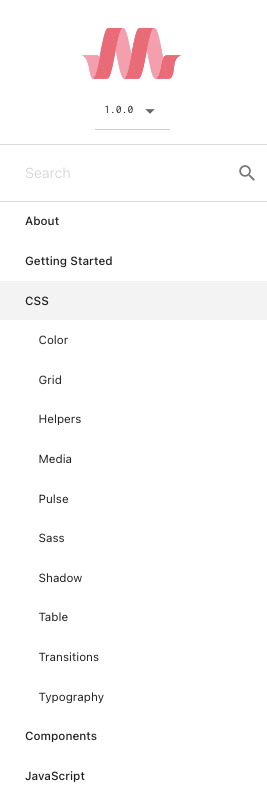
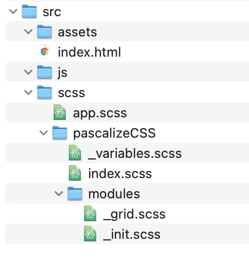

# 24-02. Notre environnement de travail

Pour développer notre framework FrontEnd, nous aurons besoin des éléments suivants

## Un système de versionning

Il sera important de versionner le développement de notre framework car cela nous permettra de gérer les différentes versions mais également de centraliser notre travail tout en le diffusant. C'est là un élément important de notre portfolio.

J'ai personnellement choisi GITHUB et GITKRAKEN.

## Un bundler pour l'optimisation de nos ressources front

Nous allons travailler avec un bundler (Parcel) pour optimiser nos ressources front. Donc nous partirons de notre dossier 'src' qui sera compilé dans le dossier 'dist'.

## Notre framework

Notre framework va se baser sur une série de modules qui auront chacun leur propre objectif. Nous aurons ainsi

- un module d'initialisation pour tout ce qui est général comme le box-sizing, ...
- un module pour la grille responsive
- un module pour la gestion des boites
- un module pour les éléments de formulaires,
- ...

Ces modules correspondent finalement à ce qui pourra se trouver dans notre documentation.

Notre framework contiendra également un fichier de variables qui permettra de paramétrer le framework pour qu'il s'adapte au projet en cours.

## Un fichier de surcharge

D'autre part, en plus de notre framework, nous allons intégrer dans notre HTML l'appel à un fichier de surcharge qui reprendra les déclaration spécifiques à notre application en cours et qui ne seront pas récupérables pour un autre projet.

Ce fichier de surcharge devra également être structuré, histoire de ne pas y mettre le bordel. Probablement qu'une logique de composant et les nomenclatures BEM ou atomiques pourraient nous aider.

## La structure suivante

