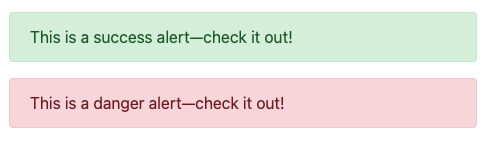
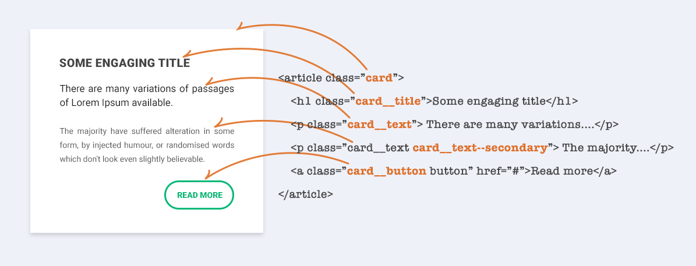
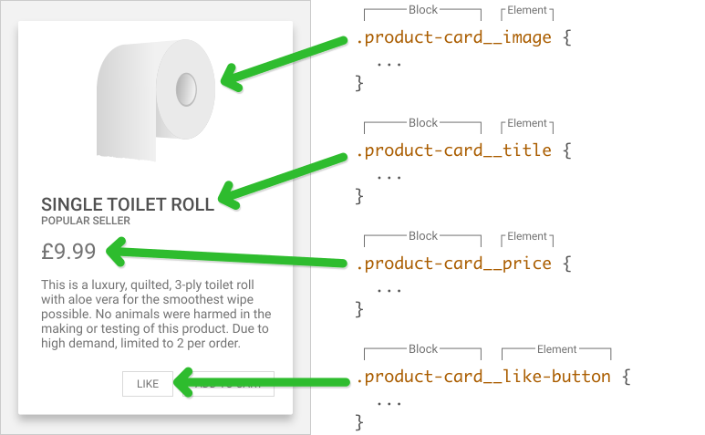
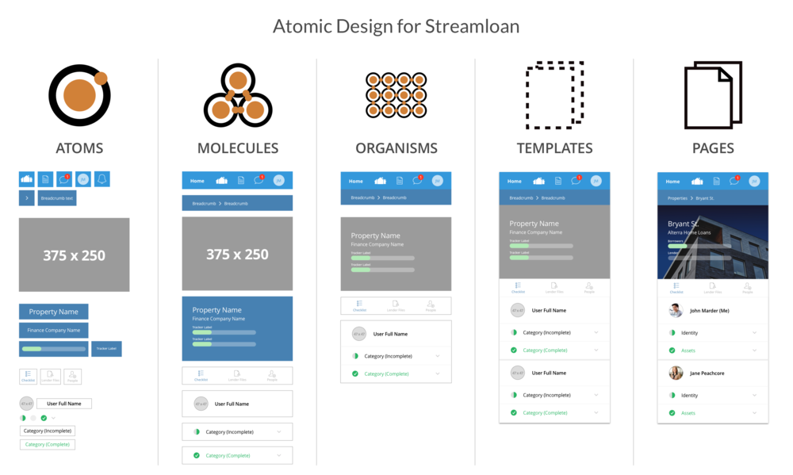

# 24-03. OOCSS, BEM ET CSS Atomique

Pour nommer nos classes, que ce soit dans le framework ou dans la surcharge, il va nous falloir respecter certains principes...

## La logique OOCSS

L'idée est de séparer les classes pour ne pas de répéter (DRY - Don't repeat Yourself).

OOCSS suggère une logique Orientée Objet pour notre CSS. Si la POO est très à la mode dans les autres langages, on ne peut pas dire qu'il s'agisse du même concept ici...

Cela ressemble plus à une mise en évidence ou factorisation en mathématiques puisqu'il s'agit de mettre en évidence les déclarations CSS communes à différents objets dans une classe générique (l'objet) et de placer les déclarations non redondantes dans des étiquettes spécifiques (caractéristiques de l'objet).



### **NON ! 😭**

```css
/* PAS BIEN :-( */
.alert-success {
  padding: 1em;
  border-radius: 5px;
  background: #D4EDDA;
}
.alert-danger {
  padding: 1em;
  border-radius: 5px;
  background: #F8D7DA;
}
```

```html
<div class="alert-success">
  This is a success alert—check it out!
</div>

<div class="alert-danger">
  This is a danger alert—check it out!
</div>
```

<video src="images/w1nhpHDYgzxpEJxR.mp4" autoplay loop muted playsinline controls></video>

### **OUI ! 😃**

```css
/* BIEN :-D */
.alert {
  padding: 1em;
  border-radius: 5px;
}
.alert-success {
  background: #D4EDDA;
}
.alert-danger {
  background: #F8D7DA;
}
```

```html
<div class="alert alert-success">
  This is a success alert—check it out!
</div>

<div class="alert alert-danger">
  This is a danger alert—check it out!
</div>
```

<video src="images/zpGutcZep9yFgABW.mp4" autoplay loop muted playsinline controls></video>

## **La nomenclature BEM**

C'est toujours délicat de nommer nos classes. Chacun peut définir sa propre nomenclature et sa propre logique en CSS. Et c'est bien là le problème car si je dois récupérer le code CSS d'un autre, ça risque fort d'être sportif. Alors que c'est si clair en développement back avec la logique MVC... Pourquoi y a pas une manière commune de faire ? Parce que le CSS reste le langage le plus foireux du web. Voilà pourquoi.

OK, mais depuis le temps, est-ce qu'il n'y a pas quelques guides pour survivre tout de même dans ce langage bordélique ?

La logique BEM (Block-Element--Modifier) va nous permettre de nommer nos classes de manière organisée. On va distinguer

- **Le BLOCK**: entité ou objet autonome comme un bouton, un article, un slider, un menu, ...
- **L'ELEMENT**: une partie identifiable du block comme le texte d'un bouton, le titre d'un article pou un élément du menu, ...
- **LE MODIFIER**: état de l'élément comme un bouton primary, une article en vedette, un élément actif du menu, ...





<video src="images/Qvv8MYk25Efnc2IF.mp4" autoplay loop muted playsinline controls></video>

## La logique atomique

La logique atomique est clairement basée sur la nomenclature BEM et propose de découper le prototype en éléments organiques hiérarchisés la pages. Elle introduit la notion de composants.




Certains proposent même de descendre plus bas dans la décomposition en ajoutant des électrons, des protons et des neutrons... A quand les bosons ?

Bref, la métaphore est séduisante et cela permet de décomposant le document en éléments identifiables, des composants, et de créer une nomenclature qui a du sens et qui est très proche de la nomenclature BEM. C'est juste une extension de cette nomenclature puisque le BEM ne propose que 2 niveaux hiérarchiques (BLOCK - ELEMENT) alors qu'en logique atomique, on peut de retrouver avec beaucoup plus de niveaux.

Il y a de nombreux détracteurs à cette logique atomique et c'est vrai que cela comporte de nombreux inconvénients. Il faut bien avouer que la lisibilité du code HTML en pâtit considérablement.

## La logique atomique dans les développement front

En développement front, il sera souvent nécessaire de découper nos prototypes en composants interactifs et certains auteur proposent une logique atomique pour la décomposition de nos composants.


## La logique utilitaire (atomic CSS)

Alors là... C'est à ne plus rien comprendre. Si on fait une recherche Google sur les CSS atomiques, on trouve des articles sur le design atomique dont on vient de parler, mais également sur les atomic CSS qui sont un tout autre concepts.

Les atomic CSS sont un manière récente d'envisager la ré-utilisabilité. Il s'agit de réduire la surcharge à son minimum en créant une étiquettes de styles dans le framework pour pratiquement chaque propriété CSS... C'est ce que propose le framework TAILWIND CSS par exemple.

```html
<div class="border border-gray-500 rounded p-4 pb-0 text-gray-700">
  <div class="flex items-center">
    
    <div>
      <h3 class="text-gray-900 text-lg font-bold">John Appleseed</h3>
      <h4 class="text-sm">Director of Something Rather</h4>
    </div>
  </div>
  <p>Lorem ipsum dolor sit amet consectetur adipisicing elit. Impedit accusamus numquam blanditiis obcaecati ullam, fugiat repudiandae autem at nostrum labore doloribus non porro similique eveniet.</p>
  <p>
    <a
      href="#"
      class="link text-blue-600 underline transition-opacity ease-in-out duration-300 hover:opacity-50"
    >Hover me.</a>
  </p>
</div>
```

Alors ici, plus aucune notion de composant. Tout est paramétré à coup d'étiquettes. Bon d'accord, ce n'est pas lisible du coup. Mais par contre, pratiquement plus besoin de surcharge. Le framework a tout prévu. Un peu lourd à coder ce framework mais bon... On n'a rien sans rien m'dame !

---

## REFÉRENCES - POUR ALLER PLUS LOIN

[BEM — Block Element Modifier](http://getbem.com/introduction/)

[Block-Element-Modifier (BEM) & CSS atomique -](https://blog.arcoptimizer.com/block-element-modifier-bem-css-atomique)

[Le Design Atomique – 24 jours de web](https://www.24joursdeweb.fr/2013/le-design-atomique/)

[Design atomique](https://la-cascade.io/design-atomique/)

[Atomic Design | Brad Frost](https://bradfrost.com/blog/post/atomic-web-design/)

[Atomic Design Methodology | Atomic Design by Brad Frost](https://atomicdesign.bradfrost.com/chapter-2/)

[Atomic Design dans la pratique](https://blog.ippon.fr/2018/05/29/atomic-design-dans-la-pratique/)

[Comment concevoir un système de composants en atomic design ? | by Audrey Hacq | Medium](https://audreyhacq.medium.com/comment-concevoir-un-syst%C3%A8me-de-composants-en-atomic-design-770b910f4f32)

[Atomic Design and UI Components: Theory to Practice | by Jonathan Saring | Bits and Pieces](https://blog.bitsrc.io/atomic-design-and-ui-components-theory-to-practice-f200db337c24)

[https://envylabs.com/insights/weighing-the-advantages-of-component-based-and-atomic-css-approaches/](https://envylabs.com/insights/weighing-the-advantages-of-component-based-and-atomic-css-approaches/)

[The Problem with Atomic CSS. Since publishing MaintainableCSS I’ve… | by Adam Silver | Simple = Human | Medium](https://medium.com/simple-human/the-problem-with-atomic-css-d0c09c7aa38e)
