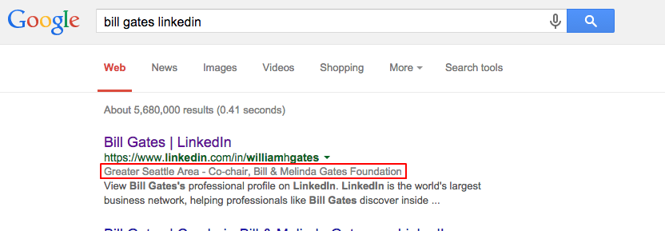
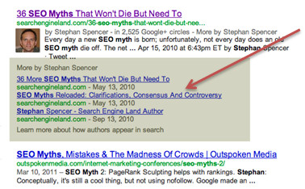

# 25-01. Les Micro-données et la sémantique chirurgicale

---

```embed
title: "Les données structurées ou microdata - Version HTML"
image: "https://i.ytimg.com/vi/zjeBqsoXYPo/hqdefault.jpg"
description: "Vidéo YouTube · Pascal LACROIX"
url: "https://www.youtube.com/watch?v=zjeBqsoXYPo"
favicon: ""
aspectRatio: "56.25"
```

```embed
title: "Les données structurées ou microdata: Version JS"
image: "https://i.ytimg.com/vi/2UVL85z_2a0/hqdefault.jpg"
description: "Vidéo YouTube · Pascal LACROIX"
url: "https://www.youtube.com/watch?v=2UVL85z_2a0"
favicon: ""
aspectRatio: "56.25"
```

---

## Les micro-données

- Permettent d'encoder des données spécifiques (personnes, événements, adresses, ...)
- Aucune interprétation graphique du navigateur
- Parsées par Google pour du référencement fin et des ajouts de fonctionnalités
- Interprétées par les navigateurs et en particulier les navigateurs mobiles
- Ont un avenir plus que prometteur !






> **LE PRINCIPE**1. Définir le bloc qui va contenir les micro-données comme étant un bloc de micro-données > Attribut itemscope2. Définir le type de données de ce bloc > Attribut itemtype > Liste de tous les types disponibles : [http://schema.org](http://schema.org)3. Spécifier les données > Attribut itemprop > Liste des propriétés disponibles : [http://schema.org](http://schema.org)4. Un itemscope peut en contenir d'autres > Exemple : un événement peut contenir une personne ...

### Un événement sans micro-données

```html
<article>
 <h1>Balade en Condroz</h1>
 <p>Belle balade en Condroz ...</p>
 <p>Rdv le <time datetime="2014-05-13T12:00:00">samedi 13 mai 2014 à 12h</time><br/>
    Lieu : Place de l'église, Clavier<br/>
    Site web : <a href="http://www.baladecondroz.be">./balade1.html</a><br/>
    Organisation : M. Blavier</p>
</article>
```

### **Un événement** avec micro-données

```html
<article itemscope="itemscope" itemtype="http://www.schema.org/Event">
 <h1 itemprop="name">Balade en Condroz</h1>
 <p itemprop="description">Belle balade en Condroz...</p>
 <p>Rdv le 
   	<time datetime="2014-05-13T12:00:00" itemprop="startDate">samedi 13 mai 2014 à 12h</time><br/>
    Lieu : <span itemprop="location">Place de l'église, Clavier</span><br/>
    Site web : <a href="http://www.baladecondroz.be" itemprop="url">./balade1.html</a><br/>
    Organisation : <span itemprop="attendee">M. Blavier</span></p>
</article>
```

> **LES ÉTAPES**1. Identifier les balises itemscope2. Schema.org : Quel schéma/type d'itemscope (full)3. Coller l'itemtype4. Placer les itemprop

### Le problème des adresses :

Adresse pour un EVENT :

itemprop 'location qui est un itempscope de type 'Place' :

- avec un name obligatoire- avec un address obligatoire

- qui peut être non détaillé- qui peut être un type PostalAddress- prop streetAddress- .

### Les cotations et notations :

`<!-- Imbrication d’un item AggregateRating -->`

`<span` `itemprop="aggregateRating"` `itemscope itemtype="[http://schema.org/AggregateRating](http://schema.org/AggregateRating)">`

`<span` `itemprop="ratingValue">4</span>/<span` `itemprop="bestRating">5</span>`

`</span>`

---

### Pour tester vos micro-données :

[http://www.google.com/webmasters/tools/richsnippets](http://www.google.com/webmasters/tools/richsnippets)

---

### Les types de données : [http://schema.org/docs/full.html](http://schema.org/docs/full.html)

**2 grands types de données :**> Ceux avec * contiennent des types plus précis ... Allez voir sur le site !!!

**1 - Les types "date" :**

- Boolean
    - Date
    - Number*
    - Text*
    - Time

**2 - Les types "Thing":**

- Action* : toute action réalisée par un agent ...
    - BroadcastService : tout service de livraison à travers lequel le contenu est fourni par la diffusion sur les ondes ou en ligne.
    - Class : type générique abstrait
    - CreativeWork* : toute création (livre, playlist, sculpture, ...)
    - Event* : tout événement
    - Intangible* : toute chose impalpable comme des quantités, des listes de valeurs, ...
    - MedicalEntity* : tout ce qui est relatif à la médecine ...
    - Organization* : comme une école, une ONG, ...
    - Person : toute personne
    - Place* : toute entité identifiée physiquement, localisée, territorialisée (Pays, commune, gare, ...)
    - Product* : tout ce qui est disponible à le vente
    - Property : pour définir une relation

Une fois que vous avez identifié le type de données, allez voir sur le site s'il n'y a pas un type plus précis qui pourrait mieux correspondre.

Pour chaque type, des propriétés existent ...

---

### Pour aller plus loin :

- LA REFERENCE GOOGLE: [Comprendre le fonctionnement des données structurées](https://developers.google.com/search/docs/guides/intro-structured-data?hl=fr)
- Excellent tutoriel : [http://www.html5-css3.fr/html5/microformats-microdata-html5#more-633](http://www.html5-css3.fr/html5/microformats-microdata-html5#more-633)
- Références officielles : [http://www.w3.org/TR/microdata/](http://www.w3.org/TR/microdata/)
- Tout sur les types disponibles : [http://schema.org](http://schema.org)
- http:[//www.alsacreations.com/article/lire/1509-microdata-microformats-schema-semantique.html](https:////www.alsacreations.com/article/lire/1509-microdata-microformats-schema-semantique.html)
- [http://www.html5-css3.fr/html5/microformats-microdata-html5](http://www.html5-css3.fr/html5/microformats-microdata-html5)
